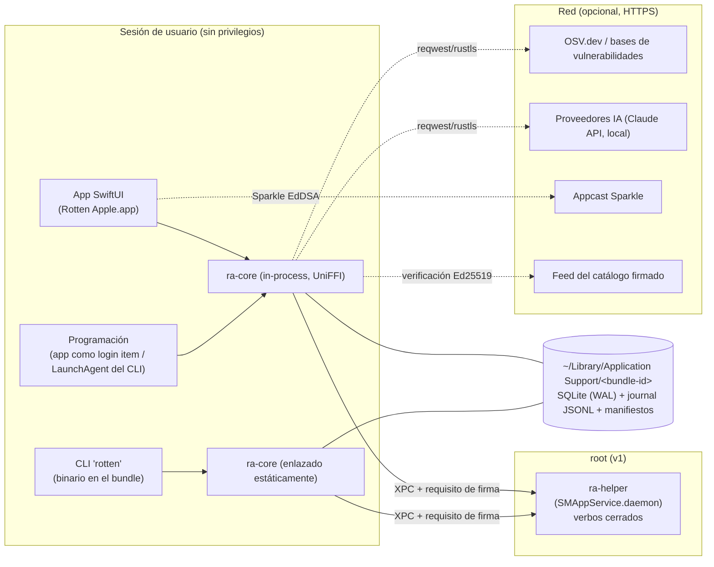
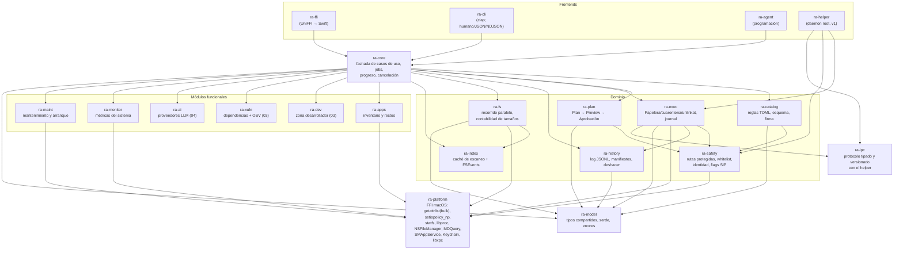
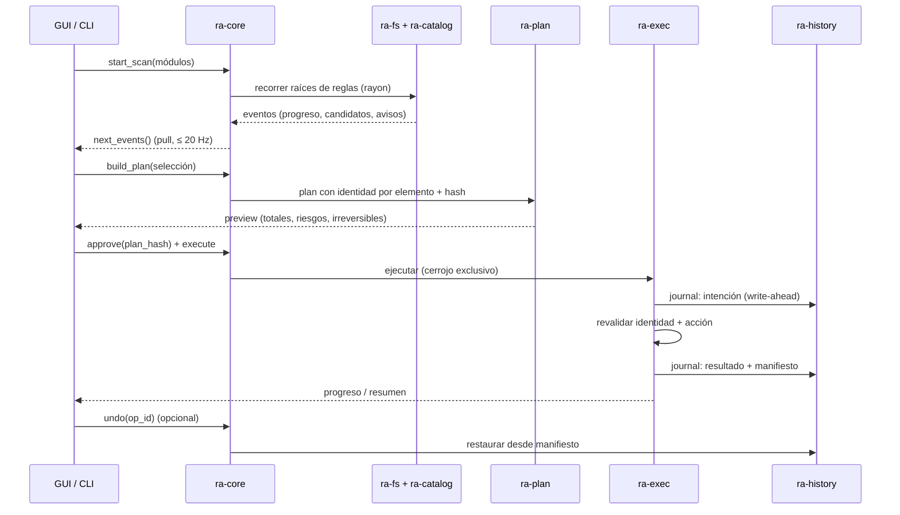
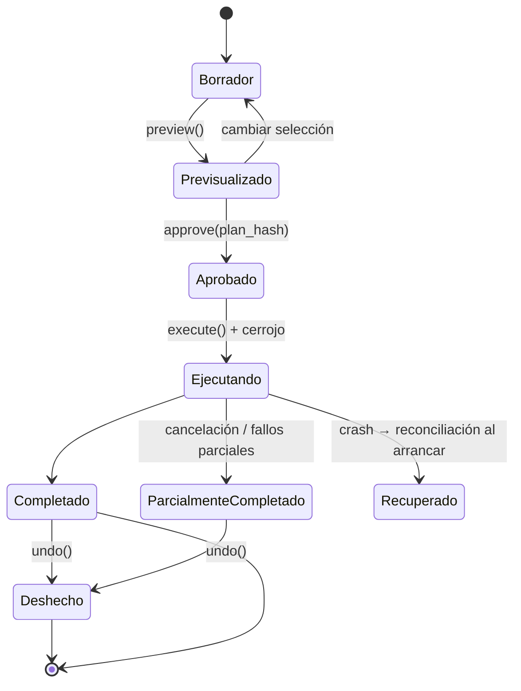

# 05 — Arquitectura, modelo de permisos de macOS, distribución y ADRs

> **Nota de consolidación (2026-11-01):** las decisiones, el MVP único y las erratas entre documentos están en [`docs/README.md`](../README.md), que prevalece sobre este documento. En particular: catálogo remoto Won't en MVP y v1 (D-06), códigos de salida del CLI unificados y límites de la ejecución desatendida (README §8). La revisión crítica está en [06](06-revision-advisor.md).

| Campo | Valor |
|---|---|
| Documento | 05-arquitectura |
| Versión | 0.1 (borrador para revisión) |
| Fecha | 2026-11-01 |
| Plataforma de referencia | macOS 27.0.1 (build 26A434), SDK `macosx27.0`, rustc/cargo 1.96.1 |
| Estado de las decisiones | Todas las ADR están en estado **Propuesta (provisional)** hasta validar los *spikes* indicados |
| Relación con otros documentos | 02 (requisitos funcionales; `RF-SEG-*` = seguridad operativa), 03 (zona desarrollador y vulnerabilidades), 04 (IA). Las referencias cruzadas se hacen por prefijo, sin inventar números concretos |
| Regla clean-room | Mole (tw93/mole) es GPL-3.0 y este repositorio es MIT: **no se ha leído ni se portará código de Mole**. Este documento solo usa documentación pública de Apple, de los crates y de herramientas de terceros |

**Convenciones de este documento**

- **[Verificado localmente]**: comprobado en esta máquina (macOS 27.0.1) mediante cabeceras del SDK, páginas `man` o binarios del sistema.
- **[Fuente secundaria]**: afirmación tomada de blogs/foros que citan a Apple; hay que confirmarla contra la documentación oficial.
- **[Por verificar]**: hipótesis razonada sin confirmar; se indica cómo verificarla.
- MoSCoW: **M** (Must), **S** (Should), **C** (Could), **W** (Won't, por ahora). Fases: **MVP**, **v1**, **v2**.

---

## 0. Resumen ejecutivo

1. **La plataforma manda.** En macOS 27 el acceso a contenedores de datos de apps de *otros equipos de desarrollo* (`~/Library/Containers`, `~/Library/Group Containers`) se **deniega por defecto sin preguntar** [Fuente secundaria]; el Acceso total al disco (FDA) **no se puede solicitar ni detectar con una API** (Apple DTS, 2026) y el truco de leer `TCC.db` ha dejado de funcionar en macOS 27. El producto debe funcionar en **modo degradado sin FDA** y comprobar permisos con un *preflight* conductual.
2. **Distribución fuera de la Mac App Store**: Developer ID + hardened runtime + notarización + DMG + cask de Homebrew + Sparkle 2 (EdDSA). La App Sandbox haría imposible la mayoría de módulos. Una edición "lite" para la MAS queda como opción v2 de bajo valor.
3. **GUI (ADR-01)** — recomendación provisional: **app SwiftUI fina + núcleo Rust vía UniFFI**, condicionada a un *spike* de 2 semanas que compare con Tauri 2. Motivos: aspecto nativo (Liquid Glass gratis en macOS 26+), accesibilidad, acceso directo a SMAppService/QuickLook/Foundation Models/Sparkle. Toda la lógica (qué borrar, cómo y si es seguro) vive en Rust.
4. **Núcleo (ADR-03)**: workspace de crates con fachada única `ra-core`; pipeline **Escaneo → Reglas → Plan → Preview → Ejecución → Log → Deshacer**; recorrido paralelo con `rayon` (y `getattrlistbulk` en una segunda iteración), red y orquestación con `tokio`, progreso en *streaming* por *pull* asíncrono.
5. **Seguridad de borrado (ADR-04)**: plan inmutable con hash, ejecución *journal-first*, verificación de identidad `(st_dev, st_ino, tipo, tamaño, mtime, ctime)` justo antes de actuar con primitivas relativas a descriptor (`openat`/`unlinkat`, `O_NOFOLLOW_ANY`, `AT_RESOLVE_BENEATH`, `AT_NODELETEBUSY`), Papelera por defecto y manifiesto propio para deshacer (la Papelera vía API **no** ofrece "Devolver" fiable en Finder).
6. **Privilegios mínimos**: MVP **sin helper root** (solo ámbito de usuario); en v1 un daemon `SMAppService.daemon` con un conjunto **cerrado** de verbos tipados por XPC, validación de firma del cliente y sin ejecución de shell.
7. **Reglas como datos (ADR-05)**: catálogo TOML versionado, firmado con Ed25519, con anti-rollback y una prueba de fixture obligatoria por regla.
8. **IA (ADR-07)**: clientes HTTP de proveedores en Rust (`reqwest`); Foundation Models (solo Swift) mediante un adaptador Swift en la GUI y, en macOS 27, opcionalmente el CLI del sistema `/usr/bin/fm` [Verificado localmente] para CLI/agente. Claves en el Llavero. La IA solo **propone** planes; nunca ejecuta.

---

## 1. Restricciones de la plataforma macOS

Esta sección condiciona todas las ADR. Para cada restricción se indica el impacto en el producto.

### 1.1 TCC (Transparency, Consent and Control)

#### 1.1.1 Modelo general

- `tccd` media el acceso a datos protegidos. La decisión se toma sobre el **proceso responsable** (*responsible process*) identificado por su firma de código (designated requirement); los procesos hijos heredan el responsable de su padre. Por eso un CLI ejecutado desde Terminal usa los permisos de **Terminal**, no los suyos.
- Los permisos están ligados a la firma: cambiar de Team ID o de bundle ID invalida los permisos concedidos. **Consecuencia**: el bundle ID y el certificado deben fijarse antes de la primera beta pública y no cambiarse.
- `root` **no** exime de TCC. `sudo` tampoco: un acceso denegado por TCC devuelve `EPERM` ("Operation not permitted") aunque el proceso sea root.
- Reinicio para pruebas: `tccutil reset All <bundle-id>` (`/usr/bin/tccutil` está presente [Verificado localmente]). No hay API pública para **conceder** permisos; solo el usuario (o un perfil PPPC instalado por MDM) puede hacerlo.

#### 1.1.2 Acceso total al disco (Full Disk Access, `kTCCServiceSystemPolicyAllFiles`)

**No se puede solicitar programáticamente.** La app solo puede:

1. Explicar por qué lo necesita (pantalla de *onboarding* con ejemplos concretos: "sin FDA no puedo medir las copias de iPhone en `~/Library/Application Support/MobileSync`").
2. Abrir Ajustes del Sistema en el panel correcto con un *deep link*:
   - `x-apple.systempreferences:com.apple.preference.security?Privacy_AllFiles` (esquema clásico, funcionaba en macOS 13–15).
   - `x-apple.systempreferences:com.apple.settings.PrivacySecurity.extension?Privacy_AllFiles` (esquema de Ajustes del Sistema).
   - **[Por verificar]** en macOS 27: no se ha podido probar `open` desde el sandbox de esta sesión. Verificación: `open "<url>"` en macOS 15, 26 y 27; usar el primero que funcione y, si ninguno, abrir `Privacy & Security` y mostrar instrucciones con captura.
3. Provocar que la app **aparezca en la lista de FDA**: intentar **abrir** (no `access()`/`isReadableFile`) un fichero protegido registra la app en la lista. Apple DTS indica que `access()` no dispara la comprobación TCC; abrir el fichero sí.
4. Detectar si se ha concedido:
   - **No existe API** ni ruta "fiable" para detectar FDA. Apple DTS (2026) responde "no" a las tres preguntas (¿API?, ¿método soportado?, ¿ruta a sondear?) y recomienda un **preflight conductual** que reproduzca las operaciones reales.
   - El método habitual (leer `~/Library/Application Support/com.apple.TCC/TCC.db`) **da falso negativo en macOS 27** aunque FDA esté concedido [Fuente secundaria: hilo de Apple Developer Forums 841091].
   - **Decisión de diseño**: implementar `ra-platform::permissions::preflight()` que intenta `open(O_RDONLY)` + `close` sobre un conjunto de rutas representativas (no lee contenido) y clasifica el resultado por módulo, no como un booleano global:

| Ruta sondeada (orientativa) | Qué desbloquea | Notas |
|---|---|---|
| `~/Library/Safari/` (p. ej. `Bookmarks.plist`, `History.db`) | Caches de Safari, Organizador de marcadores (04) | Protegida por FDA desde macOS 10.14 |
| `~/Library/Mail/` | Adjuntos/descargas de Mail | Requiere FDA |
| `~/Library/Messages/` (`chat.db`, `Attachments/`) | Adjuntos de Mensajes (gran consumidor de espacio) | Requiere FDA |
| `~/Library/Application Support/MobileSync/Backup/` | Copias de iPhone/iPad | Requiere FDA; habitualmente decenas de GB |
| `~/Library/Cookies/`, `~/Library/HomeKit/`, `~/Library/Suggestions/` | Indicadores de FDA concedido | Solo sondeo |
| `~/Library/Containers/com.apple.*` | Datos de apps de Apple | Requiere FDA |

   La lista exacta se mantiene en el catálogo (ADR-05) para poder ajustarla sin recompilar. **[Por verificar]** en cada versión de macOS de la matriz (macOS 15, 26, 27) con y sin FDA.
   - El preflight se repite: al arrancar, al volver a primer plano desde Ajustes, y **justo antes de ejecutar** un plan (Apple DTS advierte que Endpoint Security y MDM pueden hacer fallar accesos incluso con FDA).

#### 1.1.3 Archivos y carpetas (Files and Folders)

Carpetas protegidas para apps no sandboxed que **no** tienen FDA: `~/Desktop`, `~/Documents`, `~/Downloads`, iCloud Drive, almacenamiento de terceros en la nube (File Provider), volúmenes extraíbles, volúmenes de red y copias de Time Machine (lista confirmada para macOS 26 por The Eclectic Light Company).

- El primer acceso dispara un diálogo del sistema con el texto de las claves de `Info.plist`: `NSDesktopFolderUsageDescription`, `NSDocumentsFolderUsageDescription`, `NSDownloadsFolderUsageDescription`, `NSRemovableVolumesUsageDescription`, `NSNetworkVolumesUsageDescription`, `NSFileProviderDomainUsageDescription` **[Por verificar la última en 27]**. Sin esas claves la app puede fallar o mostrar un texto genérico.
- No hay API para consultar el estado; se infiere del resultado del acceso (`EPERM`).
- **Impacto**: el módulo "Instaladores y descargas" y el "Organizador con IA" (Escritorio) necesitan como mínimo estos permisos. La UX debe pedir cada permiso **en el momento en que el usuario entra en el módulo**, no todos al principio.
- Un `NSOpenPanel` elegido por el usuario expresa intención y concede acceso a lo seleccionado durante la sesión (y de forma persistente con *security-scoped bookmarks* si la app estuviera en sandbox). Útil como alternativa a FDA para "escanear esta carpeta".

#### 1.1.4 Datos de otras apps (contenedores y group containers)

Evolución (relevante para el Desinstalador y el Explorador de espacio):

| Versión | Comportamiento | Fuente |
|---|---|---|
| macOS 14 | Acceso al contenedor de otra app → diálogo "*X quiere acceder a datos de otras apps*". Incluso con FDA, DaisyDisk reportaba comprobaciones lentas en `~/Library/Containers` | Eclectic Light; foros MacRumors [Fuente secundaria] |
| macOS 15 | Los *app group containers* pasan a estar protegidos por SIP incluso para apps sin sandbox; acceso ajeno → diálogo | Documentación de App Groups de Apple, citada [Fuente secundaria] |
| **macOS 27** | El acceso a contenedores y group containers de **otro equipo de desarrollo** "ya no pide autorización; se deniega por defecto" y se gestiona en Privacidad y seguridad. Clasificado bajo *System Integrity Protection* (Radar 161835690). Los accesos dentro del mismo Team ID no cambian | Notas de versión de macOS 27 citadas por blakecrosley.com y macos-tahoe.com [Fuente secundaria] |

- **¿FDA cubre estos contenedores en macOS 27?** Una fuente afirma que sí ("Full Disk Access covers app data containers"); otra no lo aclara. **[Por verificar empíricamente]**: en una VM macOS 27 con y sin FDA, listar y medir `~/Library/Containers/<app de terceros>/Data` y `~/Library/Group Containers/<TEAMID>.*`.
- **Síntoma**: denegación silenciosa (listados vacíos) o `EPERM`. El escáner **no** debe interpretar `EPERM` como "vacío" ni como "inexistente": debe registrar "inaccesible" y mostrar el tamaño como desconocido.
- **Impacto en el Desinstalador**: los restos de una app en su contenedor pueden ser invisibles sin FDA. El desinstalador debe mostrar "Puede haber restos no visibles: concede FDA para un análisis completo" en vez de afirmar que no quedan restos.

#### 1.1.5 Gestión de apps (App Management, `kTCCServiceSystemPolicyAppBundles`)

- Desde macOS 13, modificar bundles de apps firmadas por otros equipos requiere el permiso **Gestión de apps** (las actualizaciones del propio equipo y del sistema están exentas).
- **[Por verificar]**: si mover a la Papelera un `.app` completo de `/Applications` (operación de *rename* del directorio raíz del bundle, sin escribir dentro) requiere App Management o solo permisos POSIX/admin. Verificación en VM: desinstalar una app de terceros (p. ej. una app de prueba firmada por otro Team ID) con y sin el permiso; observar `log stream --predicate 'subsystem == "com.apple.TCC"'`.
- **Impacto**: el Desinstalador debe detectar el fallo (`EPERM`) y guiar al usuario a *Privacidad y seguridad → Gestión de apps*.

#### 1.1.6 Automatización (Apple Events)

- Necesaria solo si se controlan otras apps por Apple Events (p. ej. pedir a Finder que mueva a la Papelera para conservar "Devolver", o leer pestañas de un navegador).
- Requisitos con hardened runtime: entitlement `com.apple.security.automation.apple-events` + `NSAppleEventsUsageDescription`. El permiso es por app destino.
- Consulta/solicitud sin enviar un evento real: `AEDeterminePermissionToAutomateTarget(target, kAEWildCard, kAEWildCard, askUserIfNeeded)` (CoreServices, C API → invocable desde Rust por FFI).
- **Decisión provisional**: **no** usar Apple Events en el MVP. Cerrar apps se hace con `NSRunningApplication.terminate()` (sin Apple Events). La integración con Finder para "Devolver" queda como opción v2 (ADR-04).

#### 1.1.7 Atribución de permisos por tipo de proceso (decisión transversal)

Esta tabla ata ADR-01, ADR-03 y ADR-06: **dónde se ejecuta cada operación determina qué permisos tiene**.

| Proceso | Cómo se lanza | Identidad TCC (hipótesis) | Confianza | Cómo verificar |
|---|---|---|---|---|
| App GUI (`.app`) | Usuario / Finder / login item | El propio bundle | Alta | — |
| XPC service embebido (`Contents/XPCServices/*.xpc`) | `launchd` bajo demanda para la app | La app contenedora (proceso responsable) | Media-alta | Prototipo + `log stream --predicate 'subsystem == "com.apple.TCC"'` |
| Ejecutable auxiliar lanzado por la app (`posix_spawn`) | Hijo de la app | La app (hereda responsable) | Alta | — |
| LaunchAgent vía `SMAppService.agent` (`BundleProgram` dentro del bundle) | `launchd` | **Desconocido**: el propio ejecutable o la app asociada por BTM | Baja | Prototipo: conceder FDA solo a la app y comprobar si el agente lee `~/Library/Safari` |
| LaunchDaemon vía `SMAppService.daemon` (root) | `launchd` | El propio ejecutable del daemon; root no exime | Media | Prototipo; comprobar si aparece como entrada propia en la lista de FDA |
| CLI ejecutado en Terminal/iTerm/VS Code | Shell | **La app de terminal** | Alta | — |
| CLI desde un LaunchAgent clásico (`~/Library/LaunchAgents`) | `launchd` | El binario del CLI | Media | Prototipo |
| App auxiliar *login item* con bundle ID propio | `SMAppService.loginItem` | Su propio bundle ID (identidad TCC separada) | Media | Prototipo |

**Consecuencias de diseño** (válidas mientras no se demuestre lo contrario):

1. Los escaneos y borrados que dependen de FDA se ejecutan **en el proceso de la app** (o en un XPC service embebido), no en el helper root.
2. El helper root solo hace lo que **requiere root** (sección 1.4) y se diseña asumiendo que **no** tiene FDA. Que un daemon necesite su propia entrada de FDA es una trampa de UX que hay que evitar.
3. El CLI tiene dos modos posibles (decisión en ADR-06): *standalone* (permisos de la terminal) o *cliente fino* del proceso de la app (permisos de la app).
4. La programación desatendida se aloja preferentemente en la **propia app** registrada como login item (`SMAppService.mainApp`) para conservar una sola identidad TCC (ADR-06).

#### 1.1.8 Requisitos derivados para la UX de permisos

- Funcionar **sin ningún permiso** con alcance reducido (caches de usuario no protegidas, artefactos de proyectos en rutas no protegidas, Explorador sobre carpetas elegidas con `NSOpenPanel`).
- Mostrar en el Panel un **estado de permisos por módulo** ("Limpieza del sistema: 70 % de ubicaciones accesibles; falta FDA para Mail, Mensajes y copias de iPhone").
- Nunca pedir que se desactive SIP ni editar `TCC.db`.

### 1.2 SIP, rutas protegidas y volumen de sistema sellado (SSV)

- **SSV (desde macOS 11)**: el volumen del sistema es una instantánea APFS sellada criptográficamente y montada en solo lectura. `/System`, `/bin`, `/sbin`, `/usr` (salvo `/usr/local`) y las apps de Apple preinstaladas viven ahí. **Nada de lo que hay en el volumen de sistema es limpiable**; intentarlo falla con `EROFS`/`EPERM`.
- **Volumen de datos** `/System/Volumes/Data`, unido al de sistema mediante *firmlinks* (`/Users`, `/Applications`, `/Library`, `/private/var`…). Recorrer `/` y `/System/Volumes/Data` a la vez **duplica el conteo**: deduplicar por `(st_dev, st_ino)` y elegir raíces de escaneo explícitas. Los firmlinks se reconocen con `SF_FIRMLINK` (`st_flags`, `0x00800000`) y los elementos sintéticos con `EF_IS_SYNTHETIC` (`getattrlist`, `ATTR_CMNEXT_EXT_FLAGS`) [Verificado localmente en cabeceras y `man getattrlist`].
- **SIP en el volumen de datos**: ficheros con `SF_RESTRICTED` (`0x00080000`, "entitlement required for writing") [Verificado localmente], p. ej. partes de `/Library/Apple`, `/private/var/db` y, desde macOS 15, los *group containers*. El ejecutor **rechaza** cualquier elemento con `SF_RESTRICTED`, `SF_IMMUTABLE`/`UF_IMMUTABLE`, `SF_APPEND`/`UF_APPEND` o `SF_NOUNLINK` (comprobación en `ra-safety`).
- Lista **fail-closed** de raíces nunca tocables (incrustada en el binario, no en el catálogo remoto): `/System`, `/usr` (salvo `/usr/local`), `/bin`, `/sbin`, `/private/var/db`, `/private/var/vm`, `/Library/Apple`, `/Library/Keychains`, `~/Library/Keychains`, `~/Library/Mobile Documents` (iCloud Drive; ver 1.5.4), `/Volumes/*/Backups.backupdb`, carpetas de Time Machine, raíces de volúmenes, `$HOME` en sí, `~/Documents`, `~/Desktop` (salvo módulos explícitos y con preview), y cualquier punto de montaje.
- `csrutil status` se puede leer para diagnóstico, pero el producto **nunca** requiere ni recomienda desactivar SIP.

### 1.3 App Sandbox y Mac App Store

| Capacidad necesaria | ¿Posible con App Sandbox (MAS)? |
|---|---|
| Leer `~/Library/Caches` de otras apps, `~/Library/Logs`, `~/Library/Developer` | No (solo el contenedor propio, salvo carpetas elegidas por el usuario con `NSOpenPanel`) |
| Acceso total al disco | Poco útil: la guía 2.4.5 exige sandbox "apropiado" y el sandbox sigue limitando el acceso aunque el usuario conceda FDA [Por verificar]; depender de FDA como requisito funcional es un riesgo de rechazo |
| Desinstalar otras apps y sus restos | Muy limitado; requiere selección manual de cada carpeta |
| Helper privilegiado (`SMAppService.daemon`) | No |
| LaunchAgents propios para programación | No como LaunchAgent; sí `SMAppService.mainApp` (login item) |
| Ejecutar herramientas (`brew`, `xcrun simctl`, `docker`) | No (procesos hijos heredan sandbox; binarios externos no ejecutables) |
| Gestionar elementos de arranque de terceros | No (CleanMyMac documenta que su versión MAS no puede activar/desactivar *launch agents*) |
| Explorador de espacio sobre carpetas elegidas | Sí |
| Analizar Descargas/Escritorio con permiso del usuario | Sí (con *security-scoped bookmarks*) |

**Evaluación**: distribuir en la MAS eliminaría Limpieza del sistema, Desinstalador, Mantenimiento, Zona Desarrollador y la mayor parte de Seguridad de dependencias. **Decisión provisional: Developer ID + notarización fuera de la MAS** (ADR-02).

**Edición "lite" para la MAS** (opción v2, no comprometida):

| Opción | Pros | Contras |
|---|---|---|
| A. No hacer edición MAS | Un solo producto, una sola base de código de distribución, sin revisión de Apple | Se pierde el canal de descubrimiento de la MAS |
| B. "Lite" = Explorador de espacio + Instaladores/Descargas + Organizador IA sobre carpetas elegidas | Canal de descubrimiento; *funnel* hacia la edición completa | Segundo *target* con sandbox, entitlements y flujos distintos; riesgo de rechazo por "funcionalidad mínima" o por referir a una versión externa; el núcleo debe compilar sin capacidades no permitidas (feature flags) |

**Recomendación provisional**: A en MVP y v1; reevaluar B en v2 solo si hay demanda. Coste de mantener la puerta abierta: que `ra-core` permita desactivar por *feature flags* el helper, la ejecución de herramientas externas y el acceso fuera de rutas elegidas.

### 1.4 Operaciones privilegiadas

#### 1.4.1 Qué requiere root realmente

| Operación | ¿Root? | Notas |
|---|---|---|
| Caches/logs de usuario (`~/Library/Caches`, `~/Library/Logs`) | No | Puede requerir FDA para algunas subcarpetas |
| `/Library/Caches`, `/Library/Logs`, `/private/var/log` (parcial) | Sí (o grupo admin, según la ruta) | |
| Eliminar `.app` instaladas por `.pkg` con propietario root | Sí | Las apps arrastradas por el usuario suelen ser del usuario/admin |
| `/Library/LaunchDaemons`, `/Library/LaunchAgents`, `/Library/PrivilegedHelperTools` (restos) | Sí | Requiere también `launchctl bootout` del servicio |
| `pkgutil --forget <id>` (recibos de instalación) | Sí | |
| `tmutil deletelocalsnapshots` / `thinlocalsnapshots` | **[Por verificar]** (probablemente root y/o FDA) | |
| Vaciar caché DNS (`dscacheutil -flushcache`, `killall -HUP mDNSResponder`) | Sí | Mantenimiento |
| Reindexar Spotlight (`mdutil -E /`) | Sí | Mantenimiento |
| `purge` (memoria) | Sí | Valor dudoso; candidato a no incluir |
| Home de otros usuarios | Sí + FDA | Fuera de alcance MVP/v1 |

#### 1.4.2 Mecanismo

- **`SMJobBless` está obsoleto desde macOS 13**. Se usará **`SMAppService.daemon(plistName:)`** (ServiceManagement, macOS 13+): el plist del daemon va en `Contents/Library/LaunchDaemons/` con `BundleProgram` relativo al bundle; el registro deja el servicio en `.requiresApproval` hasta que el usuario lo permite en *Ajustes → General → Ítems de inicio y extensiones*; `SMAppService.openSystemSettingsLoginItems()` abre ese panel. Estados: `notRegistered`, `enabled`, `requiresApproval`, `notFound`.
- Depuración: `sfltool dumpbtm` (presente en `/usr/bin` [Verificado localmente]) y los subsistemas `smd` y `backgroundtaskmanagement` en Console.
- Hay informes de regresiones de XPC con daemons `SMAppService` en algunos Macs con macOS 26 [Fuente secundaria: Apple Developer Forums]. Mitigación: pruebas E2E del registro y la conexión en la matriz de versiones (sección 10).
- **IPC**: XPC sobre Mach service declarado en `MachServices` del plist. Desde Rust se usa la **API C de libxpc** (`xpc_connection_create_mach_service`, `xpc_dictionary_*`) mediante FFI generada con `bindgen` (el crate `xpc-connection` está sin mantener desde 2020). Validación del cliente en el daemon con `xpc_connection_set_peer_code_signing_requirement` (macOS 12+) usando un requisito del tipo `anchor apple generic and certificate leaf[subject.OU] = "<TEAMID>" and identifier "<bundle-id>"`.
- **Autorización** antes de cada operación privilegiada: confirmación del usuario en la GUI + (opcional) `LocalAuthentication` (Touch ID / contraseña) con `LAContext.evaluatePolicy(.deviceOwnerAuthentication)`. Alternativa: derecho personalizado de Authorization Services (`AuthorizationRightSet`) comprobado en el daemon con un `AuthorizationExternalForm` enviado por XPC. `AuthorizationExecuteWithPrivileges` está prohibido (obsoleto e inseguro).

#### 1.4.3 Principio de mínimo privilegio para el helper

1. API **cerrada**: un `enum` de verbos tipados y versionados (p. ej. `RemovePath { plan_id, item_id, expected_identity }`, `ForgetReceipt { pkg_id }`, `BootoutService { label }`, `FlushDnsCache`, `ThinLocalSnapshots { bytes }`). **Nunca** "ejecuta este comando" ni "borra esta ruta arbitraria".
2. El daemon revalida cada elemento contra la lista fail-closed incrustada y contra las raíces privilegiadas permitidas del catálogo firmado; vuelve a comprobar identidad (dev/ino) y flags SIP.
3. El daemon no tiene red, no carga plugins, no interpreta reglas: solo ejecuta verbos.
4. Sale tras un periodo de inactividad (lanzamiento bajo demanda por `launchd`).
5. Comparte los crates `ra-safety` y `ra-exec` con el proceso de usuario (misma lógica de identidad y borrado), compilados en un binario mínimo.
6. **Fase**: el helper **no entra en el MVP**. El MVP cubre solo ámbito de usuario; el helper llega en v1 (RNF-ARQ-14).

### 1.5 Sistema de ficheros

#### 1.5.1 Papelera nativa

- API: `-[NSFileManager trashItemAtURL:resultingItemURL:error:]` (Foundation). Desde Rust: `objc2-foundation` 0.3.x (`NSFileManager::trashItemAtURL_resultingItemURL_error`). El crate `trash` 5.x existe y usa la misma API en macOS, pero conviene envolver directamente para **capturar `resultingItemURL`** (necesario para deshacer).
- Papeleras por volumen: `~/.Trash` en el volumen de arranque; `/Volumes/<vol>/.Trashes/<uid>` en otros volúmenes. Mover a la Papelera es un *rename* en el mismo volumen: rápido, **conserva `st_ino`** y no copia datos.
- **"Devolver" de Finder no es fiable** con esta API: Finder solo conoce el origen de lo que él mismo mueve; elementos enviados desde otras apps a menudo no muestran "Devolver" (informes de VS Code, Lightroom, Xojo y foros de Apple). **Consecuencia**: el deshacer del producto se basa en su **propio manifiesto** (ADR-04), no en Finder.
- Volúmenes sin Papelera (muchos recursos SMB/NFS, algunos sistemas de ficheros externos): `trashItemAtURL` falla con error. El ejecutor **nunca** degrada automáticamente a borrado definitivo: marca el elemento como "requiere borrado irreversible" y pide confirmación explícita (RF-SEG-*).
- Elementos de root (v1): la Papelera del usuario no es adecuada. Opción recomendada: el helper los mueve (rename atómico, mismo volumen) a una **cuarentena** gestionada `/Library/Application Support/<bundle-id>/Quarantine/<op-id>/` con retención configurable (p. ej. 7 días) y purga posterior; reversible mientras dure la retención.

#### 1.5.2 Tamaños: lógico, físico, clones, dispersos y enlaces duros

| Concepto | Cómo obtenerlo | Uso en el producto |
|---|---|---|
| Tamaño lógico | `st_size` | Informativo |
| Tamaño asignado | `st_blocks * 512` | Base del "tamaño en disco" (refleja compresión `UF_COMPRESSED` y dispersión) |
| **Bytes que se liberarían** | `getattrlist` con `ATTR_CMNEXT_PRIVATESIZE` (en `forkattr`, con `FSOPT_ATTR_CMN_EXTENDED`): "bytes no atrapados en un clon o instantánea, que se liberarían inmediatamente si se borrara el fichero" [Verificado localmente en `man getattrlist`] | **Cifra principal de "espacio recuperable"** |
| Clones APFS | `ATTR_CMNEXT_EXT_FLAGS` → `EF_MAY_SHARE_BLOCKS`, `EF_SHARES_ALL_BLOCKS`; `ATTR_CMNEXT_CLONEID`, `ATTR_CMNEXT_CLONE_REFCNT` | Advertir "comparte bloques: borrar libera menos de lo que ocupa" |
| Dispersos | `EF_IS_SPARSE` | Mostrar tamaño asignado, no lógico (imágenes de VM, Docker.raw) |
| Purgables | `EF_IS_PURGEABLE` | El sistema puede liberarlos solo; no son objetivo prioritario |
| Enlaces duros | `st_nlink > 1` → contar una sola vez por `(st_dev, st_ino)` | Evitar doble conteo |

- Los volúmenes que no devuelven `PRIVATESIZE` (HFS+, exFAT, SMB) usan `st_blocks * 512` como aproximación. Comprobar siempre que el atributo viene en la respuesta (`returned_attrs`) antes de confiar en él.
- `getattrlistbulk(2)` devuelve atributos de muchas entradas de un directorio en una sola llamada; es la vía de optimización del escáner (ADR-03).

#### 1.5.3 Espacio purgable e instantáneas locales de Time Machine

- "Disponible" según Finder incluye espacio **purgable** (caches gestionadas por el sistema, contenido optimizado de iCloud, instantáneas locales). Para mostrar cifras coherentes: `NSURLVolumeAvailableCapacityForImportantUsageKey` (incluye purgable) frente a `NSURLVolumeAvailableCapacityKey` / `statfs` (no lo incluye). Mostrar ambos y explicar la diferencia.
- **Instantáneas locales** (`tmutil listlocalsnapshots /`): mientras existan, los bloques de los ficheros borrados siguen ocupados. **El espacio liberado puede no aparecer hasta que la instantánea caduque (~24 h) o se adelgace** con `tmutil thinlocalsnapshots / <bytes> <urgencia>`. La UX debe decirlo explícitamente tras una limpieza ("12,4 GB eliminados; 9,1 GB se liberarán cuando macOS retire las instantáneas locales").
- Borrar instantáneas es **irreversible** y elimina puntos de restauración: siempre categoría "Avanzado", nunca desatendido.
- No usar la API privada `CacheDelete`.

#### 1.5.4 Ficheros de iCloud "sin descargar" (dataless)

- Un fichero *dataless* tiene `SF_DATALESS` (`0x40000000`) en `st_flags` [Verificado localmente]. Las raíces de sincronización (iCloud Drive, File Provider) se marcan con `EF_IS_SYNC_ROOT`.
- **No provocar descargas al recorrer**: al arrancar cada proceso de escaneo, `setiopolicy_np(IOPOL_TYPE_VFS_MATERIALIZE_DATALESS_FILES, IOPOL_SCOPE_PROCESS, IOPOL_MATERIALIZE_DATALESS_FILES_OFF)` [Verificado localmente en `sys/resource.h` y `man setiopolicy_np`; el *man* indica que OFF es el valor por defecto del sistema, pero se fija explícitamente porque la política se hereda del proceso padre]. `stat`/`getattrlist` no materializan; leer contenido sí. El escáner **nunca lee contenido** (ni para *hashing* de duplicados) de ficheros con `SF_DATALESS`.
- `setiopolicy_np(IOPOL_TYPE_VFS_ATIME_UPDATES, IOPOL_SCOPE_PROCESS, IOPOL_ATIME_UPDATES_OFF)` evita alterar `atime` durante el escaneo (no contaminar la señal "último acceso" y reducir escrituras de metadatos).
- **Peligro**: mover a la Papelera un fichero dentro de iCloud Drive lo elimina **en todos los dispositivos** del usuario. Por defecto, `~/Library/Mobile Documents` y cualquier `EF_IS_SYNC_ROOT` quedan fuera de toda regla de limpieza; solo el Explorador puede mostrarlos, y cualquier acción requiere confirmación reforzada.

#### 1.5.5 TOCTOU, enlaces simbólicos y montajes

Entre el escaneo/preview y la ejecución pueden pasar minutos: el árbol puede cambiar (incluso de forma maliciosa: sustituir un directorio por un enlace simbólico hacia `~/Documents`).

Primitivas disponibles en macOS 27 [Verificado localmente en `sys/fcntl.h`, `sys/stdio.h`, `man 2 open`, `man 2 unlink`]:

| Primitiva | Efecto |
|---|---|
| `O_NOFOLLOW_ANY` (open) / `AT_SYMLINK_NOFOLLOW_ANY` (`*at`) | Falla con `ELOOP` si **cualquier** componente de la ruta es un enlace simbólico (disponible desde macOS 11 según Malwarebytes) |
| `O_RESOLVE_BENEATH` / `AT_RESOLVE_BENEATH` | Falla con `ENOTCAPABLE` si la resolución escapa del directorio del descriptor |
| `AT_NODELETEBUSY` (unlinkat) | Falla con `EBUSY` si el fichero tiene descriptores abiertos |
| `O_UNIQUE` / `AT_UNIQUE` | Falla si el fichero tiene más de un enlace duro |
| `RENAME_NOFOLLOW_ANY`, `RENAME_RESOLVE_BENEATH`, `RENAME_EXCL` (`renameatx_np`) | Renombrados seguros (cuarentena, restauración sin sobrescribir) |

**[Por verificar]**: versión mínima de macOS de `*_RESOLVE_BENEATH`, `AT_NODELETEBUSY` y `*_UNIQUE` (las páginas `man` no lo indican). Estrategia: detección en tiempo de ejecución (si la llamada devuelve `EINVAL`, desactivar la capacidad y usar la comprobación manual equivalente con `fstatat` + comparación de identidad).

Algoritmo de borrado seguro (detalle en ADR-04):

1. Abrir la **raíz permitida** de la regla con `open(root, O_DIRECTORY | O_NOFOLLOW_ANY)`.
2. Abrir cada directorio intermedio con `openat(dirfd, comp, O_DIRECTORY | O_NOFOLLOW | O_RESOLVE_BENEATH)`.
3. `fstatat(dirfd, name, AT_SYMLINK_NOFOLLOW)` y comparar con la identidad capturada en el plan `(st_dev, st_ino, tipo, st_size, mtime, ctime)`. Si difiere → el elemento se **omite** y se registra como "cambiado desde la preview".
4. Comprobar flags (`SF_RESTRICTED`, inmutables, `SF_DATALESS`) y que `st_dev` coincide con el de la raíz (no cruzar montajes).
5. Acción: Papelera (vía URL, ver nota) o `unlinkat(dirfd, name, AT_NODELETEBUSY)` / recorrido recursivo propio basado en descriptores para directorios (nunca `rm -rf` ni `removefile` por ruta).

> Nota: `trashItemAtURL` trabaja por ruta, así que mantiene una ventana TOCTOU pequeña. Mitigación: verificación de identidad inmediatamente antes, y verificación posterior de que el `resultingItemURL` tiene el mismo `st_ino` (si no coincide, alerta y registro). **[Por verificar]** si `trashItemAtURL` acepta *file reference URLs* (`/.file/id=…`, ligadas al inode), lo que cerraría la ventana.

Montajes y otros:

- No cruzar `st_dev` durante el recorrido salvo que el usuario elija explícitamente otro volumen.
- Volúmenes de red: excluidos por defecto (`statfs` → `f_flags & MNT_LOCAL` falso). Volúmenes extraíbles: solo bajo petición.
- Nunca seguir enlaces simbólicos en el recorrido (`jwalk` con `follow_links(false)`; el recorrido propio usa `O_NOFOLLOW`).

#### 1.5.6 Ficheros en uso

- `proc_listpidspath()` (libproc, crate `libproc` 0.14) para listar procesos con un fichero abierto bajo una ruta (más rápido que `lsof`; `lsof` como diagnóstico).
- `NSWorkspace.runningApplications` / `NSRunningApplication` por bundle ID: el Desinstalador y las reglas con condición `app_not_running` exigen que la app esté cerrada; se ofrece "Salir de la app" (`terminate()`), nunca `kill -9` por defecto.
- `AT_NODELETEBUSY` como última barrera en `unlinkat`.

### 1.6 Resumen: capacidad × requisito de plataforma

| Módulo | Sin permisos | Archivos y carpetas | FDA | Gestión de apps | Root (helper) | Automatización |
|---|---|---|---|---|---|---|
| Panel / Escaneo rápido | Parcial | Mejora | Completo | — | — | — |
| Limpieza del sistema | Caches/logs de usuario | — | Mail, Mensajes, Safari, MobileSync | — | `/Library/*` (v1) | — |
| Desinstalador | Apps del usuario | — | Restos en contenedores | Probable | Apps root, daemons, recibos (v1) | — |
| Explorador de espacio | Carpetas elegidas | Escritorio/Documentos/Descargas | Disco completo | — | Otras cuentas (fuera de alcance) | — |
| Instaladores y descargas | — | Descargas | — | — | — | — |
| Mantenimiento y arranque | Login items propios | — | — | — | DNS, Spotlight, daemons (v1) | — |
| Monitor del sistema | Sí (`host_statistics64`, `sysinfo`) | — | — | — | — | — |
| Zona Desarrollador (03) | Mayoría de rutas | Proyectos en Documentos/Escritorio | — | — | — | — |
| Seguridad de dependencias (03) | Sí | Proyectos en carpetas protegidas | — | — | — | — |
| Organizador con IA (04) | — | Escritorio/Descargas | Marcadores de Safari | — | — | Opcional (navegadores) |
| Historial y deshacer | Sí | — | — | — | Cuarentena root (v1) | — |

---

## 2. ADR-01 — Capa de interfaz gráfica

**Estado**: Propuesta (provisional) · **Decisores**: autor del proyecto · **Depende de**: spike GUI (§2.6)

### 2.1 Contexto

- El núcleo es Rust (decisión tomada). El producto es **solo macOS**, dirigido a usuario común y a desarrolladores; su propuesta de valor frente a Mole (CLI/TUI) es una **GUI intuitiva y confiable**.
- Una herramienta que borra ficheros necesita transmitir **confianza**: aspecto nativo, flujos de permisos claros, previsualización rica (QuickLook), accesibilidad.
- Varias APIs necesarias son de Apple y algunas **solo existen en Swift** (Foundation Models). Otras son Objective-C/C accesibles desde Rust con `objc2-*` 0.3.x (`objc2-service-management`, `objc2-app-kit`, `objc2-user-notifications`, `objc2-quick-look-thumbnailing`, `objc2-local-authentication`) o por FFI C (CoreServices `MDQuery`/`MDItem`, libxpc, libproc).
- El autor tiene instalados cargo/rustc, swift y node; **se desconoce su soltura en Swift/SwiftUI y en front-end web** (pregunta abierta P-01).

### 2.2 Opciones

**(a) Tauri 2** (crate `tauri` 2.12.5, oct-2026): Rust + UI web en `WKWebView` (sistema).
**(b) App SwiftUI/AppKit + núcleo Rust** como biblioteca estática, con bindings generados por **UniFFI** (0.32.2, sep-2026) o **swift-bridge** (0.1.59).
**(c) GUI Rust nativa**: `egui` 0.37, `iced` 0.14, `gpui` 0.2.2 (Zed), `Slint` 1.18, `Dioxus` 0.7 (en escritorio usa también un webview, así que se parece más a (a)).

### 2.3 Comparativa

| Criterio (peso) | (a) Tauri 2 | (b) SwiftUI + Rust (UniFFI) | (c) GUI Rust nativa |
|---|---|---|---|
| Aspecto nativo y confianza (alto) | Medio: controles web; sin Liquid Glass salvo plugins que usan API privada (`NSGlassEffectView`) y zonas transparentes | **Alto**: controles del sistema; en macOS 26+ adopta el lenguaje Liquid Glass con los componentes estándar | Bajo-medio: dibujado propio (egui/iced/gpui/Slint) |
| Accesibilidad / VoiceOver (alto) | Media-alta si se usa HTML semántico + ARIA (WebKit expone el árbol a VoiceOver); requiere disciplina | **Alta**: accesibilidad nativa de SwiftUI/AppKit; auditoría automática con `XCUIApplication.performAccessibilityAudit()` | Variable: AccessKit 0.25 (egui, Slint, gpui en desarrollo); el estado real de gpui en Zed no está confirmado; iced sin soporte maduro [Por verificar] |
| Velocidad de desarrollo (alto) | **Alta** si el autor domina TS/React/Svelte; ecosistema de visualización (treemaps, sunburst con d3) | Media: dos lenguajes y frontera FFI; SwiftUI muy productivo para formularios/listas; treemap requiere `Canvas` propio | Media-baja: menos componentes listos (tablas grandes, árboles, diálogos de sistema) |
| Tamaño binario (bajo) | ~5–15 MB | ~10–25 MB (Swift en el sistema + lib Rust) | ~5–15 MB |
| FDA (deep link + preflight) | Igual en todas: preflight en Rust; deep link vía `NSWorkspace.open` (objc2) | Nativo | Igual que (a) |
| SMAppService (daemon, login item) | Vía `objc2-service-management` desde Rust | **Nativo** | Vía objc2 |
| QuickLook (vista previa) | `QLPreviewPanel` desde Rust/objc2 sobre una ventana webview: posible pero incómodo | **Nativo** (`.quickLookPreview`, `QLPreviewPanel`) | Vía objc2, incómodo |
| Spotlight (`MDQuery`/`NSMetadataQuery`) | API C desde Rust (neutral) | Nativo o desde Rust | API C desde Rust |
| Foundation Models (solo Swift) | Shim Swift (`swift-rs`, `@_cdecl`) o CLI `fm` (macOS 27) | **Nativo** | Shim Swift o `fm` |
| Barra de menús | `tray-icon` (Tauri) | `MenuBarExtra` nativo | Limitado |
| Notificaciones | `tauri-plugin-notification` 2.8 | `UNUserNotificationCenter` nativo | objc2 |
| Actualizaciones | `tauri-plugin-updater` 2.14 (firmas minisign) o Sparkle embebido a mano | **Sparkle 2 por SwiftPM** | Sparkle embebido a mano |
| Testing E2E de UI | Débil en macOS: WebDriver no está soportado con WKWebView [Por verificar en docs Tauri]; se puede probar la UI web en navegador con *backend* simulado | **XCUITest** + auditoría de accesibilidad | Débil |
| Curva para el autor | Rust + TS | Rust + Swift + Xcode | Solo Rust (pero API inmaduras/cambiantes, gpui sin estabilidad de API) |
| Portabilidad futura | Alta (Windows/Linux) | Nula (solo Apple) | Alta |

### 2.4 Recomendación provisional

**Opción (b): app SwiftUI (con AppKit puntual) + núcleo Rust vía UniFFI**, con una regla de arquitectura estricta de **"GUI fina"**:

- Swift **solo** contiene presentación, navegación y adaptadores de APIs exclusivas de Apple (SMAppService, Sparkle, QuickLook, notificaciones, Foundation Models, `NSWorkspace`).
- Swift **no** contiene lógica de decisión (qué es limpiable, riesgos, planes) ni mutaciones de ficheros (RNF-ARQ-01; se comprueba en CI con un *lint* que prohíbe `FileManager.removeItem`, `trashItem` y similares en el target de la app).
- La API Rust expuesta es **gruesa y orientada a casos de uso** (`start_scan`, `next_events`, `build_plan`, `preview`, `execute`, `undo`), no un puente fino objeto a objeto.
- La UI recibe **vistas agregadas y paginadas** (nodos del árbol bajo demanda, top-N), nunca el árbol completo de millones de entradas.

**Justificación**: el producto es solo macOS y compite en confianza y facilidad de uso; (b) ofrece el mejor resultado en los criterios de mayor peso (aspecto nativo, accesibilidad, integración con permisos/servicios/actualizaciones) y es la única opción donde Foundation Models es nativo. El coste (dos lenguajes, frontera FFI) se acota con la regla de GUI fina y con un desarrollo **CLI-first**: el núcleo y el CLI son útiles y comprobables antes de que exista la GUI.

**UniFFI frente a swift-bridge**: se prefiere UniFFI (proyecto de Mozilla, más usuarios, *proc-macros* `#[uniffi::export]`, `async`, *foreign traits*). Riesgos conocidos: soporte parcial de Swift 6 (los tipos `async` no son `Sendable`, *issue* #2448) y ergonomía de *streams*. Plan B dentro de (b): una frontera mínima "JSON sobre FFI" (`call(request_json) -> response_json` + `next_event()`) generada con `cbindgen`, que sacrifica tipado a cambio de simplicidad.

**Cuándo cambiar a (a) Tauri**: si el spike muestra que el autor es claramente más productivo en web, o que la frontera UniFFI genera fricción continua; en ese caso, Foundation Models se integraría con un shim Swift mínimo o el CLI `fm`, y se aceptaría un aspecto menos nativo.

(c) se descarta por ahora: inmadurez de accesibilidad y componentes, y no evita la necesidad de un shim Swift para Foundation Models.

### 2.5 Consecuencias

- Estructura: `apps/macos/` (proyecto Xcode generado con XcodeGen o Tuist para que sea revisable en git) + paquete Swift `RottenCore` que envuelve los bindings generados y un `RottenCoreFFI.xcframework` construido con `cargo xtask xcframework`.
- Dos *toolchains* en CI (cargo + Xcode). Las pruebas de lógica viven en Rust; las de Swift cubren *view models* y E2E.
- Liquid Glass en macOS 26+ y aspecto clásico en macOS 15 → dos apariencias que revisar visualmente (coste asumido si el mínimo es macOS 15; ver ADR-02).

### 2.6 Spike de validación (2 semanas, *time-boxed*)

Construir la **misma rebanada vertical** en (a) y (b):

1. Escaneo de `~/Library/Caches` y `~/Library/Developer` con progreso en *streaming* (≥ 10 actualizaciones/s, sin bloquear la UI) y cancelación (≤ 500 ms).
2. Lista/árbol de ≥ 100 000 elementos con desplazamiento fluido (paginación desde Rust).
3. Preflight de FDA + deep link a Ajustes + reevaluación al volver a primer plano.
4. Registro de la app como login item con `SMAppService.mainApp` y notificación local.
5. Recorrido completo con VoiceOver de los pasos 1–4.
6. Firma, notarización y *stapling* del artefacto.

**Criterios de decisión**: horas reales invertidas por el autor en cada variante, número de problemas de FFI/puente, fluidez medida (Instruments), resultado de la auditoría de accesibilidad y valoración subjetiva del aspecto. Se documenta el resultado como actualización de este ADR (estado → Aceptada).

---

## 3. ADR-02 — Distribución, actualizaciones, versión mínima y arquitecturas

**Estado**: Propuesta (provisional)

### 3.1 Canal de distribución

**Decisión provisional**: **Developer ID + hardened runtime + notarización**, distribuido como **DMG** (descarga directa desde GitHub Releases/web) y como **cask de Homebrew**; actualizaciones con **Sparkle 2**.

Requisitos y pasos:

1. **Apple Developer Program** (cuota anual) para obtener el certificado *Developer ID Application* y poder notarizar. Pregunta abierta P-03.
2. **Firma de dentro hacia fuera** (código anidado primero: CLI, helper, XPC services, `Sparkle.framework`, después la app): `codesign --force --options runtime --timestamp --entitlements <fichero> --sign "Developer ID Application: <Nombre> (<TEAMID>)" <ruta>`. Sin `--deep` para firmar (solo para verificar).
3. **Notarización**: `xcrun notarytool submit RottenApple.dmg --key <AuthKey.p8> --key-id <id> --issuer <uuid> --wait` (clave de API de App Store Connect en CI); después `xcrun stapler staple` sobre la app y el DMG. (`altool` ya no sirve para notarizar.)
4. **Verificación en CI**: `codesign --verify --strict --deep -vvv`, `spctl --assess --type execute -vvv`, `xcrun stapler validate`.
5. **Homebrew**:
   - Fase 1: *tap* propio (`<usuario>/homebrew-tap`), porque `homebrew/cask` exige notoriedad (métricas de la *Package Acceptance Policy*).
   - Fase 2: solicitar inclusión en `homebrew/cask` cuando se cumplan los umbrales.
   - La política de Homebrew exige que los casks **pasen las comprobaciones de Gatekeeper** y prohíbe requerir que se desactive o eluda Gatekeeper/SIP; los casks que no las pasan quedaron marcados para desactivarse el **2026-09-01** [Fuente secundaria] y se está retirando `--no-quarantine`. Con notarización se cumple.
   - Estrofas del cask: `auto_updates true` (Sparkle), `depends_on macos: ">= :sequoia"`, `depends_on arch: :arm64` (si se decide solo arm64), `binary "#{appdir}/Rotten Apple.app/Contents/MacOS/rotten"` para el CLI, `uninstall quit:` y una estrofa `zap trash:` **completa y exacta** (siendo un limpiador, debe desinstalarse impecablemente).
   - La app ofrece "Desinstalar Rotten Apple", que primero da de baja servicios (`SMAppService.unregister()` del daemon/login item) y luego borra sus datos; el cask no puede llamar a SMAppService por sí mismo [Por verificar si `uninstall launchctl:` es suficiente para servicios BTM].
6. **Fórmula de `homebrew-core` solo para el CLI** (compilada desde el código fuente MIT): opción v1 para usuarios sin GUI. El binario resultante no está firmado con Developer ID, así que hereda los permisos de la terminal (coherente con §1.1.7).

Alternativas descartadas: Mac App Store (§1.3); binarios sin firmar (Gatekeeper los bloquea y Homebrew los rechaza); instalador `.pkg` (innecesario: `SMAppService` evita tener que instalar el helper con privilegios en la instalación).

### 3.2 Actualizaciones

| Opción | Pros | Contras |
|---|---|---|
| **Sparkle 2** (2.10.1, publicada un 25-oct sin año visible en la página de releases [Por verificar]; requiere macOS 12+) con firmas **EdDSA (ed25519)** | Estándar de facto fuera de la MAS; *deltas* binarios; UI nativa; gestión de consentimiento de comprobación automática; appcast estático | Dependencia Objective-C (integración trivial por SwiftPM en la opción (b)) |
| `tauri-plugin-updater` 2.14 (firmas minisign) | Natural en Tauri | UI propia; sin deltas equivalentes |
| Solo Homebrew (`brew upgrade`) | Cero código | Los usuarios de DMG quedan sin actualizar; peor seguridad |

**Recomendación provisional**: Sparkle 2 ≥ 2.6.4 (versiones anteriores tenían un fallo que permitía saltarse la verificación de firmas; GHSA-wc9m-r3v6-9p5h), clave pública en `SUPublicEDKey`, `SUFeedURL` por HTTPS (GitHub Pages), artefactos firmados con `sign_update` y appcast generado con `generate_appcast` (incluye deltas). Con Homebrew, `auto_updates true` evita conflictos entre Sparkle y `brew upgrade`.

Consideraciones específicas:

- Las XPC services de Sparkle son para apps con sandbox; en una app Developer ID sin sandbox no son necesarias.
- **Actualización del helper root** (v1): tras actualizar, `BundleProgram` apunta al binario nuevo; el protocolo XPC incluye un *handshake* de versión y, si no coincide, el daemon termina y `launchd` arranca la versión nueva en la siguiente conexión.
- La clave privada EdDSA se guarda fuera del repositorio (secreto de CI en un *environment* protegido con aprobación manual, o firma offline) y es distinta de la clave del catálogo (ADR-05).

### 3.3 Versión mínima de macOS

Contexto: hoy macOS 27 es la versión actual; Apple suele publicar parches de seguridad para la actual y las dos anteriores (27, 26, 15).

| Opción | Pros | Contras |
|---|---|---|
| macOS 14 | Mayor base instalada | Fuera del soporte de seguridad de Apple; comportamiento de contenedores distinto (14 vs 15+); más matriz de pruebas |
| **macOS 15** | Todas las versiones con parches de seguridad de Apple; `@Observable` (14+) y SwiftUI moderno; protección de *group containers* homogénea desde 15 | Dos apariencias (clásica en 15, Liquid Glass en 26+); Foundation Models solo con `#available(macOS 26, *)` |
| macOS 26 | Un solo lenguaje visual; Foundation Models siempre disponible (si Apple Intelligence está activo); matriz menor | Excluye a usuarios que se quedan en 15 (empresas, Macs que no actualizan) |
| macOS 27 | Mínimo esfuerzo | Excluye a la mayoría de usuarios durante el primer año |

**Recomendación provisional**: **mínimo macOS 15** para MVP con la política "**N-2 con soporte de seguridad de Apple**": cuando se publique macOS 28 (previsiblemente septiembre de 2027) y macOS 15 deje de recibir parches, subir el mínimo a 26 en la siguiente versión mayor.

### 3.4 Apple Silicon / Intel

Hechos: macOS 26 es la última versión para Macs Intel y macOS 27 solo funciona en Apple Silicon; Rosetta 2 se retira progresivamente a partir de macOS 27/28 (las fuentes discrepan en el detalle) [Fuente secundaria]; Homebrew pasó Intel a *Tier 3* en septiembre de 2026 y dejará de funcionar en Intel en septiembre de 2027 [Fuente secundaria: anuncio de Homebrew 5.0.0 y crónicas de 7.0.0]; Foundation Models requiere Apple Silicon; las VMs de Apple Silicon no pueden ejecutar macOS Intel, así que **Intel no es comprobable en CI sin hardware Intel**.

| Opción | Pros | Contras |
|---|---|---|
| **Solo arm64** | Binario más pequeño; todo lo que se publica se prueba; coherente con la plataforma | Excluye Macs Intel con macOS 15/26 |
| Universal (arm64 + x86_64 con `lipo`) | Cubre Intel con macOS 15/26; en Rust es barato compilar `x86_64-apple-darwin` | ~1,8× tamaño; se publica código sin probar en Intel; ventana de valor que se cierra en 2027 |

**Recomendación provisional**: **solo arm64**, manteniendo el código neutral respecto a la arquitectura (sin `cfg(target_arch)` salvo necesidad) para que el binario universal sea un cambio de configuración si hay demanda. **Es una decisión de producto para el autor** (P-02): si el mínimo fuera macOS 15/26 y se quisiera cubrir Intel, el binario universal "best effort" sin pruebas en Intel es la alternativa.

### 3.5 Identidad del producto (afecta a distribución)

- El **bundle ID** y el Team ID deben fijarse antes de la primera beta (los permisos TCC y el Llavero dependen de ellos). Propuesta de marcador: `dev.<dominio>.rottenapple` (P-05).
- **Riesgo de marca**: el nombre "rotten-apple" contiene "Apple"; las directrices de marca de Apple restringen el uso de sus marcas en nombres de productos. No afecta a la notarización, pero sí al riesgo legal/reputacional y a la aceptación en canales de distribución. Recomendación: decidir el nombre comercial antes de publicar (P-04; R-ARQ-12).

### 3.6 Consecuencias y validación

- Coste fijo anual del Apple Developer Program y secretos de firma/notarización en CI (§9.2).
- Pipeline de release en `xtask`: compilar → firmar (de dentro hacia fuera) → notarizar → *staple* → DMG/ZIP → appcast → SBOM → cask.
- Con solo arm64, los Macs Intel quedan fuera; el cask lo declara (`depends_on arch: :arm64`).
- **Validación**: la primera build interna debe (1) pasar `spctl` en una VM limpia, (2) instalarse desde el *tap* con `brew install --cask`, (3) actualizarse por Sparkle desde la versión anterior y (4) desinstalarse con `brew uninstall --zap` sin restos (RNF-ARQ-30).

---

## 4. ADR-03 — Arquitectura del núcleo

**Estado**: Propuesta (provisional)

### 4.1 Objetivos de diseño

1. **Una sola lógica** para GUI, CLI, agente programado y helper: todo pasa por la fachada `ra-core`.
2. **Seguridad por construcción**: ninguna mutación del sistema de ficheros fuera de `ra-exec`; ninguna ejecución sin un plan aprobado (ADR-04).
3. **Aislamiento de plataforma**: todo el `unsafe`/FFI de macOS en `ra-platform`; el resto de crates con `#![forbid(unsafe_code)]` (RNF-ARQ-16).
4. **Rendimiento**: recorrido paralelo, I/O con prioridad baja, caché incremental.
5. **Testabilidad**: el sistema de ficheros y el reloj se inyectan (traits), lo que permite pruebas de propiedades y simulación de condiciones de carrera.

### 4.2 Procesos y fronteras de confianza



Notas:

- El núcleo corre **dentro del proceso de la app** (hereda sus permisos TCC, §1.1.7). Un XPC service embebido para aislar el escaneo es una mejora posible (v2) si se necesita resiliencia ante *crashes*; se pospone porque complica el *streaming* y el ciclo de vida.
- El CLI enlaza el núcleo estáticamente (modo *standalone*); el modo "cliente fino" se discute en ADR-06.
- GUI, CLI y agente comparten el mismo estado; la coordinación se hace con SQLite en modo WAL y un **cerrojo de ejecución** (`flock` sobre `exec.lock`) que garantiza **un solo ejecutor a la vez** (RNF-ARQ-20).

### 4.3 Componentes (workspace de crates)



| Crate | Responsabilidad | Dependencias clave (versión actual) | Fase |
|---|---|---|---|
| `ra-model` | Tipos de dominio: `Item`, `Identity`, `Rule`, `Plan`, `Action`, `Risk`, `Category`, eventos; serialización estable | `serde`, `serde_json` 1.0, `schemars` 1.2 | MVP |
| `ra-platform` | Única capa `unsafe`: `getattrlist`/`getattrlistbulk` (PRIVATESIZE, EXT_FLAGS), `setiopolicy_np`, `statfs`, `openat`/`unlinkat`/`renameatx_np`, `proc_listpidspath`, `NSFileManager.trashItem`, `MDQuery`, Keychain, `SMAppService`, libxpc | `libc`, `objc2` 0.6 + `objc2-foundation`/`-app-kit`/`-service-management`/`-security` 0.3, `libproc` 0.14, `security-framework` 3.7 | MVP |
| `ra-safety` | Lista fail-closed incrustada, rutas protegidas del catálogo, whitelist del usuario, comprobación de identidad y flags, límites | `ra-platform` | MVP |
| `ra-fs` | Recorrido paralelo, deduplicación `(dev, ino)`, tamaños (lógico/asignado/privado), filtros, cancelación, política de I/O | `jwalk` 0.9, `rayon` 1.12, `ignore` 0.4 (zona dev) | MVP |
| `ra-index` | Caché del último escaneo, agregados por directorio, invalidación incremental por FSEvents | `rusqlite` 0.41 (WAL), `notify` 8.2 / `fsevent-sys` 5.2 | v1 |
| `ra-catalog` | Esquema de reglas, carga, validación, firma Ed25519/minisign, evaluación de reglas → candidatos | `toml` 1.1, `jsonschema` 0.60, `ed25519-dalek` 3.0 o `minisign` 0.10, `globset` | MVP |
| `ra-plan` | Construcción de planes, preview, diff entre planes, hash canónico, aprobación | `blake3` | MVP |
| `ra-exec` | Ejecución transaccional (Papelera, cuarentena, `unlinkat`), journal *write-ahead*, verbos de herramientas conocidas | `ra-safety`, `ra-history` | MVP |
| `ra-history` | Log JSONL, índice de operaciones en SQLite, manifiestos, deshacer, recuperación tras *crash* | `rusqlite` | MVP |
| `ra-apps` | Inventario de apps (`Info.plist` con crate `plist`), restos asociados por bundle ID/Team ID, recibos (`pkgutil`), ítems de arranque | `plist`, `ra-platform` | MVP (usuario) / v1 (root) |
| `ra-maint` | Mantenimiento y arranque (login items, LaunchAgents de usuario, DNS, Spotlight) | `ra-ipc` | v1 |
| `ra-monitor` | CPU, memoria, disco, energía, térmico | `sysinfo` 0.40, `host_statistics64` | v1 |
| `ra-dev` | Detectores de proyectos y toolchains (ver 03) | `ignore` | MVP/v1 según 03 |
| `ra-vuln` | Inventario de dependencias y consulta a OSV.dev con caché offline (ver 03) | `reqwest` 0.13 (rustls), `tokio` 1.54 | v1 según 03 |
| `ra-ai` | Abstracción de proveedores LLM, herramientas, redacción de datos (ver 04 y ADR-07) | `reqwest`, `tokio` | v1/v2 según 04 |
| `ra-core` | Fachada: casos de uso, gestor de *jobs*, bus de eventos, configuración | `tokio`, `tokio-util` (cancelación) | MVP |
| `ra-ffi` | Exportación UniFFI (`staticlib`), generación del paquete Swift | `uniffi` 0.32 | MVP (si ADR-01 = b) |
| `ra-cli` | Binario `rotten` (nombre provisional): subcomandos, salida humana/JSON/NDJSON, códigos de salida | `clap` | MVP |
| `ra-agent` | Lógica de programación desatendida (puede ser un subcomando de `ra-cli`) | — | v1 |
| `ra-ipc` | Mensajes tipados y versionados app↔helper (serialización a `xpc_dictionary`) | — | v1 |
| `ra-helper` | Daemon root mínimo | `ra-exec`, `ra-safety`, `ra-ipc` | v1 |
| `xtask` | Construcción del xcframework, firma, notarización, SBOM, appcast | — | MVP |

Estructura de repositorio propuesta:

```
rotten-apple/
├── Cargo.toml              # workspace
├── crates/ra-*/            # crates de la tabla anterior
├── catalog/                # reglas TOML + fixtures por regla (ADR-05)
├── apps/macos/             # app SwiftUI (XcodeGen/Tuist), paquete RottenCore
├── xtask/
├── deny.toml               # cargo-deny
└── docs/analisis/
```

### 4.4 Flujo principal



### 4.5 Concurrencia

- **Recorrido del sistema de ficheros (CPU + I/O síncrona)**: pool de `rayon`.
  - MVP: `jwalk` 0.9 (recorrido paralelo basado en rayon) con `follow_links(false)`, `skip_hidden(false)` y `process_read_dir` para podar subárboles según las reglas.
  - v1: recorrido propio sobre `getattrlistbulk(2)` (atributos de muchas entradas por llamada, incluidos `ATTR_CMNEXT_PRIVATESIZE` y `EXT_FLAGS`) con *work-stealing*; se adopta solo si los *benchmarks* (RNF-ARQ-10) muestran una mejora ≥ 30 %.
  - `ignore` 0.4 (`WalkParallel`) en la zona desarrollador, donde la semántica de `.gitignore` es una señal útil.
- **Red y orquestación**: `tokio` (multi-thread) para OSV, IA, catálogo remoto y el gestor de *jobs*. Puente rayon↔tokio con canales (`tokio::sync::mpsc` / `crossbeam-channel`) y `spawn_blocking`.
- **Prioridad**: hilos de escaneo con QoS `utility` (`pthread_set_qos_class_self_np(QOS_CLASS_UTILITY, 0)`) y política de disco `IOPOL_UTILITY`; las ejecuciones programadas con `QOS_CLASS_BACKGROUND` / `IOPOL_THROTTLE`. Al iniciar cada proceso: `IOPOL_MATERIALIZE_DATALESS_FILES_OFF` y `IOPOL_ATIME_UPDATES_OFF` (§1.5.4).
- **Cancelación**: `tokio_util::sync::CancellationToken` por *job*; los recorridos comprueban un `AtomicBool` por directorio (objetivo ≤ 500 ms, RNF-ARQ-12). En ejecución, la cancelación se aplica **entre elementos, nunca a mitad de uno**; el plan queda en estado "parcialmente completado", que es consistente y deshacible.
- **Progreso en *streaming***: cada *job* produce eventos tipados (`Progress { files, bytes, current_dir }`, `Found { batch }`, `Warning { path, kind: PermissionDenied | Dataless | Changed | Busy }`, `Finished { summary }`), agregados y limitados a ≤ 20 Hz. La API es **pull asíncrona** (`async fn next_events(job, max) -> Vec<Event>`; en Swift, `for await` sobre un `AsyncStream` que la envuelve), lo que evita reentradas de *callbacks* a través de FFI y da contrapresión natural. El CLI consume el mismo flujo y lo emite como NDJSON.

### 4.6 Índice y caché de escaneo (v1)

- Persistir agregados por directorio (tamaño asignado y privado, número de ficheros, `mtime`) en SQLite.
- Guardar el último *event ID* de FSEvents (`FSEventsGetCurrentEventId`) y, al reanudar, pedir eventos desde ese ID (`sinceWhen`) con `kFSEventStreamCreateFlagFileEvents` para invalidar solo los subárboles cambiados. Si FSEvents indica `MustScanSubDirs`/`EventIdsWrapped` o el volumen cambió (UUID de volumen), invalidar todo.
- El Panel muestra resultados de la caché al instante, marcados como "hace X min", y refresca en segundo plano.

### 4.7 Estado persistente

| Dato | Ubicación | Formato |
|---|---|---|
| Configuración | `~/Library/Application Support/<bundle-id>/settings.toml` | TOML (editable a mano; validado con esquema) |
| Historial e índice de operaciones | `…/<bundle-id>/state.sqlite` | SQLite WAL, migraciones versionadas |
| Journal de operaciones | `…/<bundle-id>/journal/AAAA-MM.jsonl` | JSONL *append-only* |
| Manifiestos de deshacer | `…/<bundle-id>/manifests/<op-id>.json` | JSON |
| Caché de escaneo | `~/Library/Caches/<bundle-id>/index.sqlite` | SQLite (regenerable) |
| Catálogo descargado | `…/<bundle-id>/catalog/<versión>/` + firma | TOML + `.minisig` |
| Reglas del usuario | `…/<bundle-id>/rules.d/*.toml` | TOML |
| Logs de diagnóstico | `~/Library/Logs/<bundle-id>/` + `os_log` (subsistema `<bundle-id>`) | texto/JSON |
| Claves de API | Llavero (ADR-07) | — |

El producto **no escribe fuera** de estas ubicaciones salvo por las acciones de un plan aprobado (RNF-ARQ-19).

### 4.8 Errores y observabilidad

- Errores tipados (`thiserror`) que distinguen *permiso denegado por TCC* (`EPERM`), *protegido por SIP*, *cambiado desde la preview*, *en uso*, *dataless*, *sin Papelera en el volumen*.
- Ningún `panic` cruza la frontera FFI (UniFFI convierte errores declarados; además `catch_unwind` en la fachada).
- `tracing` con una capa hacia `os_log` (crate a evaluar) y otra a fichero rotativo; sin rutas completas en niveles `info` cuando se comparta un informe (anonimización al exportar).

### 4.9 Consecuencias y validación

- La fachada `ra-core` es la API pública interna: los cambios incompatibles afectan a GUI, CLI y agente a la vez (versionar la API FFI).
- La **dirección de dependencias** se impone en CI con `cargo-deny` (`[bans]` con `wrappers`): solo `ra-core` y `ra-helper` pueden depender de `ra-exec`; `ra-ai`, `ra-vuln` y `ra-dev` no pueden depender de `ra-exec` (la IA y los detectores no borran).
- Más crates implican más tiempo de compilación: dependencias unificadas en `[workspace.dependencies]` y caché de compilación (`sccache`) en CI.
- **Validación**: *benchmark* `jwalk` frente a recorrido con `getattrlistbulk` sobre el árbol de 1 M ficheros (RNF-ARQ-10) antes de v1; prueba del flujo completo de §4.4 desde el CLI antes de construir la GUI (desarrollo *CLI-first*).

---

## 5. ADR-04 — Modelo de seguridad de borrado

**Estado**: Propuesta (provisional) · **Implementa**: requisitos `RF-SEG-*` del documento 02 (preview, Papelera por defecto, deshacer, whitelist fail-closed, comprobación de identidad antes de borrar, log).

### 5.1 Principios

1. **Nada se borra fuera de un plan aprobado.** El plan es la unidad de transacción, auditoría y deshacer.
2. **Defensa en profundidad**: cuatro capas de validación independientes (regla → plan → ejecución → helper).
3. **Fail-closed**: ante la duda (lista que no carga, identidad que no coincide, atributo desconocido), **no se actúa** y se registra el motivo.
4. **Reversible por defecto**: la acción por defecto es Papelera (usuario) o cuarentena (root, v1); lo irreversible requiere confirmación explícita y nunca es desatendido.
5. **Transparencia**: todo lo ejecutado (y lo omitido, y por qué) queda en un log legible.

### 5.2 Estructura del plan

```json
{
  "schema": "rotten.plan.v1",
  "plan_id": "01JC9Q4Z…",
  "created_at": "2026-11-01T10:12:03Z",
  "catalog_version": "2026.10.3",
  "origin": "rules",
  "items": [
    {
      "item_id": 1,
      "path": "/Users/ana/Library/Caches/com.example.Editor",
      "kind": "dir",
      "identity": { "dev": 16777232, "ino": 4823011, "size": 0, "mtime": 1761990000, "ctime": 1761990000 },
      "bytes_allocated": 734003200,
      "bytes_private": 731906048,
      "rule": { "id": "user-caches.app-generic", "version": 3 },
      "category": "cache",
      "risk": "safe",
      "regenerable": true,
      "action": "trash",
      "reversible": true,
      "requires": []
    }
  ],
  "totals": { "items": 1, "bytes_private": 731906048, "irreversible_items": 0 },
  "plan_hash": "blake3:9f2c…"
}
```

- `plan_hash` = BLAKE3 de la serialización canónica (claves ordenadas) sin el propio hash. **La aprobación se liga al hash**: si el plan cambia, hay que volver a aprobar.
- Planes externos (`rotten plan apply plan.json`): cada elemento se **revalida** contra las reglas del catálogo y las listas protegidas. Un plan con `origin: "custom"` (no generado por reglas) exige `--allow-custom` y sigue sujeto a la lista fail-closed incrustada. Esto impide que un `plan.json` malicioso convierta el CLI en un "rm" con otra sintaxis.

### 5.3 Ciclo de vida



### 5.4 Capas de validación

| Capa | Momento | Comprobaciones | Resultado si falla |
|---|---|---|---|
| 1. Regla | Escaneo | Ruta dentro de `roots` de la regla; patrones; condiciones (`min_age`, `app_not_installed`, `app_not_running`…); macOS soportado | El elemento no es candidato |
| 2. Plan | Construcción y preview | Lista fail-closed incrustada; rutas protegidas del catálogo; whitelist del usuario; límites (§5.8); clasificación de reversibilidad | Elemento excluido con motivo visible |
| 3. Ejecución | Inmediatamente antes de cada acción | Identidad `(dev, ino, tipo, size, mtime, ctime)`; flags (`SF_RESTRICTED`, inmutables, `SF_DATALESS`); mismo `st_dev` que la raíz; sin enlaces simbólicos en la ruta (`O_NOFOLLOW_ANY`); bajo la raíz (`*_RESOLVE_BENEATH`); no en uso (`AT_NODELETEBUSY` / `proc_listpidspath`); app asociada cerrada | Elemento **omitido**, registrado como `skipped` con causa |
| 4. Helper (v1) | En el daemon root | Repite 2 (lista incrustada) y 3 con su propia copia de `ra-safety`; valida firma del cliente | Rechazo del verbo |

**Listas de protección** (de mayor a menor prioridad):

1. **Lista incrustada** en el binario (§1.2): no anulable por configuración, catálogo ni plan.
2. **Rutas protegidas del catálogo firmado** (p. ej. datos de gestores de contraseñas, bases de datos de apps conocidas, `~/Library/Mobile Documents`).
3. **Whitelist del usuario** ("no tocar nunca"), por ruta o patrón.

Si la 2 o la 3 no se pueden cargar o validar (fichero corrupto, firma inválida), **se bloquea la ejecución** (el escaneo sigue permitido con un aviso). Es el comportamiento *fail-closed* que exige `RF-SEG-*`.

### 5.5 Reversibilidad por tipo de acción

| Acción | ¿Reversible? | Mecanismo de deshacer | Desatendida |
|---|---|---|---|
| Papelera (usuario) | Sí, hasta que se vacíe la Papelera | Manifiesto: ruta original + `resultingItemURL` + identidad; restauración con `renameatx_np(RENAME_EXCL)` | Sí, si la regla lo permite (ADR-06) |
| Cuarentena root (v1) | Sí, durante la retención (p. ej. 7 días) | Rename inverso por el helper | No |
| Borrado definitivo (`unlinkat`) | **No** | — | **Nunca** |
| Comandos de herramientas conocidas (`brew cleanup`, `xcrun simctl delete unavailable`, `docker system prune`, `npm cache clean`) | No (lo gestiona la herramienta) — contenido **regenerable** | — | Solo si la regla los marca como seguros y el usuario lo activa |
| Desactivar ítem de arranque | Sí | Guardar estado anterior y reactivarlo | No |
| Vaciar caché DNS / reindexar Spotlight | No aplica (sin pérdida de datos) | — | No (no aporta) |
| Borrar instantáneas locales de Time Machine | **No** | — | **Nunca** |
| `pkgutil --forget` | No | — | No |
| Vaciar la Papelera | **No** | — | **Nunca** (el producto no vacía la Papelera por iniciativa propia) |

Clasificación de datos usada por las reglas: **regenerable** (caches, artefactos de compilación), **no regenerable de bajo valor** (logs antiguos, instaladores ya usados) y **datos del usuario** (nunca en reglas automáticas; solo acciones manuales con preview).

### 5.6 Journal y log JSONL

Escritura *write-ahead*: se registra la **intención** antes de actuar y el **resultado** después. Para no penalizar planes de 100 000 elementos, `fsync` por lotes (cada N elementos o 250 ms), siempre **antes** de ejecutar el lote al que se refiere la intención.

```json
{"ts":"2026-11-01T10:14:00.112Z","op":"01JC9R…","ev":"plan_approved","plan_hash":"blake3:9f2c…","items":1312,"bytes_private":8123456789,"by":"gui","user":"ana"}
{"ts":"2026-11-01T10:14:00.120Z","op":"01JC9R…","ev":"item_intent","item":1,"action":"trash","path":"/Users/ana/Library/Caches/com.example.Editor","dev":16777232,"ino":4823011}
{"ts":"2026-11-01T10:14:00.141Z","op":"01JC9R…","ev":"item_done","item":1,"result_path":"/Users/ana/.Trash/com.example.Editor","bytes_private":731906048}
{"ts":"2026-11-01T10:14:00.150Z","op":"01JC9R…","ev":"item_skipped","item":2,"reason":"identity_changed"}
{"ts":"2026-11-01T10:14:09.870Z","op":"01JC9R…","ev":"op_finished","status":"partial","done":1310,"skipped":2,"failed":0}
```

- **Recuperación tras *crash***: al arrancar, buscar operaciones sin `op_finished`; para cada `item_intent` sin resultado, inspeccionar el sistema de ficheros (¿existe el original con la misma identidad? ¿existe el destino en la Papelera?), escribir `item_reconciled` y cerrar la operación como `recovered`.
- El log es legible, *grep*-able y exportable; es la fuente de verdad del módulo "Historial y deshacer". SQLite indexa el journal para consultas rápidas, pero puede reconstruirse a partir de él.
- Rotación mensual; retención de manifiestos configurable (propuesta: 90 días).

### 5.7 Deshacer

- Granularidad: operación completa o elementos sueltos.
- Antes de restaurar se comprueba que el elemento en la Papelera conserva la identidad (`st_ino` igual; mover a la Papelera es un *rename* en el mismo volumen). Si ya no está ("Papelera vaciada" o movido por el usuario), se informa con claridad y se marca como no recuperable.
- Si la ruta original existe (conflicto), se restaura con sufijo (`nombre (restaurado)`) o se pregunta; nunca se sobrescribe (`RENAME_EXCL`).
- Se recrean los directorios padre que falten con los modos registrados.
- Deshacer también es una operación con journal propio (`undo_intent`/`undo_done`).
- Opción v2 (no comprometida): integración con Finder por Apple Events para que "Devolver" funcione también desde Finder (requiere permiso de Automatización; §1.1.6).

### 5.8 Dry-run y límites

- **Dry-run**: recorre exactamente la misma tubería (incluida la validación de la capa 3) sustituyendo la llamada final por un registrador. La salida es el plan con el resultado previsto de cada elemento (`would_trash`, `would_skip: identity_changed`…). En el CLI: `--dry-run`; además, `rotten clean` sin `--yes` muestra el plan y pide confirmación interactiva.
- **Límites que exigen confirmación reforzada** (valores provisionales, configurables): > 10 000 elementos, > 20 GB, cualquier elemento > 5 GB, cualquier elemento no regenerable, cualquier acción irreversible.
- **Límites de la ejecución desatendida**: solo reglas con `unattended = true`, solo acción Papelera, tope por ejecución (p. ej. 5 GB), nada modificado en las últimas 24 h (o el `min_age` de la regla si es mayor), interruptor global para desactivarla.
- **Ventana de seguridad**: no se ejecuta un plan cuya preview tenga más de N minutos (p. ej. 30) sin volver a validar; en ese caso se regenera la preview y se muestran las diferencias.

### 5.9 Consecuencias y validación

- Coste por elemento: un `fstatat` y comprobaciones de flags antes de cada acción; aceptable frente al coste del propio *rename*/`unlink`.
- Más pasos en la UX (preview, confirmaciones reforzadas); se compensa con presets ("Solo lo seguro") y con el deshacer.
- El journal y los manifiestos ocupan espacio (rotación y retención configurables).
- **Validación**: pruebas de propiedades e inyección de fallos (§10.3) en verde de forma continuada; revisión externa del código de `ra-exec` y `ra-safety` antes de publicar v1.

---

## 6. ADR-05 — Catálogo de reglas declarativo

**Estado**: Propuesta (provisional)

### 6.1 Decisión

Las ubicaciones limpiables se describen como **datos versionados, no como código**. El motor (`ra-catalog`) es genérico; añadir soporte para una app o toolchain nueva no requiere recompilar (salvo verbos de herramienta nuevos).

| Formato | Pros | Contras |
|---|---|---|
| **TOML** | Legible, comentarios, natural en Rust, sin ambigüedades de tipos; validable con JSON Schema (Taplo ofrece autocompletado en editores) | Anidamiento profundo incómodo |
| YAML | Familiar para la comunidad | Tipado implícito ("problema de Noruega"), parsers complejos |
| JSON | Universal | Sin comentarios, poco amigable para contribuir |
| Script (rhai, Lua, WASM) | Expresividad total | Superficie de ataque, difícil de auditar y de firmar con garantías semánticas |

**Recomendación provisional: TOML** con esquema JSON generado desde los tipos Rust (`schemars`) y publicado en el repositorio. Reglas como código descartadas.

### 6.2 Esquema de una regla (borrador)

```toml
schema = 1
catalog_version = "2026.11.0"

[[rule]]
id          = "dev.xcode.derived-data"
version     = 2
title       = "rules.dev.xcode.derived_data.title"   # clave i18n (es/en)
category    = "developer"                            # cache | logs | developer | installers | apps | system
risk        = "safe"                                 # safe | review | advanced
regenerable = true
unattended  = false
macos       = ">=15"
requires    = []                                     # fda | root | app_management | automation
action      = "trash"                                # trash | quarantine | delete | tool
roots       = ["~/Library/Developer/Xcode/DerivedData"]
match       = { depth = 1, kind = "dir" }
conditions  = { min_age_days = 7, app_not_running = ["com.apple.dt.Xcode"] }
evidence    = "https://developer.apple.com/…"        # justificación de que es seguro borrarlo
explain     = "rules.dev.xcode.derived_data.explain"

[[rule]]
id       = "dev.simulators.unavailable"
version  = 1
category = "developer"
risk     = "review"
action   = "tool"
tool     = { verb = "simctl_delete_unavailable" }    # enum implementado en Rust; sin argumentos libres
```

- Variables permitidas en rutas: `~`, `{bundle_id}`, `{team_id}`, `{version}` (resueltas por el motor, nunca por un shell).
- Condiciones disponibles (lista cerrada): `min_age_days`, `min_size`, `app_not_running`, `app_not_installed` (detección de huérfanos por bundle ID), `owner_app`, `exclude` (patrones), `max_depth`.
- **Acciones `tool`**: referencian un `enum` de verbos implementados en Rust que ejecutan herramientas conocidas con argumentos fijos, rutas absolutas resueltas y verificadas (`/usr/bin/xcrun`, `/opt/homebrew/bin/brew` con propietario comprobado) y entorno saneado. Una regla **nunca** contiene una línea de comandos.

### 6.3 Firma, distribución y anti-rollback

- El catálogo **va incluido en la app** (funciona sin red). Las actualizaciones remotas son opcionales (pregunta abierta P-06 sobre si se activan por defecto).
- Paquete remoto: `catalog-<versión>.tar.zst` + firma **Ed25519 en formato minisign** (`.minisig`), publicado en GitHub Releases. Claves públicas incrustadas en el binario (clave activa + clave siguiente para rotación). La clave privada se custodia offline, separada de las de Sparkle y Developer ID.
- **Anti-rollback**: `catalog_version` monotónica; se rechaza cualquier versión inferior a la instalada. `min_app_version` impide cargar catálogos que requieran capacidades que el binario no tiene.
- **Límite de daño ante una clave comprometida**: el binario incrusta una **lista de prefijos raíz permitidos** (p. ej. `~/Library/Caches`, `~/Library/Logs`, `~/Library/Developer`, `~/Library/Application Support/<ids conocidos>`, `/Library/Caches`, directorios de proyectos elegidos). Un catálogo remoto solo puede añadir reglas **dentro** de esos prefijos; un prefijo nuevo exige una versión nueva de la app (firmada y notarizada). La lista fail-closed (§1.2) siempre prevalece.
- Alternativas evaluadas: **TUF** (crate `tough`) resuelve mejor rotación de claves y ataques de congelación, con más complejidad → reconsiderar en v2. **Sigstore** (crate `sigstore` 0.14) aporta registro de transparencia → opcional v2.

### 6.4 Contribuciones de la comunidad y pruebas por regla

- Cada regla nueva o modificada llega por *pull request* con:
  1. La regla TOML.
  2. Un **fixture** en `catalog/fixtures/<rule-id>/tree.toml` que describe un árbol (ficheros, tamaños, edades, xattrs, flags) con **casos positivos y negativos** (p. ej. una carpeta de datos del usuario con nombre parecido que **no** debe coincidir).
  3. `expected.toml` con lo que debe coincidir y lo que no.
  4. Enlace de evidencia (documentación del fabricante, issue, etc.).
- CI ejecuta `cargo xtask catalog test`: validación de esquema, materialización de fixtures en un directorio temporal, evaluación y comparación con `expected.toml`, y *lints*:
  - `risk = "safe"` exige `regenerable = true`.
  - `unattended = true` exige `risk = "safe"` y `action = "trash"`.
  - Las raíces deben estar dentro de los prefijos permitidos.
  - Prohibidas las raíces demasiado amplias (`~`, `~/Library`, `/Library` sin subruta).
- `CODEOWNERS`: dos aprobaciones de mantenedores para reglas `safe` o `unattended`.
- **Reglas del usuario** (`rules.d/*.toml`): sin firmar, marcadas como "usuario" en la UI, sujetas a la lista fail-closed; no pueden ser desatendidas salvo que el usuario lo active regla a regla.

### 6.5 Consecuencias y validación

- El motor solo ofrece un conjunto cerrado de condiciones y verbos: una condición nueva exige una versión nueva de la app (es deliberado).
- Contribuir una regla exige un fixture: más fricción, pero cada regla queda probada.
- **Validación**: escribir las primeras 30–50 reglas reales (caches de navegadores, Xcode, simuladores, gestores de paquetes de 03) con el esquema; si alguna necesita "código", revisar el esquema antes de congelarlo como `schema = 1`.

---

## 7. ADR-06 — Programación, automatización y CLI

**Estado**: Propuesta (provisional)

### 7.1 Dónde se aloja la ejecución programada

| Opción | Pros | Contras |
|---|---|---|
| **A. La propia app como login item** (`SMAppService.mainApp`), residente como *accessory* (icono en la barra de menús), con `NSBackgroundActivityScheduler` | Una sola identidad TCC (los permisos de la app valen); notificaciones nativas; barra de menús; sin binarios extra | Proceso residente (memoria); el usuario puede cerrarla |
| B. LaunchAgent vía `SMAppService.agent` que ejecuta `rotten agent run` periódicamente (plist estático con `StartInterval`) | Ligero; no requiere la app abierta | Atribución TCC desconocida (§1.1.7); un binario sin bundle no puede usar `UNUserNotificationCenter` |
| C. App auxiliar *login item* con bundle propio | Ligera y con notificaciones | **Identidad TCC separada**: el usuario tendría que conceder FDA dos veces |
| D. Daemon root | — | Privilegio innecesario para categorías seguras: **descartada** |
| E. Solo CLI: `rotten schedule install` crea `~/Library/LaunchAgents/<label>.plist` y hace `launchctl bootstrap gui/$UID` | Para usuarios sin GUI | Permisos del binario del CLI (FDA propia si se necesita alcance completo) |

**Recomendación provisional**: **A** para usuarios de la GUI y **E** para usuarios solo-CLI, ambas en **v1**. B queda como alternativa si el prototipo demuestra que el agente hereda los permisos de la app y el consumo de memoria de A resulta excesivo (objetivo: < 60 MB residentes en reposo, a medir).

### 7.2 Política de ejecución desatendida

- Solo reglas con `unattended = true` (que por *lint* son `safe`, regenerables y con acción Papelera), con los límites de §5.8.
- Condiciones: conectado a corriente o batería > 50 %, sin Modo de bajo consumo (`ProcessInfo.isLowPowerModeEnabled`), estado térmico `nominal`/`fair`, QoS `background`.
- Disparadores: calendario (diario/semanal) y **presión de disco** (espacio libre < umbral, comprobado cada hora).
- Todo lo que no es `unattended` se convierte en una **notificación de revisión** ("Hay 12 GB revisables") que abre la app; nunca se ejecuta.
- Notificación tras cada ejecución con resumen y acción **Deshacer** que abre el Historial.
- Un plan desatendido sigue exactamente el mismo pipeline (plan, journal, manifiesto) con `by: "scheduler"` en el log.

### 7.3 CLI

Subcomandos (nombre provisional `rotten`):

```
rotten scan [--module caches|logs|dev|apps|downloads|space] [--json|--ndjson]
rotten plan create --rules <selector> -o plan.json
rotten plan show plan.json
rotten plan apply plan.json [--dry-run] [--yes]
rotten clean <categoría> [--dry-run] [--yes]        # atajo: scan + plan + apply
rotten undo <op-id> | --last
rotten history [--since 7d] [--json]
rotten apps list | uninstall <bundle-id> [--dry-run]
rotten dev … | rotten vuln scan …                    # ver 03
rotten permissions [--json]                          # informe del preflight de permisos
rotten catalog list | test | update | verify
rotten schedule install | remove | status
```

- **Salida**: humana por defecto en TTY; `--json` (un documento) y `--ndjson` (eventos en *streaming*) con campo `"schema": "rotten.<comando>.v1"`. Los JSON Schema se publican en el repositorio y se comprueban con *snapshot tests* (RNF-ARQ-22).
- **Códigos de salida estables**: `0` éxito, `1` error, `2` uso incorrecto, `3` completado parcialmente (elementos omitidos), `4` falta un permiso (FDA/TCC), `5` plan inválido o cambiado, `6` otro ejecutor activo (cerrojo).
- **Seguridad no interactiva**: sin TTY, las órdenes destructivas exigen `--yes` o `--dry-run`; `--json` implica no interactivo. Las acciones irreversibles (`delete`) exigen además `--irreversible`, también en modo interactivo.
- **Integraciones**: Raycast/Alfred consumen `--json` (v1/v2). Para agentes de IA, un modo `rotten mcp` (servidor MCP por stdio, v2) con herramientas de **solo lectura** (escanear, explicar, crear plan) y una herramienta de "solicitar aprobación" que muestra el plan en la GUI para que lo apruebe una persona: el agente propone, el humano aprueba (coherente con 04).

**Modo de permisos del CLI**:

| Opción | Pros | Contras |
|---|---|---|
| **Standalone** (enlaza `ra-core`) | Simple; funciona sin la app; scriptable | Permisos de la terminal (hay que conceder FDA a Terminal/iTerm para alcance completo) |
| Cliente fino (habla por XPC/socket con la app) | Usa los permisos de la app | Requiere la app instalada y activa; IPC autenticada (validación del par); más complejo |

**Recomendación provisional**: *standalone* en MVP, con un mensaje explícito cuando falle por TCC ("concede Acceso total al disco a tu terminal o usa la app"); cliente fino como opción v2 (`rotten --via-app`).

### 7.4 Consecuencias y validación

- Con la opción A, la app puede quedar residente: hay que medir y vigilar su memoria en reposo.
- Los usuarios solo-CLI con programación necesitan conceder permisos al binario del CLI (documentarlo en `rotten schedule install`).
- **Validación**: prototipo de la opción A (memoria en reposo, notificación con acción Deshacer) y prueba de atribución TCC de B y E (V-05) antes de cerrar este ADR.

---

## 8. ADR-07 — Integración de IA desde la arquitectura

**Estado**: Propuesta (provisional) · **Contenido funcional**: documento 04.

### 8.1 Dónde vive el cliente de proveedor

| Opción | Pros | Contras |
|---|---|---|
| **A. Rust (`ra-ai`, `reqwest`) para proveedores HTTP + adaptador Swift solo para Foundation Models** | Una implementación para GUI, CLI y agente; probable en Rust; Foundation Models nativo en la GUI | Foundation Models no disponible desde el CLI salvo por las vías de §8.2 |
| B. Todo en Swift (GUI) | Natural si la GUI es SwiftUI | CLI/agente sin IA; lógica duplicada o perdida |
| C. Todo en Rust, incluido Foundation Models vía el crate comunitario `foundation-models` 0.11 (shim Swift con `@_cdecl`, requiere macOS 26+, Apple Silicon y Apple Intelligence activo) | Un solo lenguaje | Dependencia comunitaria joven; compilación con SDK de Xcode 26+ |

**Recomendación provisional: A.** Un `trait LlmProvider` en Rust con implementaciones:

- `anthropic`: Claude API (Messages API) con la clave del usuario.
- `openai_compatible`: servidores locales (Ollama, LM Studio, servidor de llama.cpp/MLX) en `localhost`.
- `foundation_models_swift`: implementado en Swift como *foreign trait* de UniFFI dentro del proceso de la GUI (`#available(macOS 26, *)`).
- `foundation_models_cli` (macOS 27): ejecuta `/usr/bin/fm respond --schema <fichero> --instructions …` y lee JSON por stdout. **[Verificado localmente]**: `/usr/bin/fm` existe en macOS 27.0.1 y exige que un administrador acepte la licencia (`sudo fm license`) antes del primer uso. Apple presentó además un SDK de Python (`apple_fm_sdk`) en la sesión 334 de la WWDC26; no se usará (añade un *runtime* Python).

**Impacto según ADR-01**: con (b) SwiftUI, Foundation Models es nativo en la GUI; con (a) Tauri o (c) GUI Rust, haría falta el shim Swift (`swift-rs`/`@_cdecl` o el crate `foundation-models`) o el CLI `fm`, también para la GUI.

### 8.2 Reglas de arquitectura para la IA

1. **La IA solo propone.** Las salidas del modelo se piden con esquema estructurado (p. ej. `[{ "src": …, "dst_folder": … }]`) y se convierten en un **plan** de `ra-plan` (categoría `organize`, acciones *move* reversibles con manifiesto) que pasa por preview, aprobación, journal y deshacer como cualquier otro.
2. Las herramientas expuestas al modelo son de **solo lectura** (listar metadatos de una carpeta, leer nombres); ninguna herramienta muta el sistema de ficheros.
3. **Minimización de datos** (detalle en 04): por defecto solo metadatos (nombre, extensión, tamaño, fechas); contenido solo con consentimiento por carpeta; sustitución de `/Users/<nombre>` por `~`; vista previa de lo que se enviará; preferencia por modelos locales para datos sensibles.
4. El núcleo compila y funciona **sin** el módulo de IA (*feature flag* `ai`), RNF-ARQ-24.
5. Red con `rustls`, *timeouts*, presupuesto de tokens por ejecución y estimación de coste visible (modelos y precios: documento 04).

### 8.3 Almacenamiento de claves

- Llavero mediante `security-framework` 3.7 (`SecItemAdd`/`SecItemCopyMatching`, `kSecClassGenericPassword`, servicio `<bundle-id>.ai`, cuenta = proveedor).
- El **llavero de protección de datos** (`kSecUseDataProtectionKeychain`) requiere el entitlement `keychain-access-groups`, que en Developer ID implica un *provisioning profile* **[Por verificar]**. El llavero de inicio de sesión clásico funciona sin él → opción por defecto en MVP/v1.
- La app y el CLI tienen identidades de firma distintas: si el CLI lee una clave creada por la app, macOS mostrará un diálogo de acceso (o habrá que incluir ambos en la ACL del elemento). Para uso sin interfaz, el CLI acepta la variable de entorno `ROTTEN_ANTHROPIC_API_KEY`.
- Las claves nunca se escriben en `settings.toml`, logs, journal ni informes de fallo.

### 8.4 Consecuencias y validación

- El adaptador Swift de Foundation Models debe ser fino (solo traduce peticiones/respuestas); la lógica de *prompts*, esquemas y conversión a planes vive en Rust.
- La vía `fm` (CLI del sistema) depende de que un administrador haya aceptado su licencia: el producto debe detectarlo y explicarlo, no fallar en silencio.
- **Validación**: prototipo con los tres proveedores (Claude API, servidor local compatible con OpenAI, Foundation Models por Swift y por `fm`) que produzca el mismo plan de organización a partir de un fixture de Escritorio; medir latencia y tasa de salidas que no cumplen el esquema.

---

## 9. Seguridad de la cadena de suministro y del propio producto

### 9.1 Dependencias

- **`cargo-deny`** 0.20 en cada PR (`deny.toml`):
  - `advisories`: deniega vulnerabilidades y crates sin mantener de RustSec.
  - `licenses`: lista permitida MIT, Apache-2.0, BSD-2-Clause, BSD-3-Clause, ISC, Zlib, Unicode-3.0; MPL-2.0 tras revisión; **deniega GPL/AGPL/LGPL**, coherente con la licencia MIT y la regla *clean-room*.
  - `bans`: avisa de versiones duplicadas; `sources`: solo crates.io y repositorios git aprobados.
- **`cargo-audit`** 0.22 programado a diario sobre `Cargo.lock` y, con **`cargo-auditable`** 0.7, sobre los binarios publicados (`cargo audit bin`).
- **`cargo-vet`** 0.10 (v1): importar auditorías de Mozilla/Google/Bytecode Alliance para dependencias críticas (`objc2`, `rusqlite`, `reqwest`, `uniffi`).
- Dependencias Swift (Sparkle) fijadas a versión exacta en `Package.resolved`; Renovate/Dependabot para actualizaciones.
- Plantilla de PR con declaración de origen del código (DCO) y confirmación de no portar código de proyectos GPL (Mole).

### 9.2 SBOM, procedencia y firma

- **SBOM CycloneDX** por release (`cargo-cyclonedx` 0.5 + entradas manuales para Sparkle/Swift), adjunto a GitHub Releases.
- **Procedencia de compilación**: GitHub Actions con acciones fijadas por SHA, tokens de mínimo privilegio y atestaciones (`actions/attest-build-provenance`, SLSA) para DMG y ZIP.
- Reproducibilidad (objetivo para la parte Rust): `--remap-path-prefix`, `SOURCE_DATE_EPOCH`; no garantizada para la parte Xcode.
- **Material de firma** separado por propósito y con plan de rotación: certificado Developer ID (`.p12` importado en un llavero temporal del *runner*), clave de API de App Store Connect (notarización), clave EdDSA de Sparkle, clave Ed25519 del catálogo (offline). Los trabajos de release corren en *environments* de GitHub con aprobación manual.

### 9.3 Hardened runtime y entitlements

Hardened runtime **sin excepciones**: no se usan `com.apple.security.cs.allow-jit`, `allow-unsigned-executable-memory`, `disable-library-validation` ni `allow-dyld-environment-variables`.

| Binario | Entitlements | Notas |
|---|---|---|
| `Rotten Apple.app` | Ninguno en MVP. Opcionales: `com.apple.security.automation.apple-events` (solo si se activa la integración con Finder, v2); `keychain-access-groups` (solo si se adopta el llavero de protección de datos) | Sin App Sandbox. `Info.plist`: `NSDesktopFolderUsageDescription`, `NSDocumentsFolderUsageDescription`, `NSDownloadsFolderUsageDescription`, `NSRemovableVolumesUsageDescription`, `NSNetworkVolumesUsageDescription`; `NSAppleEventsUsageDescription` si procede; `SUPublicEDKey`, `SUFeedURL` |
| `rotten` (CLI, en `Contents/MacOS/` o `Contents/Helpers/`) | Ninguno | Firmado como código anidado y notarizado con la app |
| `ra-helper` (v1, `Contents/Library/LaunchDaemons/` + binario) | Ninguno | Valida al cliente con requisito de firma (Team ID + identificador); `MachServices` en su plist |
| `Sparkle.framework` | Los de Sparkle | Firmado por nosotros como código anidado |

### 9.4 Seguridad del producto (el limpiador como objetivo)

- Helper: API cerrada, validación del par XPC, revalidación de cada elemento, sin shell, sin red (§1.4.3).
- Planes externos revalidados; `origin: custom` restringido (§5.2).
- Catálogo firmado, anti-rollback y limitado a prefijos permitidos (§6.3).
- Subprocesos de herramientas conocidas con `argv` fijo, rutas absolutas verificadas y entorno saneado (sin heredar `DYLD_*`, `PATH` controlado).
- *Fuzzing* de todo lo que parsea entradas no confiables: catálogo, planes, `Info.plist`, manifiestos y *lockfiles* (03).
- Salidas de IA nunca ejecutadas directamente (§8.2).

### 9.5 Telemetría y fallos

- **Telemetría: desactivada por defecto** (opt-in). Si se activa: contadores agregados y anónimos (uso de módulos, códigos de error), **sin rutas, nombres de fichero ni nombres de apps**; carga útil visible antes de enviarse; *endpoint* propio. Pregunta abierta P-07 sobre si incluirla siquiera.
- **Informes de fallo: opt-in y bajo demanda**. *Panic hook* que escribe un informe local en `~/Library/Logs/<bundle-id>/`; botón "Enviar informe" con vista previa y anonimización de rutas. Sin SDK de terceros por defecto.
- **Sin tráfico de red no solicitado**: en el primer arranque no hay conexiones hasta que el usuario acepta en el *onboarding* la comprobación de actualizaciones (Sparkle ya pide consentimiento para las comprobaciones automáticas) y, en su caso, las del catálogo (RNF-ARQ-21).

---

## 10. Estrategia de pruebas

### 10.1 Pirámide

| Nivel | Herramientas | Qué cubre |
|---|---|---|
| Unitarias (Rust) | `cargo test`, `insta` 1.49 (snapshots) | Reglas, tamaños, clasificación, serialización, salida del CLI |
| Propiedades | `proptest` 1.12 | Invariantes del motor de planes y del ejecutor (§10.3) |
| Fuzzing | `cargo-fuzz` 0.13 / `bolero` 0.13 | Parsers de catálogo, planes, plist, lockfiles |
| Fixtures de sistema de ficheros | `tempfile` 3.27, `assert_fs` 1.1, imágenes APFS | Recorrido, tamaños, enlaces, clones, flags |
| Catálogo | `cargo xtask catalog test` | Una prueba positiva/negativa por regla (§6.4) |
| Integración Swift | Swift Testing / XCTest con núcleo simulado | *View models*, estados de permisos |
| E2E de UI | XCUITest + `performAccessibilityAudit()` | Onboarding de permisos, escaneo, preview, ejecución, deshacer |
| E2E de sistema | VMs macOS (Tart/UTM) | TCC real, SMAppService, Papelera, Sparkle, desinstalación |
| Rendimiento | `divan`/`criterion` sobre árboles sintéticos | Regresiones > 10 % bloquean la release |

### 10.2 Árboles de ficheros fixture

- DSL de construcción de árboles (también usado por el catálogo): ficheros con tamaño, edad (`utimensat`), xattrs, flags (`chflags uchg`), enlaces duros y simbólicos.
- **Imágenes de disco** para comportamientos específicos del sistema de ficheros: `hdiutil create -size 2g -fs APFS -volname RAFixture fixture.dmg` + `hdiutil attach`:
  - Clones (`cp -c` / `clonefile(2)`) → validar `ATTR_CMNEXT_PRIVATESIZE` y `EF_MAY_SHARE_BLOCKS`.
  - Dispersos (`mkfile -n`, `truncate`) → `EF_IS_SPARSE` y `st_blocks`.
  - Comprimidos (`ditto --hfsCompression`) → `UF_COMPRESSED`.
  - Papelera en un volumen que no es el de arranque (`.Trashes/<uid>`).
  - Imágenes HFS+ y exFAT para las rutas sin `PRIVATESIZE`.
- No reproducibles en fixtures locales (van a VM o a pruebas manuales): ficheros *dataless* de iCloud, instantáneas locales de Time Machine (`tmutil localsnapshot` en VM), flags SIP reales.

### 10.3 Pruebas de propiedades sobre el motor de planes

Modelo: árbol aleatorio *T*, conjunto de reglas *R*, plan *P* = plan(scan(*T*, *R*)); entre la preview y la ejecución se aplican **mutaciones adversarias** aleatorias *M* (sustituir un directorio por un enlace simbólico hacia fuera de la raíz, renombrar, cambiar un inode por otro con el mismo nombre, modificar `mtime`, mantener un descriptor abierto, crear ficheros nuevos dentro de directorios planificados).

Invariantes:

1. **Nunca borra fuera del plan**: todo inode movido o borrado pertenece a las identidades de *P*.
2. Nada fuera de las raíces permitidas cambia (hash del complemento del árbol antes = después).
3. Todo elemento cuya identidad cambió se **omite** y se registra.
4. Journal consistente: cada intención tiene resultado o reconciliación.
5. `undo(execute(P))` restaura *T* (salvo los elementos omitidos) para acciones de Papelera.
6. `dry_run(P)` no produce ningún cambio (hash del árbol completo igual).
7. *Crash* en un punto aleatorio *k* + recuperación → estado que cumple 1–4.
8. Planes externos manipulados (rutas fuera de prefijos, `..`, enlaces) son rechazados.

Implementación: trait `Fs` con implementación real y un **modelo en memoria** (rápido, para miles de casos), más una fracción de casos sobre directorios temporales reales. Presupuesto: 256 casos por PR, 10 000 casos en la ejecución nocturna (RNF-ARQ-03).

### 10.4 VMs de macOS y matriz de versiones

- **Tart** (Cirrus Labs) sobre Virtualization.framework, o UTM como alternativa. **[Por verificar]** la licencia actual de Tart para uso en CI (las fuentes discrepan entre "open source" y "freemium").
- **Límite de licencia de Apple**: como máximo **2 VMs de macOS simultáneas por Mac físico**. Con un Mac mini Apple Silicon como *runner* autoalojado: 2 trabajos E2E en paralelo.
- **Imágenes base** ("golden") por versión: macOS 15.x, 26.x, 27.x y la beta de 28 entre junio y septiembre. Variantes por imagen: **sin FDA** y **con FDA concedido** (concedido manualmente una vez y congelado en una instantánea, porque TCC no se puede automatizar sin MDM ni desactivando SIP, lo que invalidaría las pruebas), con/sin Apple Intelligence (Foundation Models), y una cuenta de iCloud de pruebas para *dataless* (prueba manual trimestral).

| Dimensión | Valores | Por PR | Nocturna / pre-release |
|---|---|---|---|
| macOS | 15, 26, 27 (+ beta 28) | 27 | Todas |
| Permisos | Sin FDA, con FDA, con Archivos y carpetas parcial | Sin FDA | Todas |
| Volumen | APFS interno, APFS externo, exFAT, SMB | APFS interno (imagen) | Todos |
| Interfaz | GUI, CLI | CLI | Ambas |
| Escenarios | Escaneo, limpieza, deshacer, desinstalar, actualización Sparkle desde la versión anterior, desinstalación completa (`zap` sin restos) | Escaneo + limpieza + deshacer | Todos |

---

## 11. Requisitos no funcionales de arquitectura (RNF-ARQ)

Valores numéricos marcados con † son **provisionales**: se fijarán tras los primeros *benchmarks* en hardware de referencia (Mac Apple Silicon base de la generación M1 o posterior, SSD interno, macOS 27).

| ID | Requisito | Prioridad | Fase | Criterio verificable |
|---|---|---|---|---|
| RNF-ARQ-01 | **GUI fina**: toda la lógica de decisión (candidatos, riesgo, planes) y toda mutación del sistema de ficheros residen en Rust; la capa Swift solo presenta y adapta APIs de Apple | M | MVP | *Lint* de CI que falla si el target Swift usa `FileManager.removeItem`, `trashItem`, `unlink`, `rename` o similares; revisión de arquitectura en cada PR que toque `apps/macos` |
| RNF-ARQ-02 | **Paridad CLI/GUI** en capacidades destructivas: toda acción ejecutable desde la GUI existe en el CLI y usa el mismo motor de planes | M | MVP | Matriz de casos de uso ↔ subcomandos en el repositorio; test que genera el mismo plan (mismo `plan_hash`) desde GUI (núcleo simulado) y CLI para el mismo fixture |
| RNF-ARQ-03 | **Nunca se borra fuera del plan** aprobado | M | MVP | Pruebas de propiedades (§10.3): 0 violaciones en 256 casos por PR y 10 000 en la ejecución nocturna |
| RNF-ARQ-04 | **Verificación de identidad** `(dev, ino, tipo, size, mtime, ctime)` y resolución sin enlaces simbólicos inmediatamente antes de cada acción | M | MVP | Tests de carrera con mutaciones adversarias (sustitución por *symlink*, cambio de inode): el elemento se omite y se registra `identity_changed` en el 100 % de los casos |
| RNF-ARQ-05 | **Papelera por defecto** para acciones de ámbito de usuario; acciones irreversibles solo con confirmación explícita y nunca desatendidas (ver `RF-SEG-*`) | M | MVP | Test: un plan por defecto no contiene acciones `delete`; el CLI rechaza `delete` sin `--irreversible --yes`; el planificador rechaza planes con acciones irreversibles |
| RNF-ARQ-06 | **Journal *write-ahead*** y recuperación tras *crash* | M | MVP | Inyección de fallos (terminación en un punto aleatorio del lote) → al rearrancar, 100 % de las intenciones quedan reconciliadas y la operación cerrada como `recovered` |
| RNF-ARQ-07 | **Listas de protección fail-closed**: la lista incrustada no es anulable; si las listas del catálogo o del usuario no cargan, la ejecución se bloquea | M | MVP | Tests: fichero de whitelist corrupto o firma de catálogo inválida → `execute` devuelve error y no toca nada; ninguna ruta de la lista incrustada aparece jamás en un plan (propiedad) |
| RNF-ARQ-08 | **No materializar ficheros de iCloud** ni operar dentro de raíces de sincronización por defecto | M | MVP | Test en VM con cuenta de iCloud de pruebas: tras un escaneo completo, los ficheros con `SF_DATALESS` lo conservan y no hay descargas (`brctl`/actividad de red); ninguna regla del catálogo tiene raíces bajo `~/Library/Mobile Documents` (lint) |
| RNF-ARQ-09 | El escaneo **no altera `atime`** y usa prioridad de I/O baja (QoS `utility`, `IOPOL_UTILITY`) | S | MVP | Test: `atime` de los ficheros del fixture idéntico antes/después; inspección de la política con `getiopolicy_np` en tests de integración |
| RNF-ARQ-10 | **Rendimiento del escaneo**: árbol sintético de 1 M ficheros / 100 k directorios en APFS: escaneo completo en frío ≤ 60 s†; con caché incremental (v1) ≤ 10 s† | S | MVP (frío) / v1 (caché) | *Benchmark* reproducible en CI autoalojado; regresión > 10 % bloquea la release |
| RNF-ARQ-11 | **Memoria**: escaneo de 1 M entradas con RSS máximo ≤ 300 MB†; GUI en reposo ≤ 150 MB† | S | MVP | Medición con `/usr/bin/time -l` (CLI) e Instruments (GUI) en el *benchmark* anterior |
| RNF-ARQ-12 | **Cancelación** de escaneos en ≤ 500 ms; la ejecución se cancela entre elementos dejando un estado consistente | M | MVP | Test automatizado: tiempo desde `cancel()` hasta el evento `Finished{cancelled}` ≤ 500 ms en el árbol de 1 M; tras cancelar una ejecución, invariantes 1–4 de §10.3 |
| RNF-ARQ-13 | **Progreso en *streaming*** sin bloquear la UI: 4–20 actualizaciones/s y hilo principal libre | M | MVP | Test del bus de eventos (frecuencia acotada); Instruments: ningún *hang* > 250 ms en el hilo principal durante el escaneo |
| RNF-ARQ-14 | **Helper root mínimo** (`SMAppService.daemon`): API cerrada de verbos tipados, validación de firma del cliente, sin shell ni red; **fuera del MVP** | M | v1 | Test E2E: un cliente sin firmar o de otro Team ID es rechazado; revisión: el `enum` de verbos no contiene variantes con rutas o comandos libres; el binario del helper no enlaza `reqwest` |
| RNF-ARQ-15 | **Modo degradado sin FDA** con *preflight* conductual por módulo, reevaluado al arrancar, al volver de Ajustes y antes de ejecutar | M | MVP | E2E en VM sin FDA: todos los módulos arrancan, muestran alcance parcial y ninguno trata `EPERM` como "vacío"; con FDA, el preflight lo detecta en macOS 15, 26 y 27 |
| RNF-ARQ-16 | **`unsafe` aislado** en `ra-platform` (y `ra-ffi` generado) | M | MVP | `#![forbid(unsafe_code)]` en el resto de crates, comprobado en CI (`cargo geiger` o `grep`) |
| RNF-ARQ-17 | **Firma Developer ID, hardened runtime sin excepciones y notarización** de todos los binarios | M | MVP | CI de release: `codesign --verify --strict --deep -vvv`, `spctl --assess --type execute -vvv` y `xcrun stapler validate` correctos; `codesign -d --entitlements -` coincide con la tabla de §9.3 |
| RNF-ARQ-18 | **Actualizaciones firmadas** (Sparkle 2 ≥ 2.6.4, EdDSA) por HTTPS | M | MVP | Test: una actualización con firma alterada se rechaza; el appcast solo se sirve por HTTPS |
| RNF-ARQ-19 | **Sin escrituras fuera de ubicaciones propias** (§4.7) salvo las acciones de un plan aprobado | M | MVP | Test E2E con `fs_usage`/Endpoint Security en VM: durante escaneo, preview y arranque solo se escribe en las rutas de §4.7 |
| RNF-ARQ-20 | **Un solo ejecutor a la vez** entre GUI, CLI y agente | M | MVP | Test: dos ejecuciones simultáneas → la segunda termina con código `6` sin efectos |
| RNF-ARQ-21 | **Sin tráfico de red no solicitado**; telemetría e informes de fallo **opt-in** | M | MVP | Test en VM con monitor de red: 0 conexiones desde el primer arranque hasta aceptar el *onboarding*; con telemetría desactivada, 0 conexiones a *endpoints* de telemetría |
| RNF-ARQ-22 | **Salida JSON/NDJSON estable y versionada** en el CLI, con códigos de salida documentados | M | MVP | JSON Schema publicado; *snapshot tests* (`insta`) y validación de esquema en CI; un cambio incompatible exige subir `vN` |
| RNF-ARQ-23 | **Accesibilidad**: todos los flujos utilizables con VoiceOver y teclado | M | MVP | XCUITest con `performAccessibilityAudit()` sin incidencias en las pantallas principales; recorrido manual con VoiceOver en cada release |
| RNF-ARQ-24 | **IA desacoplada y opcional**: el núcleo compila y funciona sin el módulo de IA; claves solo en el Llavero; la IA solo produce propuestas de plan | M | v1 | CI compila con `--no-default-features` (sin `ai`); test: ninguna ruta de código de `ra-ai` llama a `ra-exec`; búsqueda de claves en logs/journal en tests (0 coincidencias) |
| RNF-ARQ-25 | **Catálogo firmado** (Ed25519), con anti-rollback y limitado a prefijos raíz incrustados | M | MVP (incluido) / v1 (remoto) | Tests: catálogo con firma inválida, versión inferior o reglas fuera de prefijos → rechazado entero |
| RNF-ARQ-26 | **Cadena de suministro**: `cargo-deny` (advisories, licencias sin GPL/AGPL/LGPL) y `cargo-audit` en verde; SBOM CycloneDX y atestación de procedencia por release | M | MVP (deny/audit) / v1 (SBOM, atestación) | Jobs de CI obligatorios; artefactos SBOM y atestación presentes en cada GitHub Release |
| RNF-ARQ-27 | **Plataforma mínima**: macOS 15 (provisional) y arm64 (provisional); APIs más nuevas tras `#available` / detección en tiempo de ejecución | M | MVP | `LSMinimumSystemVersion` = 15.0; E2E en VMs de 15, 26 y 27; test de que las primitivas `*_RESOLVE_BENEATH`/`AT_NODELETEBUSY` degradan correctamente si devuelven `EINVAL` |
| RNF-ARQ-28 | **Exactitud del "espacio recuperable"**: estimación basada en `ATTR_CMNEXT_PRIVATESIZE` y deduplicación por inode | S | MVP | En una imagen APFS sin instantáneas, diferencia entre lo estimado y lo liberado (`statfs` antes/después) ≤ 5 %; enlaces duros y clones contados una sola vez |
| RNF-ARQ-29 | **Arranque**: la GUI es interactiva en ≤ 1,5 s† mostrando resultados de la caché (sin esperar al escaneo) | S | v1 | Medición con Instruments (*App Launch*) en hardware de referencia |
| RNF-ARQ-30 | **Desinstalación limpia del propio producto**: "Desinstalar Rotten Apple" y el `zap` del cask no dejan restos ni servicios registrados | S | v1 | E2E en VM: tras desinstalar, `sfltool dumpbtm` no muestra servicios del producto y un *diff* del sistema de ficheros no muestra ficheros residuales |

---

## 12. Riesgos técnicos

| ID | Riesgo | Prob. | Impacto | Mitigación |
|---|---|---|---|---|
| R-ARQ-01 | Cada versión de macOS endurece TCC/SIP (como la denegación de contenedores en macOS 27) y rompe funciones existentes | Alta | Alto | Probar las betas de junio a septiembre; detección conductual (no por versión); sondas y rutas en el catálogo actualizable |
| R-ARQ-02 | La detección de FDA no es fiable y la UX resulta confusa ("he dado permiso y dice que no") | Alta | Medio | Preflight por módulo, mensajes prudentes ("parece que falta…"), botón "volver a comprobar", diagnóstico exportable |
| R-ARQ-03 | La atribución TCC del agente, el daemon o el CLI no es la esperada | Media | Alto | Prototipo en el spike (§2.6, §1.1.7); diseño que asume el peor caso (helper sin FDA, programación dentro de la app) |
| R-ARQ-04 | **Pérdida de datos** por un error en una regla o en el ejecutor (riesgo reputacional máximo) | Media | Muy alto | ADR-04 completo, pruebas de propiedades, Papelera por defecto, revisión doble de reglas `safe`, canal beta del catálogo antes del estable |
| R-ARQ-05 | Borrar dentro de iCloud Drive se propaga a todos los dispositivos | Baja (con exclusión) | Muy alto | Raíces de sincronización excluidas de reglas; confirmación reforzada en el Explorador |
| R-ARQ-06 | El espacio "liberado" no aparece (instantáneas, purgable, clones) y el usuario cree que no funciona | Alta | Medio | Cifras basadas en `PRIVATESIZE`; explicación tras la limpieza; opción avanzada de adelgazar instantáneas |
| R-ARQ-07 | Fricción con UniFFI/Swift 6 y curva de Swift del autor | Media | Medio | Spike; API gruesa; plan B "JSON sobre FFI"; alternativa Tauri |
| R-ARQ-08 | Primitivas nuevas (`*_RESOLVE_BENEATH`, `AT_NODELETEBUSY`, `*_UNIQUE`) ausentes en macOS 15/26 | Media | Bajo | Detección en tiempo de ejecución y comprobación manual equivalente |
| R-ARQ-09 | Regresiones de SMAppService/XPC (informes en macOS 26) | Media | Medio | Helper solo en v1; E2E de registro/conexión en la matriz; diagnóstico con `sfltool dumpbtm` |
| R-ARQ-10 | Compromiso de una clave (Developer ID, Sparkle, catálogo) | Baja | Muy alto | Claves separadas, catálogo offline, prefijos permitidos incrustados, *environments* con aprobación, plan de rotación |
| R-ARQ-11 | Homebrew cambia políticas o no acepta el cask en `homebrew/cask` por notoriedad | Media | Bajo | *Tap* propio y DMG directo; cumplir Gatekeeper/notarización |
| R-ARQ-12 | **Marca**: "rotten-apple" incluye "Apple" | Media | Alto | Decidir nombre comercial antes de la primera beta pública (P-04); el nombre del repositorio puede mantenerse como nombre en clave |
| R-ARQ-13 | Coste de CI macOS y límite de 2 VMs por Mac | Alta | Medio | Mac mini autoalojado; matriz reducida por PR y completa por la noche |
| R-ARQ-14 | Foundation Models: requiere Apple Intelligence activo, idioma/región compatibles, licencia de `fm` aceptada por un administrador; la API cambia cada año | Media | Bajo | Abstracción de proveedores; desactivación elegante; proveedores alternativos (Claude API, locales) |
| R-ARQ-15 | Escaneo lento en *homes* enormes o en contenedores con comprobaciones TCC caras | Media | Medio | `getattrlistbulk`, caché incremental con FSEvents, poda temprana de rutas inaccesibles |
| R-ARQ-16 | EDR/MDM corporativos bloquean o marcan el producto por su patrón de borrado masivo | Media | Medio | Notarización, firma clara, documentación para TI con perfil PPPC de ejemplo, sin ofuscación |

---

## 13. Preguntas abiertas para el autor

| ID | Pregunta | Afecta a |
|---|---|---|
| P-01 | ¿Qué soltura tienes en Swift/SwiftUI frente a front-end web (TS/React/Svelte)? | ADR-01 (junto con el spike) |
| P-02 | ¿Solo arm64 o universal (arm64 + x86_64 sin pruebas en Intel)? | ADR-02 §3.4 |
| P-03 | ¿Tienes o tendrás membresía del Apple Developer Program? (imprescindible para Developer ID y notarización) | ADR-02 |
| P-04 | ¿Nombre comercial definitivo? (riesgo de marca por "Apple") | ADR-02 §3.5, R-ARQ-12 |
| P-05 | ¿Dominio propio para el bundle ID (`dev.<dominio>.…`)? Debe fijarse antes de la primera beta | TCC, Llavero, Sparkle |
| P-06 | ¿Actualización remota del catálogo activada por defecto (con aviso) u opt-in? | ADR-05, RNF-ARQ-21 |
| P-07 | ¿Telemetría opt-in o ninguna en absoluto? | §9.5 |
| P-08 | ¿Mínimo macOS 15 (más usuarios, dos apariencias) o 26 (una apariencia, Foundation Models siempre disponible)? | ADR-02 §3.3 |
| P-09 | ¿Interesa una edición "lite" en la Mac App Store a medio plazo? | §1.3 |
| P-10 | ¿Presupuesto de CI: Mac mini autoalojado o *runners* de GitHub? | §10.4 |
| P-11 | ¿El helper root entra en v1 (Desinstalador completo, Mantenimiento) o se pospone? | §1.4, RNF-ARQ-14 |
| P-12 | ¿Nombre del binario CLI (`rotten` provisional)? ¿Fórmula en `homebrew-core` además del cask? | ADR-02, ADR-06 |

### 13.1 Verificaciones pendientes (consolidado)

| ID | Qué verificar | Cómo |
|---|---|---|
| V-01 | Deep link de FDA en macOS 15/26/27 | `open "x-apple.systempreferences:…?Privacy_AllFiles"` en cada VM |
| V-02 | Rutas fiables para el preflight de FDA en macOS 27 | VM con y sin FDA; abrir cada ruta candidata y registrar el resultado |
| V-03 | Si FDA concede acceso a contenedores de otros equipos en macOS 27 | VM 27: medir `~/Library/Containers/<terceros>` y `~/Library/Group Containers/<TEAMID>.*` con y sin FDA |
| V-04 | Si mover un `.app` de terceros a la Papelera requiere Gestión de apps | VM: desinstalar con y sin el permiso; `log stream --predicate 'subsystem == "com.apple.TCC"'` |
| V-05 | Atribución TCC de XPC service, `SMAppService.agent`, daemon y CLI | Prototipo del spike + logs de TCC |
| V-06 | Si `tmutil deletelocalsnapshots`/`thinlocalsnapshots` requiere root y/o FDA | VM con instantáneas locales |
| V-07 | Versión mínima de `O_RESOLVE_BENEATH`/`AT_RESOLVE_BENEATH`, `AT_NODELETEBUSY`, `*_UNIQUE` | Probar en VMs 15 y 26; revisar cabeceras de SDK anteriores |
| V-08 | Si `trashItemAtURL` acepta *file reference URLs* | Prueba unitaria en macOS 15/26/27 |
| V-09 | Si el llavero de protección de datos exige *provisioning profile* en Developer ID | Prototipo firmado con y sin perfil |
| V-10 | Si `uninstall launchctl:` del cask basta para servicios registrados con BTM | VM: instalar cask, registrar servicios, `brew uninstall --zap`, `sfltool dumpbtm` |
| V-11 | Soporte de WebDriver/E2E de Tauri en macOS | Documentación oficial de Tauri 2 (solo si ADR-01 se inclina por Tauri) |
| V-12 | Licencia actual de Tart para uso en CI | Repositorio `cirruslabs/tart` |
| V-13 | Texto oficial de las notas de versión de macOS 27 sobre contenedores | developer.apple.com, notas de macOS 27, sección *System Integrity Protection* |

---

## 14. Fuentes

Verificación local (macOS 27.0.1, 2026-11-01):

- SDK `macosx27.0` (`/Library/Developer/CommandLineTools/SDKs/MacOSX.sdk`): `usr/include/sys/fcntl.h` (`O_NOFOLLOW_ANY`, `O_RESOLVE_BENEATH`, `O_UNIQUE`, `AT_SYMLINK_NOFOLLOW_ANY`, `AT_RESOLVE_BENEATH`, `AT_NODELETEBUSY`, `AT_UNIQUE`), `sys/stdio.h` (`RENAME_EXCL`, `RENAME_NOFOLLOW_ANY`, `RENAME_RESOLVE_BENEATH`), `sys/resource.h` (`IOPOL_TYPE_VFS_MATERIALIZE_DATALESS_FILES`, `IOPOL_TYPE_VFS_ATIME_UPDATES`), `sys/attr.h` (`ATTR_CMNEXT_PRIVATESIZE`, `ATTR_CMNEXT_CLONEID`, `ATTR_CMNEXT_EXT_FLAGS`, `ATTR_CMNEXT_CLONE_REFCNT`), `sys/stat.h` (`SF_RESTRICTED`, `SF_FIRMLINK`, `SF_DATALESS`); frameworks `FoundationModels`, `ServiceManagement`, `QuickLookThumbnailing`.
- Páginas `man`: `open(2)`, `unlink(2)`, `getattrlist(2)` (`EF_MAY_SHARE_BLOCKS`, `EF_SHARES_ALL_BLOCKS`, `EF_IS_SPARSE`, `EF_IS_PURGEABLE`, `EF_IS_SYNC_ROOT`, `EF_IS_SYNTHETIC`), `setiopolicy_np(3)`.
- Binarios: `/usr/bin/fm` (requiere `sudo fm license`), `/usr/bin/sfltool`, `/usr/bin/tmutil`, `/usr/bin/tccutil`.
- Versiones de crates consultadas en la API de crates.io el 2026-11-01: https://crates.io

TCC, contenedores y permisos:

- Apple Developer Forums, "Detecting Full Disk Access on macOS 27 — TCC.db path no longer usable" (respuesta de Apple DTS): https://developer.apple.com/forums/thread/841091
- The Eclectic Light Company, "Explainer: Permissions, privacy and TCC" (2025-11-08): https://eclecticlight.co/2025/11/08/explainer-permissions-privacy-and-tcc/
- The Eclectic Light Company, "What are all those Containers?": https://eclecticlight.co/2024/08/05/what-are-all-those-containers/
- MacRumors Forums, DaisyDisk lento en Sonoma: https://forums.macrumors.com/threads/daisydisk-very-slow-to-scan-in-sonoma.2406837/
- Blake Crosley, "macOS 27 Denies Cross-Team Container Access Without Asking" [secundaria]: https://blakecrosley.com/blog/macos-27-cross-team-container-access
- macos-tahoe.com, "macOS 27 Blocks Access to Other Apps' Data" [secundaria]: https://macos-tahoe.com/blog/macos-27-app-data-containers-access-denied-operation-not-permitted-fix-2026/
- Apple Developer Forums, group containers en Sequoia: https://developer.apple.com/forums/thread/758358
- L3Harris, "Evolution of TCC: Ventura" (App Management): https://www.l3harris.com/newsroom/editorial/2025/01/evolution-tcc-ventura
- Jamf Community, "Ventura App Management": https://community.jamf.com/t5/jamf-pro/ventura-quot-app-management-quot/m-p/304969

Service Management y privilegios:

- Apple, `SMAppService`: https://developer.apple.com/documentation/servicemanagement/smappservice
- Apple Developer Forums, etiqueta Service Management (incluye informes de regresión en macOS 26): https://developer.apple.com/forums/tags/servicemanagement
- Apple Developer Forums, UX de LaunchDaemons con SMAppService: https://developer.apple.com/forums/thread/721919
- Estados de `SMAppService` (wrapper Go): https://pkg.go.dev/github.com/go-macos/servicemanagement

Sistema de ficheros:

- `setiopolicy_np(3)` (copia pública): https://leancrew.com/all-this/man/man3/setiopolicy_np.html
- Malwarebytes, "macOS 11's hidden security improvements" (`O_NOFOLLOW_ANY`): https://www.malwarebytes.com/blog/mac/2021/08/macos-11s-hidden-security-improvements/
- The Eclectic Light Company, "How can you tell whether a file has been 'cloned' in APFS?": https://eclecticlight.co/2021/04/02/how-can-you-tell-whether-a-file-has-been-cloned-in-apfs/
- Apple Developer Forums, `trashItem` sin "Devolver": https://developer.apple.com/forums/thread/773997
- VS Code issue #86964 (sin "Devolver"): https://github.com/microsoft/vscode/issues/86964

Distribución, plataforma y actualizaciones:

- Homebrew, "Acceptable Casks": https://docs.brew.sh/Acceptable-Casks
- Homebrew, issue #20755 (retirada de `--no-quarantine`): https://github.com/Homebrew/brew/issues/20755
- Homebrew, discusión #7050 (casks que no pasan Gatekeeper): https://github.com/orgs/Homebrew/discussions/7050
- Homebrew 5.0.0 (calendario de Intel): https://brew.sh/2025/11/12/homebrew-5.0.0
- Runtimewire, Homebrew 7.0.0 e Intel Tier 3 [secundaria]: https://runtimewire.com/article/homebrew-7-vulnerability-checks-brewui-intel-tier-3
- MacRumors, macOS 27 y Rosetta 2: https://macrumors.com/2026/06/10/macos-golden-gate-last-to-support-intel-apps/
- AppleInsider, fin del soporte de apps Intel: https://appleinsider.com/articles/26/06/12/how-and-when-macos-will-finally-stop-support-for-intel-apps
- OSnews, macOS 27 sin Intel: https://www.osnews.com/story/145279/macos-27-drops-intel-support-will-be-last-release-with-rosetta-2/
- Sparkle, releases (2.10.1, macOS 12+): https://github.com/sparkle-project/Sparkle/releases
- Sparkle, migración a EdDSA: https://sparkle-project.org/documentation/eddsa-migration
- OSV, GHSA-wc9m-r3v6-9p5h (Sparkle < 2.6.4): https://osv.dev/vulnerability/GHSA-wc9m-r3v6-9p5h
- MacPaw, funciones ausentes en la versión MAS de CleanMyMac: https://macpaw.com/support/cleanmymac-x/knowledgebase/missing-features
- Apple Developer Forums, sandbox obligatorio en la MAS (guía 2.4.5): https://developer.apple.com/forums/thread/693312

GUI, FFI e IA:

- Tauri 2, versiones de webview: https://v2.tauri.app/es/reference/webview-versions/
- `tauri-plugin-liquid-glass` (API privada `NSGlassEffectView`): https://lib.rs/crates/tauri-plugin-liquid-glass
- `electron-liquid-glass`: https://github.com/Meridius-Labs/electron-liquid-glass
- UniFFI, bindings Swift: https://mozilla.github.io/uniffi-rs/latest/swift/overview.html
- UniFFI, changelog: https://github.com/mozilla/uniffi-rs/blob/main/CHANGELOG.md
- GPUI (fork) y AccessKit: https://docs.rs/gpui-ce/latest/src/gpui/window/a11y.rs.html
- WWDC26, sesión 334 "Build AI-powered scripts with the fm CLI and Python SDK": https://developer.apple.com/videos/play/wwdc2026/334/
- Crate `foundation-models` 0.11.3: https://docs.rs/crate/foundation-models/latest

Pruebas y virtualización:

- The Eclectic Light Company, límites de VMs en Apple Silicon: https://eclecticlight.co/2022/08/04/virtualisation-on-apple-silicon-macs-8-how-apple-limits-vms/
- Apple Developer Forums, VMs para pruebas y límite de 2 instancias: https://developer.apple.com/forums/thread/826102
