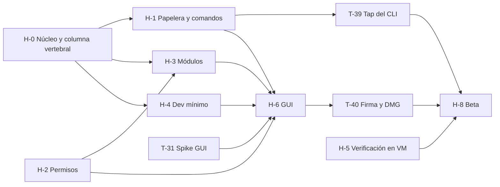

# 08 · Plan del MVP: requisitos pendientes y tareas

| Campo | Valor |
|---|---|
| Fecha | 2026-11-01 |
| Punto de partida | Rama `claude/infallible-curie-b73472` (PR #2, commit `210c392`): núcleo CLI-first con `scan`, `clean`, `history`, `undo`, `doctor` y `exclude` |
| Alcance | Lo que falta del MVP de `docs/README.md` §4 (puntos 2 a 12), la deuda del núcleo y las verificaciones abiertas |
| Qué es | La cola de trabajo del equipo: orden, dependencias y criterios de aceptación. **No redefine requisitos**: los cita por su ID |

---

## 0. Cómo usar este documento

**Precedencia.** Manda lo que fija `docs/README.md`: README › 06 › 02 › 03 y 05 (cada uno en su dominio) › 07 para el CLI. Cuando 02 contradice a README o a 07 (códigos de salida, `--permanent`, lista de subcomandos de RF-CLI-02, macOS mínimo de RNF-38), se aplica la fila correspondiente de README §8. Este plan no reabre esas decisiones.

**IDs.** Los requisitos conservan sus IDs (RF-…, RNF-…, RF-SEG-…, RF-DEV-…, CU-…). Solo hay IDs nuevos para hitos (**H-x**) y tareas (**T-xx**).

**Cada tarea sirve como encargo de una sesión.** Una tarjeta trae:
- qué requisitos cierra;
- qué crates o carpetas toca;
- qué hay que hacer y cómo se acepta;
- de qué depende y qué la bloquea;
- su tamaño;
- con qué tareas puede ir en paralelo.

Dos tareas en paralelo nunca escriben los mismos ficheros. Por eso cada una dice su alcance; donde comparten crate, cada tarea trabaja en un módulo propio. Hay tres puntos donde coinciden casi todas:

- **CLI:** cada comando nuevo vive en `crates/rotten/src/cmd/<nombre>.rs`. Lo único compartido es una variante en `args.rs` y un brazo del `match` en `main.rs`. T-03 puede mover allí los comandos que ya existen.
- **Fachada:** los métodos de `Core` de cada módulo van en su propio bloque `impl Core`, en un fichero propio dentro de `ra-core/src/`. `lib.rs` solo gana una línea `mod`.
- **`ra-platform`:** cada tarea añade su módulo, y `lib.rs` solo gana la línea `mod`.

**Tamaños.** S = un día o menos · M = de 2 a 4 días · L = de 1 a 2 semanas.

**Criterio de salida del MVP** (02 §10): beta cerrada de 20 usuarios o más (10 P1, 10 P2) durante 4 semanas, con M-1 a M-5 cumplidas y **cero pérdidas de datos**.

---

## 1. Estado actual

Qué cumple ya el código de PR #2 y qué falta. «Hecho» quiere decir implementado y con prueba automatizada.

### 1.1 Seguridad operativa (RF-SEG)

| Requisito | Estado | Dónde | Falta → tarea |
|---|---|---|---|
| RF-SEG-01 Previsualización obligatoria | Hecho | `ra-plan` (hash BLAKE3, aprobación ligada al hash, caduca a los 30 min); CLI: sin `--yes` y sin TTY → `2` | — |
| RF-SEG-02 Papelera por defecto | Hecho | `ra-exec/trash.rs` (`NSFileManager trashItemAtURL`; `ROTTEN_TRASH_DIR` en pruebas) | Comportamiento en volúmenes sin Papelera (SMB) sin probar → T-29 |
| RF-SEG-03 Borrado permanente solo explícito | Parcial | `clean --permanent` exige `--yes` | `free` y `trash empty` → T-11, T-12 |
| RF-SEG-04 Rutas protegidas | Hecho | `ra-safety/protected.rs`; propiedad `never_touches_anything_outside_the_plan` | — |
| RF-SEG-05 Fail-closed | Parcial | Configuración corrupta → `5`; raíces limitadas a `ALLOWED_PREFIXES` | Selección explícita del usuario (5a) → T-10 |
| RF-SEG-06 Resolución de rutas segura | Hecho | `O_NOFOLLOW_ANY`, operaciones relativas a descriptor | Fuzzing: v1 (06 §4) |
| RF-SEG-07 Identidad anti-TOCTOU | Hecho | `(dev, ino, tipo, tamaño, mtime, ctime)` + huella BLAKE3 de carpetas; propiedad `skips_items_changed_between_plan_and_execution` | — |
| RF-SEG-08 Ficheros en uso | Parcial | Solo apps abiertas por bundle ID (`ra-platform`, libproc) | Ficheros abiertos por procesos y `AT_NODELETEBUSY` → T-04 |
| RF-SEG-09 Nunca preseleccionar documentos | Parcial | Por construcción del catálogo | Propiedad «preseleccionados ∩ documentos = ∅» por módulo → T-10 y cada tarea de módulo |
| RF-SEG-10 Sin descargas de iCloud | Parcial | `check_flags` rechaza `SF_DATALESS` antes de actuar | Política de proceso `setiopolicy_np` → T-06 |
| RF-SEG-11 Log de operaciones | Parcial | Journal JSONL | Log técnico local rotado → T-14 |
| RF-SEG-12 Tamaños honestos | Parcial | `st_blocks × 512`; enlaces duros una vez dentro de cada elemento | `PRIVATESIZE`, deduplicación entre elementos, «liberado» medido → T-05, T-11 |
| RF-SEG-13 Mínimo privilegio | Hecho | Sin elevación; como root, aborta salvo `--allow-root` | — |
| RF-SEG-14 Automatizaciones (CLI) | Hecho | `--yes` obligatorio sin TTY | Programación: v1 |
| RF-SEG-15 Errores parciales | Hecho | Sigue con el resto; código `4` | — |
| RF-SEG-16 Dry-run idéntico | Hecho | Mismo código y mismo hash; propiedad `dry_run_changes_nothing` | — |
| RF-SEG-17 Integridad de reglas | Parcial | Catálogo incrustado y sin red | Firma Ed25519 del catálogo (RNF-ARQ-25): solo aporta con catálogo remoto (D-06) → §2 |
| RF-SEG-18 Restauración segura | Hecho | No sobrescribe (variantes «(restaurado)»); `rename` conserva propietario y permisos | — |
| RF-SEG-19 Solo el usuario actual | Hecho por construcción | Solo trabaja en la carpeta personal del usuario actual | Prueba con un segundo usuario → T-29 |

### 1.2 Historial, limpieza, panel y CLI

| Requisito | Estado | Falta → tarea |
|---|---|---|
| RF-HIS-01 Journal por operación | Hecho | — |
| RF-HIS-02 *Write-ahead* y reconciliación | Hecho (`Core::recover`, `tests/recovery.rs`) | Arnés de 1 000 `kill -9` (RNF-09) → T-07 |
| RF-HIS-03 a 05 Estados, deshacer, no restaurables | Hecho (también «restaurada en parte») | Vista en la GUI → T-35 |
| RF-HIS-06 Historial y deshacer desde el CLI | Hecho | — |
| RF-LIM-01, 03, 05 a 07, 12 | Hecho para CAT-01, CAT-03, CAT-08 y CAT-10 | Safari en contenedor y CAT-02 esperan a V-03; lista permitida de CAT-01 espera a V-18 |
| RF-LIM-04 Explicación por categoría | Parcial (título y explicación breve por regla, en es/en) | Qué pasa si se borra, si se regenera y por qué ese riesgo → T-03 |
| RF-LIM-02 Selección granular | Parcial (`--category`, exclusiones) | Selección por elemento → T-10; por subgrupo en la GUI → T-34 |
| RF-LIM-08 Informe final | Parcial (movidos, omitidos, errores) | «Liberado» medido → T-11 |
| RF-PAN-01 Estado del volumen | Pendiente | → T-05 |
| RF-PAN-02 Escaneo de las raíces del catálogo | Hecho en el CLI | Rendimiento → T-30 |
| RF-PAN-03 Resultados por categoría | Parcial (nombre, elementos y tamaño; sin riesgo ni explicación por categoría; sin *streaming*) | Riesgo y explicación → T-17; *streaming* → T-32 |
| RF-PAN-04 Dos cifras deduplicadas | Parcial | Deduplicación por inode entre elementos → T-05 |
| RF-PAN-05 «Bloqueada · requiere permiso» | Parcial (`doctor` informa FDA) | Por módulo y por categoría → T-17 |
| RF-PAN-06 Cancelar | Pendiente | → T-32 |
| RF-PAN-07 Papelera | Pendiente | → T-12 |
| RF-CLI-01, 03, 05, 06, 08 | Hecho | — |
| RF-CLI-04 JSON versionado | Parcial (`schema_version` en cada documento) | Esquema publicado y validado en CI → T-01 |
| RF-CLI-07 `doctor` | Hecho (sin FDA → `3`) | Preflight por módulo → T-17 |
| RF-CLI-09 Salida localizada | Hecho con cadenas en línea (`ui.t(es, en)`) | Externalizar y pseudo-localizar → T-03 |
| RF-AJU-01 Exclusiones | Hecho en el CLI | GUI → T-37 |
| RF-AJU-07 Idioma | Hecho en el CLI (`--lang`, `LANG`) | GUI → T-38 |

### 1.3 Arquitectura y calidad

| Requisito | Estado | Falta → tarea |
|---|---|---|
| RNF-ARQ-03 Nunca fuera del plan | 256 casos por PR | 10 000 en la ejecución nocturna → T-09 |
| RNF-ARQ-16 `unsafe` aislado | `deny(unsafe_code)` en el workspace; solo `ra-platform` lo permite | `forbid` fuera de `ra-platform` → T-09 |
| RNF-ARQ-20 Un solo ejecutor | Hecho (`6`) | — |
| RNF-ARQ-22 Salida estable y versionada | Parcial | JSON Schema, `insta` y validación en CI → T-01 |
| RNF-ARQ-26 y RNF-14 Cadena de suministro | `cargo-deny` en CI | `cargo-audit` → T-09; SBOM y atestación: v1 |
| RNF-31 Cobertura | Sin medir | → T-09 |
| RNF-32 CI | macOS 26 arm64 | Añadir la versión actual (27) si hay *runner* → T-09 |
| RNF-06 10 000 elementos en ≤ 30 s | Sin medir; un `fsync` por evento | → T-08 |

### 1.4 Comandos del MVP (07 §2 y §3)

| Comando | Estado | Tarea |
|---|---|---|
| `scan`, `clean`, `history`, `undo`, `doctor`, `exclude`, `--version`, `--help`, `help <cmd>` | Hecho | — |
| `free <op-id>` | Pendiente | T-11 |
| `trash empty` | Pendiente | T-12 |
| `config get\|set\|path` | Pendiente | T-13 |
| `completion zsh\|bash\|fish` | Pendiente | T-14 |
| `update` | Pendiente | T-15 |
| `rotten` (menú interactivo) | Pendiente | T-16 |
| `analyze [ruta]` (lista) | Pendiente | T-19 |
| `installer` | Pendiente | T-20 |
| `uninstall` | Pendiente | T-21, T-22 |
| `optimize` (solo arranque, en lectura) | Pendiente | T-23 |
| `purge`, `dev projects\|caches` (lectura) | Pendiente | T-24 a T-27 |

---

## 2. Decisiones y verificaciones que bloquean

Todas son del autor. La tabla dice qué desbloquea cada una y cómo cerrarla.

| ID | Qué falta | Bloquea | Cómo se cierra |
|---|---|---|---|
| D-07 | Spike de GUI: SwiftUI + UniFFI frente a Tauri 2 | Toda la GUI (T-32 a T-38) | T-31. **No depende del núcleo: puede empezar ya** |
| P-03 | Alta en el Apple Developer Program (cuota anual) | Firma, notarización y DMG (T-40); paso 6 del spike | Decisión y alta del autor |
| D-08 | Bundle ID definitivo (provisional: `io.github.netsirius.RottenApple`) | Antes de la beta: identidad TCC, ruta de estado, firma (T-40) | Fijarlo antes de T-33. Cambiarlo después obliga a migrar `~/Library/Application Support/<bundle-id>/` |
| D-01 | macOS 26 + arm64 (provisional) | Matriz de CI y VMs, `LSMinimumSystemVersion` | Confirmar. El código ya comprueba macOS ≥ 26 y `aarch64` |
| V-01 | URL del panel de Acceso total al disco en macOS 26 y 27 | Botón principal del onboarding (T-33) | `open "x-apple.systempreferences:…"` en VM (T-28) |
| V-03 | Acceso a contenedores de otras apps, con y sin FDA | CAT-02; Safari en contenedor dentro de CAT-08 | VM con y sin FDA (T-28). Si se confirma, se añaden las reglas y sus fixtures |
| V-04 | ¿Mover un `.app` ajeno a la Papelera requiere «Gestión de apps»? | Ejecución de `uninstall` sobre `/Applications` (T-22) | VM + `log stream --predicate 'subsystem == "com.apple.TCC"'` (T-28) |
| V-18 | Cachés «con estado» dentro de `~/Library/Caches` | Lista permitida de preselección de CAT-01 (hoy vacía) | Borrar cada candidata en VM y observar (T-28) |
| CAT-10 | README §4 lo llama «restos de actualizadores»; 02 §5 lo define como «estado guardado de ventanas» | Texto de README §4 | Se implementó 02 §5. Confirmar o pedir la otra categoría (es una regla TOML y su fixture) |
| Comandos `trash` | 07 solo define `trash empty`. RNF-ARQ-02 exige que «Mover a la Papelera» del Explorador exista en el CLI, y RF-PAN-07 pide ver la Papelera con su tamaño | T-10, T-12 | Propuesta: `rotten trash` (lectura: tamaño por volumen y lo enviado por la app) y `rotten trash put <ruta…>` (con `--dry-run`, `--json` y `--yes`, por el mismo pipeline). Aprobar o renombrar |
| Arranque en lectura | 07 pone «arranque en solo lectura» en el MVP dentro de `optimize`, sin nombre de subcomando | T-23 | Propuesta: `rotten optimize startup`. Aprobar o renombrar |
| RF-INS-02 | Pide el atajo «Seleccionar los de apps ya instaladas», pero detectar «ya instalada» es RF-INS-06 (v1) | T-20 | Propuesta: en el MVP no se ofrece el atajo; llega con RF-INS-06 |
| RNF-ARQ-25 | Firma Ed25519 del catálogo incrustado | Nada mientras D-06 = No | Propuesta: posponer la firma a cuando haya catálogo remoto; la limitación a prefijos ya está hecha |
| Hardware de pruebas | Mac mini como *runner* autoalojado con Tart (como máximo 2 VMs por Mac) | T-29, T-30 | Compra o cesión de un Mac y licencia de Tart para CI (05 §10.4, «por verificar») |

---

## 3. Hitos

| Hito | Qué entrega | Tareas | Depende de |
|---|---|---|---|
| **H-0** · Columna vertebral y deuda del núcleo | Esquemas JSON, prueba de paridad, cadenas externalizadas, núcleo completo frente a RF-SEG, arnés de fallos y planes por selección explícita | T-01 a T-10 | — |
| **H-1** · Papelera y comandos pequeños | `free`, `trash`, `config`, `completion`, `update`, menú | T-11 a T-16 | T-01; T-03 recomendado |
| **H-2** · Permisos | Preflight por módulo en el núcleo, `doctor` y `scan` | T-17 | — |
| **H-3** · Módulos del MVP | Corpus sintético, `analyze`, `installer`, `uninstall`, arranque en lectura | T-18 a T-23 | T-10 (todos los módulos con acción) |
| **H-4** · Zona Desarrollador mínima (D-03) | `purge` y `dev` en lectura | T-24 a T-27 | T-10 |
| **H-5** · Verificación | V-01/03/04/18, matriz de VMs, *benchmarks* | T-28 a T-30 | Hardware (§2) |
| **H-6** · GUI | Spike, FFI y pantallas del MVP | T-31 a T-38 | T-31 → resto; H-1 a H-4 para cada pantalla |
| **H-7** · Distribución | *Tap* con el CLI; firma, notarización, DMG y cask; Sparkle | T-39 a T-41 | P-03, D-08 |
| **H-8** · Beta cerrada | Puerta de salida y beta de 4 semanas | T-42, T-43 | Todo lo anterior |

**Ruta crítica.** Spike (T-31) → FFI (T-32) → pantallas (T-33 a T-38) → firma y DMG (T-40) → beta. La GUI es lo más largo y el spike no necesita nada del núcleo. Conviene arrancarlo a la vez que H-0.

**Esfuerzo.** Sumando los tamaños, el MVP pasa de los 6 meses que fija README §4 si lo hace una sola persona sin paralelizar. Con varias sesiones en paralelo, el cuello de botella pasa a ser la revisión del autor y las verificaciones en VM. Por eso cada tarjeta trae su criterio de aceptación automatizable.

**Primera tanda en paralelo** (sin ficheros compartidos):

| Sesión | Tarea | Escribe en |
|---|---|---|
| A | T-01 y después T-02 | `crates/rotten/tests/`, `schemas/` |
| B | T-04 | `crates/ra-platform/src/files.rs`, `crates/ra-exec/src/verify.rs` |
| C | T-07 | `crates/ra-core/tests/crash.rs` (y un *feature* de pruebas en `ra-exec/src/run.rs` si hace falta) |
| D | T-10 (cuando el autor apruebe `trash put`) | `crates/ra-plan/`, `crates/ra-core/src/lib.rs`, comando nuevo en `rotten` |
| Autor | T-31 (spike) y T-28 (VMs); decisiones de §2 | `spikes/` fuera del workspace de Rust |

---

## 4. Tareas

### 4.0 Seguimiento

| Tarea | Título | Hito | Tamaño | Depende de | Estado |
|---|---|---|---|---|---|
| T-01 | Esquemas JSON y validación en CI | H-0 | M | — | Pendiente |
| T-02 | Prueba de paridad de comandos | H-0 | S | T-01 | Pendiente |
| T-03 | Cadenas externalizadas y pseudo-localización del CLI | H-0 | M | T-01 | Pendiente |
| T-04 | Ficheros abiertos y `AT_NODELETEBUSY` | H-0 | M | — | Pendiente |
| T-05 | Tamaños honestos y estado del volumen | H-0 | M | — | Pendiente |
| T-06 | Política de E/S y de ficheros sin descargar | H-0 | S | — | Pendiente |
| T-07 | Arnés de cierre abrupto (`kill -9`) | H-0 | M | — | Pendiente |
| T-08 | `fsync` por lotes sin perder la escritura anticipada | H-0 | M | T-07 | Pendiente |
| T-09 | CI nocturna, `cargo-audit`, `forbid(unsafe_code)` y cobertura | H-0 | S | T-07 | Pendiente |
| T-10 | Planes por selección explícita y `rotten trash put` | H-0 | M | §2 | Pendiente |
| T-11 | `rotten free <op-id>` («Liberar ahora») | H-1 | M | T-01 | Pendiente |
| T-12 | `rotten trash` y `rotten trash empty` | H-1 | M | T-11 | Pendiente |
| T-13 | `rotten config` y enlace en `~/.config/rotten/` | H-1 | S | — | Pendiente |
| T-14 | `completion`, `--debug`, `--no-color` y log técnico | H-1 | S | — | Pendiente |
| T-15 | `rotten update` | H-1 | S | — | Pendiente |
| T-16 | Menú interactivo | H-1 | M | T-11 a T-15 | Pendiente |
| T-17 | Preflight de permisos por módulo | H-2 | M | — | Pendiente |
| T-18 | Corpus sintético y *benchmarks* | H-3 | M | — | Pendiente |
| T-19 | `ra-fs` y `rotten analyze` | H-3 | L | T-10, T-18 | Pendiente |
| T-20 | `rotten installer` | H-3 | M | T-10 | Pendiente |
| T-21 | `ra-apps`: inventario y restos (`uninstall --list`) | H-3 | L | — | Pendiente |
| T-22 | `rotten uninstall`: ejecución, agentes y deshacer | H-3 | L | T-10, T-21, V-04 | Pendiente |
| T-23 | Arranque en solo lectura | H-3 | M | §2 | Pendiente |
| T-24 | `ra-dev`: descubrimiento de proyectos y artefactos | H-4 | L | — | Pendiente |
| T-25 | Lectura de git segura y protecciones | H-4 | L | T-24 | Pendiente |
| T-26 | Actividad, regenerabilidad y preselección | H-4 | M | T-24, T-25 | Pendiente |
| T-27 | `rotten purge` y `rotten dev` | H-4 | M | T-10, T-26 | Pendiente |
| T-28 | Verificaciones V-01, V-03, V-04 y V-18 | H-5 | M | — | Pendiente |
| T-29 | Matriz de VMs y pruebas E2E | H-5 | L | Hardware | Pendiente |
| T-30 | *Benchmarks* en hardware de referencia | H-5 | M | T-18 | Pendiente |
| T-31 | Spike de GUI (ADR-01) | H-6 | L | — | Pendiente |
| T-32 | Capa FFI, bus de eventos y cancelación | H-6 | L | T-31 | Pendiente |
| T-33 | Onboarding y permisos | H-6 | M | T-17, T-32, V-01 | Pendiente |
| T-34 | Escaneo, limpieza, revisión e informe | H-6 | L | T-32 | Pendiente |
| T-35 | Historial, deshacer y «Liberar ahora» | H-6 | M | T-11, T-32 | Pendiente |
| T-36 | Desinstalar, Espacio, Instaladores y Arranque | H-6 | L | T-19 a T-23, T-32 | Pendiente |
| T-37 | Ajustes y modos Simple/Experto | H-6 | M | T-13, T-32 | Pendiente |
| T-38 | Accesibilidad e i18n de la GUI | H-6 | L | T-33 a T-37 | Pendiente |
| T-39 | *Tap* de Homebrew con el CLI | H-7 | S | Release etiquetada | Pendiente |
| T-40 | Firma, notarización, DMG, cask y SBOM | H-7 | L | P-03, D-08, T-38 | Pendiente |
| T-41 | Sparkle 2 | H-7 | M | T-40 | Pendiente |
| T-42 | Puerta de salida y beta cerrada | H-8 | L | Todo | Pendiente |
| T-43 | Registrar este plan en `docs/README.md` | H-8 | S | PR #1 fusionado | Pendiente |

### 4.1 H-0 · Columna vertebral y deuda del núcleo

#### T-01 · Esquemas JSON y validación en CI
- **Cierra:** RNF-ARQ-22, RF-CLI-04, RF-CLI-21 (parte JSON).
- **Alcance:** `schemas/` (nuevo), `crates/rotten/tests/`. No toca `src/`: si un documento no encaja, se anota y se corrige en T-03.
- **Qué hacer:**
  - Un JSON Schema por documento (`scan`, `clean`, `history`, `undo`, `doctor`, `exclude`), con claves en inglés y `schema_version`.
  - Pruebas *snapshot* con `insta` (MIT/Apache) que ocultan rutas, fechas e IDs.
  - Una prueba que valida cada salida contra su esquema con `jsonschema` (MIT).
- **Aceptación:**
  - `cargo test -p rotten --test schemas` valida todas las salidas de `crates/rotten/tests/cli.rs`.
  - Renombrar una clave sin subir `schema_version` hace fallar la prueba.
- **En paralelo con:** T-04 a T-07.

#### T-02 · Prueba de paridad de comandos
- **Cierra:** RF-CLI-20 y el resto de RF-CLI-21.
- **Alcance:** `crates/rotten/tests/parity.rs` y una tabla `crates/rotten/tests/parity.toml` con cada comando de 07 §2 y §3, su fase y su estado.
- **Qué hacer:** ejecutar cada comando implementado con `--dry-run --json` (o `--json` si es de lectura) y validar la salida con T-01.
- **Aceptación:**
  - La prueba falla si un comando marcado como hecho no existe o su JSON no valida.
  - Con `ROTTEN_PARITY_STRICT=1` falla mientras quede algún comando MVP pendiente. Esa variante es la puerta de T-42.

#### T-03 · Cadenas externalizadas y pseudo-localización del CLI
- **Cierra:** RNF-24 y RNF-25 (parte CLI), RF-CLI-09, RF-LIM-04.
- **Alcance:** `crates/rotten/src/` (sobre todo `main.rs` y `text.rs`) y los campos de texto de `catalog/rules/*.toml`.
- **Qué hacer:**
  - Pasar las cadenas de `ui.t(es, en)` a un catálogo de mensajes con plurales por idioma, por ejemplo Fluent (`fluent-bundle`, Apache/MIT).
  - Ampliar los textos de cada regla con qué es, qué pasa si se borra, si se regenera y por qué tiene ese riesgo, en es/en.
  - Formatear números, fechas y tamaños según el locale, con unidades decimales como Finder.
  - Añadir una pseudo-localización en CI que detecte cadenas sin traducir o concatenadas.
- **Aceptación:**
  - `LANG=es_ES.UTF-8` y `LANG=en_US.UTF-8` imprimen cada idioma.
  - La salida `--json` es idéntica en ambos.
  - La prueba de pseudo-localización pasa.
- **Nota:** hacerla **antes** de añadir comandos (H-1) para no reescribir sus cadenas. Toca los mismos ficheros que todas las tareas del CLI: no va en paralelo con ellas.

#### T-04 · Ficheros abiertos y `AT_NODELETEBUSY`
- **Cierra:** RF-SEG-08 (lo que falta).
- **Alcance:** `ra-platform` (módulo nuevo `files.rs`: `proc_listpidspath` o `proc_pidinfo(PROC_PIDLISTFDS)`), `ra-exec/src/verify.rs`.
- **Qué hacer:**
  - Justo antes de actuar, omitir el elemento si un proceso visible para el usuario lo tiene abierto, con motivo `in_use`.
  - En el borrado permanente, usar `AT_NODELETEBUSY` si el sistema lo admite y degradar si devuelve `EINVAL` (RNF-ARQ-27).
- **Aceptación:**
  - Un proceso hijo que mantiene abierto un fichero de caché provoca su omisión con motivo «en uso», y el CLI devuelve `4`.
  - Una propiedad nueva en `ra-core/tests/properties.rs` cubre ficheros abiertos.

#### T-05 · Tamaños honestos y estado del volumen
- **Cierra:** RF-SEG-12 (a, b y d), RNF-ARQ-28, RF-PAN-01, RF-PAN-04.
- **Alcance:** `ra-platform` (módulo nuevo `attrs.rs`: `getattrlist` con `ATTR_CMNEXT_PRIVATESIZE`, `statfs`, capacidad disponible para uso importante), `ra-safety/src/fingerprint.rs`, `ra-core/src/scan.rs`.
- **Qué hacer:**
  - Estimar con el tamaño privado (clones APFS una sola vez).
  - Deduplicar por `(dev, ino)` **entre** elementos en la cifra «seguro».
  - Añadir a `scan` el estado del volumen: capacidad, usado, libre, purgable aparte y disponible.
- **Aceptación:**
  - Un fichero clonado con `cp -c` no duplica la estimación y aparece el aviso de clones.
  - Un enlace duro presente en dos elementos cuenta una vez.
  - «Disponible» coincide con Finder y «libre» con `diskutil info /` (± 1 %).

#### T-06 · Política de E/S y de ficheros sin descargar
- **Cierra:** RF-SEG-10 (política de proceso), RNF-ARQ-09.
- **Alcance:** `ra-platform` (módulo nuevo `iopolicy.rs`), arranque de `ra-core`.
- **Qué hacer:** al crear `Core`, fijar `IOPOL_TYPE_VFS_MATERIALIZE_DATALESS_FILES` en «off» para el proceso (por verificar, 02 RF-SEG-10: confirmarlo antes de dar la política por buena) y E/S de prioridad `utility`.
- **Aceptación:**
  - `getiopolicy_np` devuelve las políticas fijadas.
  - El `atime` de los ficheros del fixture no cambia tras `scan`.
  - La prueba con iCloud real (`brctl evict`) queda en la lista manual de T-29.

#### T-07 · Arnés de cierre abrupto (`kill -9`)
- **Cierra:** RNF-09, RNF-ARQ-06, RNF-12.
- **Alcance:** `crates/ra-core/tests/crash.rs`. Si hace falta frenar la ejecución en puntos concretos, un *feature* `fault-injection` que solo existe en pruebas.
- **Qué hacer:**
  - Lanzar `rotten clean --yes` y `rotten undo --yes` sobre un fixture y matarlos con `SIGKILL` en un momento aleatorio.
  - Después, ejecutar `Core::recover`.
- **Aceptación:**
  - En cada ronda, todo elemento está en su ruta original o en la Papelera de prueba, y registrado.
  - La operación queda cerrada como recuperada y repetir `recover` no cambia nada.
  - 50 rondas por PR y 1 000 en la nocturna (T-09).

#### T-08 · `fsync` por lotes sin perder la escritura anticipada
- **Cierra:** RNF-06.
- **Alcance:** `ra-history/src/journal.rs`, `ra-exec/src/run.rs`.
- **Qué hacer:**
  - Escribir las intenciones de un lote y hacer un único `fsync`.
  - Después actuar sobre ese lote y anotar los resultados.
  - El tamaño del lote es configurable; nunca se actúa sobre un elemento cuya intención no es durable.
- **Aceptación:**
  - 10 000 elementos a la Papelera de prueba en ≤ 30 s en el hardware de referencia.
  - El arnés de T-07 sigue pasando.

#### T-09 · CI nocturna, `cargo-audit`, `forbid(unsafe_code)` y cobertura
- **Cierra:** RNF-ARQ-03 (nocturna), RNF-ARQ-16, RNF-ARQ-26, RNF-14 y RNF-31 (medición). También RNF-32, si hay *runner* de macOS 27.
- **Alcance:** `.github/workflows/`, cabeceras `lib.rs` de cada crate salvo `ra-platform`.
- **Qué hacer:**
  - Un *workflow* nocturno con `PROPTEST_CASES=10000` y el arnés de T-07 con 1 000 rondas.
  - Añadir `cargo audit`.
  - Poner `#![forbid(unsafe_code)]` en todos los crates menos `ra-platform`.
  - Medir la cobertura con `cargo-llvm-cov`.
- **Aceptación:**
  - Los *jobs* corren y están en verde.
  - La cobertura de `ra-safety`, `ra-plan`, `ra-exec` y `ra-history` aparece en el informe; el objetivo es ≥ 80 %.

#### T-10 · Planes por selección explícita y `rotten trash put`
- **Cierra:** RF-SEG-05 (a), RNF-ARQ-02 (Explorador), RF-LIM-02 (por elemento). Prepara RF-SEG-09 para todos los módulos.
- **Alcance:** `ra-plan`, `ra-core/src/lib.rs`, comando nuevo en `rotten`.
- **Qué hacer:**
  - Generalizar el plan para que sus elementos puedan venir de una regla del catálogo, de un módulo (instaladores, desinstalador, dev) o de una selección explícita del usuario.
  - Todos pasan por la lista protegida, las exclusiones, la identidad y el journal (con el origen anotado).
  - Exponerlo en el CLI como `rotten trash put <ruta…>` si el autor lo aprueba (§2).
- **Aceptación:**
  - Una ruta protegida o un ancestro de ella se rechaza con `5`.
  - Una ruta excluida no entra en el plan.
  - Se añade la propiedad «preseleccionados ∩ documentos = ∅» sobre una carpeta personal de fixture con Documentos, Escritorio y Descargas.
  - `trash put` y `undo` dejan el árbol como estaba.
- **Bloqueado por:** el nombre del comando (§2, «Comandos `trash`»). El núcleo puede hacerse antes.

### 4.2 H-1 · Papelera y comandos pequeños

#### T-11 · `rotten free <op-id>` («Liberar ahora»)
- **Cierra:** CU-08 (elementos de una operación), RF-SEG-03, RF-SEG-12 (e), RF-LIM-08, M-5. Comando de 07 §3.
- **Alcance:**
  - `ra-exec`: borrado relativo a descriptor ya existente.
  - `ra-history`: tipo de operación nuevo y estados.
  - `ra-core` y `rotten`.
- **Qué hacer:**
  - Leer del journal la ruta en la Papelera de cada elemento de la operación (acepta varias `op-id`).
  - Revalidar su identidad con `same_after_move` y borrarlo para siempre.
  - Anotar la operación como irreversible y referenciar la original, que pasa a «irreversible» o «restaurada en parte».
  - Medir el espacio liberado con `statfs` antes y después, e informar de lo estimado frente a lo liberado.
  - Exigir `--yes` sin terminal. Con terminal, confirmar con el número de elementos, el tamaño y «no se puede deshacer», con «No» por defecto.
  - Tras `clean`, el informe sugiere `rotten free <op-id>`.
- **Aceptación:**
  - `clean --yes` y `free <op> --yes` dejan vacía de esos elementos la Papelera de prueba; `history` muestra «irreversible» y `undo` devuelve `1`.
  - Un elemento modificado o sustituido dentro de la Papelera se omite y el resultado es `4`.
  - `--dry-run --json` muestra el plan sin tocar nada.
  - Una propiedad garantiza que `free` nunca borra nada que no esté registrado para esa operación.
- **En paralelo con:** T-13 a T-15, si T-03 ya está hecha.

#### T-12 · `rotten trash` y `rotten trash empty`
- **Cierra:** CU-08 (toda la Papelera), RF-PAN-07.
- **Alcance:** los mismos crates que T-11 (por eso va después).
- **Qué hacer:**
  - `rotten trash` muestra el tamaño por volumen (`~/.Trash`, `/Volumes/<X>/.Trashes/<uid>`) y separa lo que envió Rotten Apple, por operación, de lo demás.
  - `rotten trash empty` construye un plan con la identidad de cada entrada de primer nivel, la revalida y borra.
  - Las operaciones afectadas cambian de estado.
  - Sin acceso a `~/.Trash`, `trash` muestra solo lo que conoce por el journal y lo dice (CU-08 A1). `trash empty` termina con `3` y sugiere `rotten free`.
- **Aceptación:**
  - Pruebas con `ROTTEN_TRASH_DIR`.
  - Un elemento que aparece en la Papelera tras la previsualización no se borra.
  - La prueba con la Papelera real queda como `#[ignore]` documentada.
- **Bloqueado por:** solo el `rotten trash` de lectura espera a §2 («Comandos `trash`»); `trash empty` ya está en 07.

#### T-13 · `rotten config` y enlace en `~/.config/rotten/`
- **Cierra:** `config` de 07 §3 y la fila de configuración de 07 §2.
- **Alcance:** `ra-safety` (escritura validada y atómica de `config.toml`), `ra-core`, `rotten`.
- **Qué hacer:**
  - Implementar `config path`, `config get <clave>` y `config set <clave> <valor>`, con claves validadas.
  - Crear el enlace `~/.config/rotten/config.toml` → configuración canónica si no existe. Nunca sustituir un fichero que ya esté ahí.
- **Aceptación:**
  - Con la configuración corrupta, `config set` se niega y devuelve `5`.
  - Si `~/.config/rotten/config.toml` existe y no es el enlace, `doctor` lo avisa y las acciones destructivas abortan con `5` (RF-SEG-05 c).

#### T-14 · `completion`, `--debug`, `--no-color` y log técnico
- **Cierra:** `completion` de 07 (MVP), flags globales de 07 §4, RF-SEG-11 (log técnico) y RNF-33.
- **Alcance:** `rotten` (`clap_complete`, MIT/Apache) y un *logger* local rotado en `~/Library/Logs/<app>/`.
- **Aceptación:**
  - Los scripts de zsh, bash y fish completan subcomandos y opciones.
  - `--no-color` y `NO_COLOR` quitan los colores.
  - El log no contiene contenido de ficheros: un fichero con un marcador conocido no aparece en él.

#### T-15 · `rotten update`
- **Cierra:** `update` de 07 (MVP).
- **Alcance:** `rotten`.
- **Qué hacer:**
  - Detectar cómo se instaló el binario.
  - En el Cellar de Homebrew, delegar en `brew upgrade` del *tap*.
  - Dentro de un `.app`, delegar en Sparkle (H-7); hasta entonces, explicarlo.
  - En los demás casos, explicar cómo actualizar.
  - Nunca abre conexiones por su cuenta.
- **Aceptación:** `rotten update --dry-run --json` informa del método y del comando exacto, sin ejecutar nada.

#### T-16 · Menú interactivo
- **Cierra:** `rotten` sin subcomando (07 §2) y las teclas de 07 §2.
- **Alcance:** `rotten` (por ejemplo `ratatui` + `crossterm`, MIT).
- **Qué hacer:**
  - Cada opción ejecuta lo mismo que su subcomando, con la previsualización primero.
  - Teclas: flechas, `hjkl`, Intro, `q`, y `u` para deshacer.
  - Sin terminal, imprime la ayuda y devuelve `2`.
- **Aceptación:** pruebas de teclas con el *backend* de pruebas (sin pty real, que el sandbox bloquea).

### 4.3 H-2 · Permisos

#### T-17 · Preflight de permisos por módulo
- **Cierra:** RNF-ARQ-15, RF-PAN-03 (riesgo y explicación por categoría), RF-PAN-05, RF-CLI-07 y RF-AJU-08 (núcleo). Prepara CU-01.
- **Alcance:**
  - `ra-platform` (módulo nuevo `permissions.rs`).
  - `catalog/permissions.toml`: lista de rutas sondeadas, que 05 §1.1.2 quiere en el catálogo.
  - `ra-core/src/doctor.rs` y `scan.rs`.
- **Qué hacer:**
  - Sustituir `fda_preflight` por aperturas `O_RDONLY` + `close` de rutas representativas, sin leer contenido.
  - Clasificar por módulo: Limpieza, Papelera, Instaladores, Desinstalador.
  - Las carpetas con consentimiento por carpeta (Descargas, Escritorio) **no se sondean**: quedan como «requiere consentimiento» hasta que el usuario abre el módulo.
  - Repetir el preflight justo antes de ejecutar un plan.
  - Distinguir `EPERM` (TCC) de `EACCES` (permisos POSIX).
  - Completar el resumen de cada categoría en `scan` con su riesgo, su explicación y su estado de bloqueo.
- **Aceptación:**
  - `doctor --json` incluye `permissions` por módulo.
  - Cada categoría de `scan --json` trae nombre, explicación, riesgo, número de elementos y tamaño (RF-PAN-03).
  - En `scan`, una categoría que requiere FDA sin tenerlo sale bloqueada, con el tamaño a `null` y sin error.
  - Pruebas con carpetas sin permiso para simular la denegación; la comprobación con TCC real queda en T-29.
- **En paralelo con:** cualquier tarea de H-1. **No** con T-05, que también toca `ra-core/src/scan.rs`.

### 4.4 H-3 · Módulos del MVP

#### T-18 · Corpus sintético y *benchmarks*
- **Cierra:** el script del corpus que exige 02 §9 y la base medible de RNF-01 a RNF-03, RNF-ARQ-10 y RNF-ARQ-11.
- **Alcance:** `xtask/` (crate nuevo, fuera de los binarios publicados).
- **Qué hacer:**
  - `cargo xtask corpus --entries <n> --seed <s> --out <dir>` genera las raíces del catálogo y un árbol de volumen, con enlaces duros, *symlink* circular, fichero disperso y clones (`clonefile`).
  - `cargo xtask bench scan|analyze` mide el p95 y la memoria máxima (`/usr/bin/time -l`).
- **Aceptación:**
  - Con la misma semilla, el corpus sale idéntico (hash del listado).
  - El *bench* emite JSON comparable entre ejecuciones.

#### T-19 · `ra-fs` y `rotten analyze`
- **Cierra:** RF-ESP-01 a 05, CU-04, RNF-02, RNF-03.
- **Alcance:**
  - `ra-fs` (crate nuevo de 05 §4.3: recorrido paralelo con `rayon`/`jwalk`).
  - `ra-platform` (módulo nuevo `bulk.rs`: `getattrlistbulk`).
  - `rotten`.
- **Qué hacer:**
  - Jerarquía ordenada por tamaño asignado (`--depth`) y los N ficheros más grandes (`--top 50`).
  - Enlaces duros una vez. Sin seguir *symlinks*. Sin cruzar volúmenes salvo `--cross-mounts`.
  - Ficheros sin descargar como «en la nube», sin abrirlos.
  - Paquetes (`.app`, `.photoslibrary`…) como unidad, con `--into-packages` para el modo Experto.
  - Errores clasificados (RNF-11) y `scan_status`.
  - «Mover a la Papelera» del Explorador usa T-10.
- **Aceptación:**
  - Con enlaces duros, *symlink* circular y fichero disperso, el total coincide con `du -skx` (± 1 %).
  - El top 50 coincide con la referencia calculada sobre el fixture.
  - Con el corpus de T-18: 2 M de entradas en ≤ 45 s en caliente y ≤ 300 MB, medido en T-30.

#### T-20 · `rotten installer`
- **Cierra:** RF-INS-01 a 04, CU-09, CAT-19 (Descargas y Escritorio).
- **Alcance:** módulo nuevo en `ra-core` (o crate propio si crece), `rotten`.
- **Qué hacer:**
  - Detectar por extensión y cabecera: `koly` de UDIF, `xar!` de `.pkg` y `.xip`, `CD001` de ISO 9660. Leer solo los primeros o los últimos bytes, y nunca de un fichero sin descargar.
  - Omitir las imágenes montadas (consultando `hdiutil info -plist`, que no monta nada).
  - Nada preseleccionado: `--select <ids|all>`.
  - Flags `--source downloads|desktop`, `--dry-run`, `--json`, `--yes` y `--permanent`.
  - Sin acceso a la carpeta (TCC de la terminal), devolver `3` con la causa y la acción sugerida.
- **Aceptación:**
  - Fixture de 10 instaladores y 10 señuelos (extensión cambiada, cabecera falsa): 100 % de aciertos.
  - Sin `--select`, el plan está vacío.
  - `hdiutil info` no muestra imágenes nuevas tras el escaneo.
  - Un DMG montado en la prueba sale «en uso».

#### T-21 · `ra-apps`: inventario y restos (`uninstall --list`)
- **Cierra:** RF-DES-01, 03, 04 y 08; CAT-14 (parte de usuario).
- **Alcance:**
  - `ra-apps` (crate nuevo; módulo `inventory.rs`, con `plist`, MIT).
  - Variable `ROTTEN_APPS_DIRS` para pruebas.
  - `rotten`.
- **Qué hacer:**
  - Listar `/Applications` (con subcarpetas) y `~/Applications`; nunca `/System/Applications`.
  - De cada app: nombre, bundle ID, versión, origen (`_MASReceipt`, Caskroom, Developer ID), Team ID (`codesign -dv`) y tamaño total.
  - Buscar sus restos en las rutas de usuario de CAT-14 por bundle ID, nombre y Team ID.
  - Preseleccionar según RF-DES-04.
  - Bloquear los `Group Containers` compartidos con otra app instalada del mismo Team ID.
- **Aceptación:**
  - `rotten uninstall --list --json` devuelve `name`, `bundle_id`, `source`, `path` y `size` (07).
  - Prueba de RF-DES-04: `Application Support`, `Containers`, `Group Containers` y `Preferences` nunca van marcados.
  - Prueba de RF-DES-08 con dos apps de fixture del mismo Team ID.
  - El *recall* ≥ 95 % sobre 20 apps populares se mide en T-29.

#### T-22 · `rotten uninstall`: ejecución, agentes y deshacer
- **Cierra:** RF-DES-05, 06, 07 (agentes de usuario) y 09; CU-03.
- **Alcance:** `ra-apps` (módulo `uninstall.rs`), `ra-exec` (acción nueva de agente), `rotten`.
- **Qué hacer:**
  - Omitir las apps abiertas (RF-DES-05).
  - Las apps de root no entran en el plan; se sugiere `open -R <ruta>` («Mostrar en Finder», RF-DES-09).
  - Para `~/Library/LaunchAgents`: `launchctl bootout gui/<uid>/<label>` y el plist a la Papelera. Deshacer devuelve el plist y ejecuta `launchctl bootstrap`.
  - `--with-data` nunca incluye Documentos ni fototecas.
  - `launchctl` va detrás de un *trait* para poder usar un doble en las pruebas.
  - Un `EPERM` al mover el `.app` lleva a «Gestión de apps» y devuelve `3`.
- **Aceptación:**
  - Con el fixture, `uninstall` y `undo` restauran la app y sus restos en su ruta.
  - En VM (T-29), la app firmada de prueba abre tras restaurarla.
  - `launchctl print gui/<uid>/<label>` no encuentra el servicio tras desinstalar.
- **Bloqueado por:** V-04.

#### T-23 · Arranque en solo lectura
- **Cierra:** RF-MAN-01, RF-MAN-02.
- **Alcance:** `ra-apps` (módulo `startup.rs`), `rotten` (nombre propuesto `rotten optimize startup`, pendiente de §2).
- **Qué hacer:**
  - Leer los plists de `~/Library/LaunchAgents`, `/Library/LaunchAgents` y `/Library/LaunchDaemons`.
  - De cada uno: etiqueta, programa, app propietaria, Team ID, si está cargado (`launchctl print`) y si es huérfano (el ejecutable no existe).
  - Lo que no se puede enumerar sin admin (ítems en segundo plano) se dice explícitamente, con el enlace al panel de Ajustes del Sistema (URL por verificar en 26 y 27).
- **Aceptación:**
  - El listado coincide con los plists del fixture.
  - «Cargado» coincide con `launchctl print`.
  - El comando no modifica nada (hash del fixture antes y después).

### 4.5 H-4 · Zona Desarrollador mínima (D-03)

Corte de D-03: proyectos en raíces sin TCC; `node_modules`, `target/`, `.venv` y DerivedData; protecciones git; cachés globales solo en lectura. Los comandos nativos de herramientas (`brew cleanup`, `simctl`) quedan para v1.

#### T-24 · `ra-dev`: descubrimiento de proyectos y artefactos
- **Cierra:** RF-DEV-01, 02, 04 y 26.
- **Alcance:** `ra-dev` (crate nuevo), reglas de artefactos como datos en `catalog/dev/`.
- **Qué hacer:**
  - Recorrer las raíces por defecto de 03 §3.1 con los marcadores de 03 §3.2, incluido `.git` como fichero.
  - Profundidad 8. Sin *symlinks* ni cambios de volumen. Sin entrar en paquetes ni en ficheros sin descargar.
  - Al encontrar un artefacto validado, se poda.
  - El artefacto exige su marcador hermano; además, la regla genérica `CACHEDIR.TAG`.
- **Aceptación:**
  - Criterios de RF-DEV-01 y RF-DEV-04 sobre fixture.
  - Sin diálogos TCC con la configuración por defecto (comprobación en VM, T-29).
  - Rendimiento de RF-DEV-26 con el corpus de T-18.

#### T-25 · Lectura de git segura y protecciones
- **Cierra:** RF-DEV-07, 08, 09, 10 y 13 (protecciones P1 a P8 de 03 §3.5).
- **Alcance:** `ra-dev` (módulo `git.rs`).
- **Qué hacer:**
  - Leer con `gix` (MIT/Apache).
  - Si alguna lectura no está soportada, usar el CLI neutralizado: `GIT_OPTIONAL_LOCKS=0`, `-c core.fsmonitor=false`, `-c core.hooksPath=/dev/null`, sin configuración del sistema.
  - Comprobar `xcode-select -p` antes de llamar a `/usr/bin/git`, para no abrir el instalador de las Command Line Tools.
- **Aceptación:**
  - Criterios de RF-DEV-07 a 10.
  - Un repo con `core.fsmonitor` apuntando a un script centinela: tras escanear, el centinela no existe (RF-DEV-13).
- **Riesgo:** la madurez de `gix status` para índice frente a árbol de trabajo está «por verificar» (03 §3.5). Empezar con un día de exploración y anotar el resultado aquí.

#### T-26 · Actividad, regenerabilidad y preselección
- **Cierra:** RF-DEV-06, RF-DEV-12.
- **Alcance:** `ra-dev` (módulo `activity.rs`).
- **Qué hacer:**
  - Calcular la última actividad con las señales de 03 §3.4 y asignar los estados Activo, Reciente, Inactivo, Dormido o Abandonado.
  - Preseleccionar solo los artefactos «Seguro» de proyectos inactivos o más antiguos.
  - Sin *lockfile* o con registro privado, el artefacto pasa a «Precaución» y se indica el host.
- **Aceptación:** criterios de RF-DEV-06 y RF-DEV-12 sobre fixture.

#### T-27 · `rotten purge` y `rotten dev`
- **Cierra:** `purge` de 07 (MVP), `dev` en lectura (07 §3), RF-DEV-05 y RF-DEV-14 (subconjunto en lectura).
- **Alcance:** `ra-core`, `rotten`.
- **Qué hacer:**
  - `rotten dev projects --json` y `rotten dev caches --json`, en lectura.
  - `rotten purge [--roots <dir…>] [--older-than 30d] [--select <ids|all>] [--dry-run] [--yes]` por el pipeline de T-10.
  - DerivedData solo si `xcodebuild` no está en marcha.
- **Aceptación:**
  - El plan de `--dry-run` coincide con el ejecutado (mismo hash, RF-SEG-16).
  - `undo` restaura `node_modules`.
  - Una propiedad sobre fixtures de proyectos garantiza que nunca se tocan ficheros versionados, worktrees, repos anidados ni secretos.

### 4.6 H-5 · Verificación

#### T-28 · Verificaciones V-01, V-03, V-04 y V-18
- **Alcance:** `scripts/vm/` (guiones y lista de comprobación). La ejecución es del autor, en VM.
- **Qué hacer:** un guion por verificación con el método de README §7 y 05 §1.1.
- **Entregable:**
  - El resultado anotado en `docs/README.md` §7.
  - El cambio de catálogo que se derive: lista permitida de CAT-01, CAT-02, Safari en contenedor.
  - Las tareas desbloqueadas actualizadas en §4.0.

#### T-29 · Matriz de VMs y pruebas E2E
- **Cierra:** 05 §10.4 para el CLI; las comprobaciones manuales de RF-SEG-02 (volumen sin Papelera), RF-SEG-10 (iCloud), RF-SEG-19 (segundo usuario), RF-DES-03 (*recall*), RF-DES-06 y RF-DEV-02 (sin diálogos TCC).
- **Alcance:** `.github/workflows/e2e.yml`, imágenes Tart de macOS 26 y 27, con y sin FDA.
- **Aceptación:**
  - Por PR: macOS 27 sin FDA con escaneo, limpieza y deshacer.
  - En la nocturna: toda la matriz.
- **Bloqueado por:** el hardware de §2.

#### T-30 · *Benchmarks* en hardware de referencia
- **Cierra:** RNF-01 a 03, RNF-06, RNF-ARQ-10 y RNF-ARQ-11 (medición y umbral).
- **Alcance:** *job* en el *runner* autoalojado con `cargo xtask bench`.
- **Aceptación:**
  - Cifras publicadas por versión.
  - Una regresión de más del 10 % bloquea la release.
- **Nota:** el Mac de referencia de 02 §9 usa macOS 15. Por D-01 se mide en macOS 26 o posterior.

### 4.7 H-6 · GUI

Las tarjetas de H-6 se concretarán cuando el spike decida el *stack*. El alcance y los criterios ya están fijados por los requisitos.

| Tarea | Cierra | Qué incluye | Aceptación clave |
|---|---|---|---|
| T-31 · Spike (ADR-01) | D-07 | La rebanada de 05 §2.6 en las dos variantes, en `spikes/`: escaneo con progreso, lista de 100 000 elementos, preflight de FDA, `SMAppService.mainApp`, VoiceOver, firma | ADR-01 pasa a «Aceptada» con horas, problemas de FFI, fluidez (Instruments) y auditoría de accesibilidad |
| T-32 · FFI y eventos | RNF-ARQ-12, RNF-ARQ-13, RF-PAN-06, RF-UI-04 | `ra-ffi` (UniFFI) o comandos de Tauri sobre `Core`; bus de eventos con frecuencia acotada; token de cancelación en el núcleo | Cancelar en ≤ 500 ms con el corpus de 1 M; ningún bloqueo de más de 250 ms en el hilo principal |
| T-33 · Onboarding y permisos | CU-01, RF-UI-06, RF-AJU-08, RF-AJU-10 | ≤ 4 pantallas; FDA con *deep link* (V-01); comprobación cada 2 s; App Translocation; pregunta única de red | M-1 en test moderado; cero conexiones antes de aceptar (RNF-17) |
| T-34 · Escaneo, limpieza, revisión e informe | CU-02, RF-PAN-01 a 07, RF-UI-03, RF-UI-08 a 10, RF-LIM-02 | Hoja de revisión común; estados vacío, error y bloqueado; aviso «Deshacer» de 30 s (⌘Z) | Una operación de la GUI aparece en `rotten history` y se deshace desde el CLI (RF-HIS-06) |
| T-35 · Historial y «Liberar ahora» | RF-HIS-03, RF-HIS-04, CU-05, CU-08 | Estados por operación (también «restaurada en parte»); deshacer por elemento con conflictos | Vaciar la Papelera cambia el estado sin reiniciar la app |
| T-36 · Desinstalar, Espacio, Instaladores, Arranque | CU-03, CU-04, CU-09, RF-MAN-01/02, RF-UI-07 | Vistas sobre T-19 a T-23; Quick Look y «Mostrar en Finder» en cada elemento | Paridad: mismo `plan_hash` desde la GUI y el CLI (RNF-ARQ-02) |
| T-37 · Ajustes y modos | RF-AJU-01, 02, 07, 08 y 10; RF-UI-02 | Exclusiones, Simple/Experto, permisos, idioma, actualizaciones | Mismos rechazos RF-SEG en los dos modos |
| T-38 · Accesibilidad e i18n | RNF-20 a 24, RNF-ARQ-23, RNF-ARQ-01 | VoiceOver, teclado (atajos de RNF-21), contraste AA, texto al 200 %; *lint* que falla si la capa Swift muta ficheros; variante clara (D-07) | `performAccessibilityAudit()` sin incidencias; 100 % de cadenas en es/en |

### 4.8 H-7 · Distribución

#### T-39 · *Tap* de Homebrew con el CLI
- **Cierra:** README §4 punto 12 (*tap*) y la vía de instalación del CLI para la beta.
- **Alcance:** repositorio `netsirius/homebrew-tap` (lo crea el autor) y `.github/workflows/release.yml` (etiqueta → *tarball* → fórmula con su SHA).
- **Nota:** una fórmula compilada desde el código fuente no necesita Developer ID (05 §3.1, punto 6). Así el CLI puede llegar a la beta sin esperar a P-03.
- **Aceptación:** en una VM limpia, `brew install netsirius/tap/rotten` instala la versión etiquetada y `rotten --version` coincide.

#### T-40 · Firma, notarización, DMG, cask y SBOM
- **Cierra:** RNF-15, RNF-35, RNF-ARQ-17, ADR-02 §3.6.
- **Alcance:** `cargo xtask release`: compilar → firmar de dentro hacia fuera → `notarytool` → `stapler` → DMG → SBOM CycloneDX → cask en el *tap*, con un `zap` exacto.
- **Aceptación:**
  - `codesign --verify --strict --deep -vvv`, `spctl --assess` y `stapler validate` en verde en CI.
  - `brew install --cask` y `brew uninstall --zap` sin restos en una VM limpia.
- **Bloqueado por:** P-03, D-08.

#### T-41 · Sparkle 2
- **Cierra:** RNF-ARQ-18.
- **Nota:** según 06 §4 puede esperar a la beta 2 si el *tap* cubre las actualizaciones de los primeros 20 usuarios.
- **Aceptación:** una actualización con la firma alterada se rechaza; el appcast solo se sirve por HTTPS.

### 4.9 H-8 · Beta cerrada

#### T-42 · Puerta de salida y beta cerrada
- **Puerta:**
  - `ROTTEN_PARITY_STRICT=1` en verde.
  - Matriz de VMs en verde.
  - M-2: un guion de auditoría comprueba que cada operación del journal referencia un plan confirmado.
  - M-4 ≥ 99 % en la prueba automatizada de deshacer.
  - M-5 medido en VM con APFS.
  - Las decisiones de §2 cerradas.
- **Beta:** 20 usuarios (10 P1, 10 P2) durante 4 semanas.
  - Sin telemetría (D-09): informes voluntarios e *issues*.
  - M-1, M-6 y M-7 en test moderado.
  - M-3 = 0.

#### T-43 · Registrar este plan en `docs/README.md`
- **Qué hacer:** cuando se fusione PR #1:
  - añadir la fila 08 a la tabla de documentos (§2) y su lugar en la precedencia;
  - corregir la etiqueta de CAT-10 en §4 según la decisión de §2.

---

## 5. Definición de hecho (todas las tareas)

1. Cada requisito citado cumple su criterio de aceptación con una prueba automatizada. Si no se puede automatizar, hay un procedimiento de VM en `scripts/vm/`.
2. `cargo fmt --all --check`, `cargo clippy --workspace --all-targets -- -D warnings`, `cargo test --workspace` y `cargo deny check` en verde, y el CI del PR en verde.
3. Todo cambio en `ra-safety`, `ra-plan` o `ra-exec`, y toda acción destructiva nueva, añade o amplía una propiedad en `crates/ra-core/tests/`.
4. Toda regla de catálogo nueva trae su fixture en `catalog/fixtures/` (RF-LIM-01).
5. Todo comando nuevo o cambio de JSON:
   - actualiza su esquema (T-01) y su fila de paridad (T-02);
   - si el cambio es incompatible, sube `schema_version`.
6. Las cadenas nuevas van al catálogo de mensajes en es/en, sin concatenar (T-03).
7. Las pruebas trabajan en directorios temporales con `ROTTEN_HOME` y `ROTTEN_TRASH_DIR`, nunca en el `~` real. Las excepciones son pruebas `#[ignore]` documentadas.
8. El `README.md` del repositorio refleja los comandos y variables nuevos.
9. Commits solo a nombre del autor.
10. El estado de la tarea se actualiza en §4.0 y, si cambia algo de §1, también allí.

---

## 6. Fuera del MVP

Para no colar trabajo de fases posteriores en las tarjetas:

| Fase | Qué |
|---|---|
| v1 | Vulnerabilidades (`vulns`); resto de la Zona Desarrollador (toolchains, Docker, `brew cleanup`/`autoremove`, `simctl`, IDE, modelos); `secrets`; `privacy`; `slim`; `optimize` con tareas; `status` y Monitor; barra de menús; `remove`; lanzadores; programación; duplicados, antiguos y treemap; copias de iOS e instantáneas; ayudante privilegiado; IA (`organize`, `explain`); retención y exportación del historial (RF-HIS-07/08); CAT-02, CAT-04 a CAT-07, CAT-09, CAT-11, CAT-15, CAT-16; fuzzing de parsers; SBOM y atestación |
| v2 o Won't | Catálogo remoto; asistente con herramientas; escritura de marcadores; `touchid`; servidor MCP; edición para la Mac App Store; telemetría |
