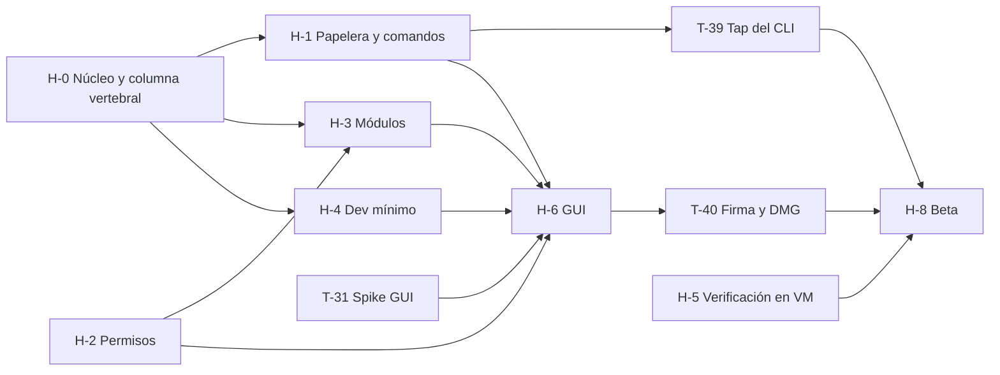

# 08 · Plan de producto: requisitos y tareas

| Campo | Valor |
|---|---|
| Fecha | 2026-11-01 |
| Punto de partida | Rama `claude/infallible-curie-b73472` (PR #2, commit `210c392`): núcleo CLI-first con `scan`, `clean`, `history`, `undo`, `doctor` y `exclude` |
| Alcance | Todo el producto de `docs/README.md` §4: lo que falta del MVP (§4 de este plan), v1 (§6), v2 (§7), propuestas nuevas pendientes de aprobación (§8) y lo que queda fuera (§9). La paridad con Mole está en §1.5 |
| Qué es | La cola de trabajo del equipo: orden, dependencias y criterios de aceptación. **No redefine requisitos**: los cita por su ID |

---

## 0. Cómo usar este documento

**Precedencia.** Manda lo que fija `docs/README.md`: README › 06 › 02 › 03 y 05 (cada uno en su dominio) › 07 para el CLI. Cuando 02 contradice a README o a 07 (códigos de salida, `--permanent`, lista de subcomandos de RF-CLI-02, macOS mínimo de RNF-38), se aplica la fila correspondiente de README §8. Este plan no reabre esas decisiones, Las decisiones del autor de §2.1 (2026-11-08) ya están recogidas en README §3, §4 y §5.

**Fase de cada función.** La fija README §4, aunque 03 o 04 digan otra cosa:

- **Organizador determinista** (RF-IA-25): 04 lo pone en el MVP, README §4 en v1. Va en v1.
- **Asistente conversacional** (F3, RF-IA-34): 04 lo pone en v1, README §4 en v2. Va en v2.
- **IA de v1** (D-05): organizar carpetas y «¿Qué es esto?».
- **Marcadores:** v1 lee y exporta (07, RF-IA-30 y 31). La reorganización con IA (RF-IA-32) queda en v2 salvo que cambies D-05; está en §2.
- **Vulnerabilidades** (D-02): v1, primero en línea y opt-in, el modo sin conexión después. No se usa la columna de fases de 03.
- **CLI:** solo se planifican los comandos y flags de 07. Lo que 05 §7.3 propone y 07 no recoge (`plan create/apply`, `permissions`, `catalog`, `--ndjson`, `--irreversible`) no se convierte en tarea.

**IDs.** Los requisitos conservan sus IDs (RF-…, RNF-…, RF-SEG-…, RF-DEV-…, RF-VUL-…, RF-IA-…, CU-…). Solo hay IDs nuevos para hitos (**H-x**), tareas (**T-xx**) y propuestas que no están en 01–07 (**PROP-xx**, §8).

**Cada tarea sirve como encargo de una sesión.** Una tarjeta trae:
- qué requisitos cierra;
- qué crates o carpetas toca;
- qué hay que hacer y cómo se acepta;
- de qué depende y qué la bloquea;
- su tamaño;
- con qué tareas puede ir en paralelo.

Dos tareas en paralelo nunca escriben los mismos ficheros. Por eso cada una dice su alcance; donde comparten crate, cada tarea trabaja en un módulo propio. Hay tres puntos donde coinciden casi todas:

- **CLI:** cada comando nuevo vive en `crates/rotten/src/cmd/<nombre>.rs`. Lo único compartido es una variante en `args.rs` y un brazo del `match` en `main.rs`. T-03 puede mover allí los comandos que ya existen.
- **Fachada:** los métodos de `Core` de cada módulo van en su propio bloque `impl Core`, en un fichero propio dentro de `ra-core/src/`. `lib.rs` solo gana una línea `mod`.
- **`ra-platform`:** cada tarea añade su módulo, y `lib.rs` solo gana la línea `mod`.

**Tamaños.** S = un día o menos · M = de 2 a 4 días · L = de 1 a 2 semanas.

**Criterio de salida del MVP** (02 §10): beta cerrada de 20 usuarios o más (10 P1, 10 P2) durante 4 semanas, con M-1 a M-5 cumplidas y **cero pérdidas de datos**.

---

## 1. Estado actual

Qué cumple ya el código de PR #2 y qué falta. «Hecho» quiere decir implementado y con prueba automatizada.

### 1.1 Seguridad operativa (RF-SEG)

| Requisito | Estado | Dónde | Falta → tarea |
|---|---|---|---|
| RF-SEG-01 Previsualización obligatoria | Hecho | `ra-plan` (hash BLAKE3, aprobación ligada al hash, caduca a los 30 min); CLI: sin `--yes` y sin TTY → `2` | — |
| RF-SEG-02 Papelera por defecto | Hecho | `ra-exec/trash.rs` (`NSFileManager trashItemAtURL`; `ROTTEN_TRASH_DIR` en pruebas) | Comportamiento en volúmenes sin Papelera (SMB) sin probar → T-29 |
| RF-SEG-03 Borrado permanente solo explícito | Parcial | `clean --permanent` exige `--yes` | `free` y `trash empty` → T-11, T-12 |
| RF-SEG-04 Rutas protegidas | Hecho | `ra-safety/protected.rs`; propiedad `never_touches_anything_outside_the_plan` | — |
| RF-SEG-05 Fail-closed | Hecho | Configuración corrupta → `5`; raíces limitadas a `ALLOWED_PREFIXES`; selección explícita (T-10): ruta protegida, ancestro, fuera de `~`, carpeta raíz del usuario o ruta que no se puede resolver → `5` | — |
| RF-SEG-06 Resolución de rutas segura | Hecho | `O_NOFOLLOW_ANY`, operaciones relativas a descriptor | Fuzzing: v1 (06 §4) → T-109 |
| RF-SEG-07 Identidad anti-TOCTOU | Hecho | `(dev, ino, tipo, tamaño, mtime, ctime)` + huella BLAKE3 de carpetas; propiedad `skips_items_changed_between_plan_and_execution` | — |
| RF-SEG-08 Ficheros en uso | Hecho | Apps abiertas por bundle ID; ficheros abiertos por procesos visibles (`ra-platform/files.rs`) → `in_use`; `AT_NODELETEBUSY` en el borrado permanente (T-04) | La lista de ficheros abiertos se toma una vez por pasada, no por elemento (§2.2) |
| RF-SEG-09 Nunca preseleccionar documentos | Parcial | Catálogo y selección explícita, con la propiedad «preseleccionados ∩ documentos = ∅» (`ra-core/tests/selection.rs`, T-10) | La misma propiedad en cada tarea de módulo |
| RF-SEG-10 Sin descargas de iCloud | Parcial | `check_flags` rechaza `SF_DATALESS` antes de actuar | Política de proceso `setiopolicy_np` → T-06 |
| RF-SEG-11 Log de operaciones | Parcial | Journal JSONL | Log técnico local rotado → T-14 |
| RF-SEG-12 Tamaños honestos | Parcial | `st_blocks × 512`; enlaces duros una vez dentro de cada elemento | `PRIVATESIZE`, deduplicación entre elementos, «liberado» medido → T-05, T-11 |
| RF-SEG-13 Mínimo privilegio | Hecho | Sin elevación; como root, aborta salvo `--allow-root` | — |
| RF-SEG-14 Automatizaciones (CLI) | Hecho | `--yes` obligatorio sin TTY | Programación: v1 → T-103 |
| RF-SEG-15 Errores parciales | Hecho | Sigue con el resto; código `4` | — |
| RF-SEG-16 Dry-run idéntico | Hecho | Mismo código y mismo hash; propiedad `dry_run_changes_nothing`; sale con `4` si prevé omisiones, como la ejecución | — |
| RF-SEG-17 Integridad de reglas | Parcial | Catálogo incrustado y sin red | Firma Ed25519 del catálogo (RNF-ARQ-25): solo aporta con catálogo remoto (D-06) → §2 |
| RF-SEG-18 Restauración segura | Hecho | No sobrescribe (variantes «(restaurado)»); `rename` conserva propietario y permisos | — |
| RF-SEG-19 Solo el usuario actual | Hecho por construcción | Solo trabaja en la carpeta personal del usuario actual | Prueba con un segundo usuario → T-29 |

### 1.2 Historial, limpieza, panel y CLI

| Requisito | Estado | Falta → tarea |
|---|---|---|
| RF-HIS-01 Journal por operación | Hecho | — |
| RF-HIS-02 *Write-ahead* y reconciliación | Hecho (`Core::recover`, `tests/recovery.rs`) | Arnés de 1 000 `kill -9` (RNF-09) → T-07 |
| RF-HIS-03 a 05 Estados, deshacer, no restaurables | Hecho (también «restaurada en parte») | Vista en la GUI → T-35 |
| RF-HIS-06 Historial y deshacer desde el CLI | Hecho | — |
| RF-LIM-01, 03, 05 a 07, 12 | Hecho para CAT-01, CAT-03, CAT-08 y CAT-10 | Safari en contenedor y CAT-02 esperan a V-03; lista permitida de CAT-01 espera a V-18 |
| RF-LIM-04 Explicación por categoría | Parcial (título y explicación breve por regla, en es/en) | Qué pasa si se borra, si se regenera y por qué ese riesgo → T-03 |
| RF-LIM-02 Selección granular | Parcial (`--category`, exclusiones) | Selección por elemento → T-10; por subgrupo en la GUI → T-34 |
| RF-LIM-08 Informe final | Parcial (movidos, omitidos, errores) | «Liberado» medido → T-11 |
| RF-PAN-01 Estado del volumen | Pendiente | → T-05 |
| RF-PAN-02 Escaneo de las raíces del catálogo | Hecho en el CLI | Rendimiento → T-30 |
| RF-PAN-03 Resultados por categoría | Parcial (nombre, elementos y tamaño; sin riesgo ni explicación por categoría; sin *streaming*) | Riesgo y explicación → T-17; *streaming* → T-32 |
| RF-PAN-04 Dos cifras deduplicadas | Parcial | Deduplicación por inode entre elementos → T-05 |
| RF-PAN-05 «Bloqueada · requiere permiso» | Parcial (`doctor` informa FDA) | Por módulo y por categoría → T-17 |
| RF-PAN-06 Cancelar | Pendiente | → T-32 |
| RF-PAN-07 Papelera | Pendiente | → T-12 |
| RF-CLI-01, 03, 05, 06, 08 | Hecho | — |
| RF-CLI-04 JSON versionado | Parcial (`schema_version` en cada documento) | Esquema publicado y validado en CI → T-01 |
| RF-CLI-07 `doctor` | Hecho (sin FDA → `3`) | Preflight por módulo → T-17 |
| RF-CLI-09 Salida localizada | Hecho con cadenas en línea (`ui.t(es, en)`) | Externalizar y pseudo-localizar → T-03 |
| RF-AJU-01 Exclusiones | Hecho en el CLI | GUI → T-37 |
| RF-AJU-07 Idioma | Hecho en el CLI (`--lang`, `LANG`) | GUI → T-38 |

### 1.3 Arquitectura y calidad

| Requisito | Estado | Falta → tarea |
|---|---|---|
| RNF-ARQ-03 Nunca fuera del plan | 256 casos por PR | 10 000 en la ejecución nocturna → T-09 |
| RNF-ARQ-16 `unsafe` aislado | `deny(unsafe_code)` en el workspace; solo `ra-platform` lo permite | `forbid` fuera de `ra-platform` → T-09 |
| RNF-ARQ-20 Un solo ejecutor | Hecho (`6`) | — |
| RNF-ARQ-22 Salida estable y versionada | Parcial | JSON Schema, `insta` y validación en CI → T-01 |
| RNF-ARQ-26 y RNF-14 Cadena de suministro | `cargo-deny` en CI | `cargo-audit` → T-09; SBOM y atestación: v1 → T-109 |
| RNF-31 Cobertura | Sin medir | → T-09 |
| RNF-32 CI | macOS 26 arm64 | Añadir la versión actual (27) si hay *runner* → T-09 |
| RNF-06 10 000 elementos en ≤ 30 s | Sin medir; un `fsync` por evento | → T-08 |

### 1.4 Comandos del MVP (07 §2 y §3)

| Comando | Estado | Tarea |
|---|---|---|
| `scan`, `clean`, `history`, `undo`, `doctor`, `exclude`, `--version`, `--help`, `help <cmd>` | Hecho | — |
| `free <op-id>` | Pendiente | T-11 |
| `trash empty` | Pendiente | T-12 |
| `config get\|set\|path` | Pendiente | T-13 |
| `completion zsh\|bash\|fish` | Pendiente | T-14 |
| `update` | Pendiente | T-15 |
| `rotten` (menú interactivo) | Pendiente | T-16 |
| `analyze [ruta]` (lista) | Pendiente | T-19 |
| `installer` | Pendiente | T-20 |
| `uninstall` | Pendiente | T-21, T-22 |
| `optimize` (solo arranque, en lectura) | Pendiente | T-23 |
| `purge`, `dev projects\|caches` (lectura) | Pendiente | T-24 a T-27 |

### 1.5 Paridad con Mole (07 §2)

D-11 promete **todos los comandos de Mole como mínimo** para el producto, pero README §4 solo mete en el MVP los que 07 marca como MVP. Por eso **la versión base no tiene paridad completa**:

- **Comandos:** de los 15 de Mole, el MVP trae 10. `optimize` llega a medias (solo el arranque, en lectura). `slim`, `status` y `remove` llegan en v1, y `touchid` en v2.
- **Contenido de `clean`:** el `clean` del MVP limpia menos que `mo clean` (segunda tabla).

**Actualizado el 2026-11-08:** el autor ha decidido que el MVP tenga paridad completa (§2.1). Las fases de las tablas siguientes son las originales de 07; las que cambian están en §2.1.

**Comandos**

| Mole | Rotten Apple | Fase (07) | Tarea | Estado |
|---|---|---|---|---|
| `mo` (menú) | `rotten` | MVP | T-16 | Pendiente |
| `mo clean` | `rotten clean` | MVP | Hecho; más categorías en T-93 y T-95 | Hecho con 4 categorías (tabla siguiente) |
| `mo clean --whitelist` | `rotten exclude` | MVP | — | Hecho |
| `mo uninstall` · `--list` `--with-data` `--permanent` | `rotten uninstall` | MVP | T-21, T-22 | Pendiente |
| `mo optimize` | `rotten optimize` | v1 (arranque en lectura: MVP) | T-23 (MVP), T-98 | Pendiente |
| `mo purge` | `rotten purge` | MVP | T-24 a T-27 | Pendiente |
| `mo installer` | `rotten installer` | MVP (más fuentes en v1) | T-20, T-97 | Pendiente |
| `mo slim` | `rotten slim` | **v1** | T-102 | Pendiente |
| `mo analyze` | `rotten analyze` | MVP (lista) · v1 (mapa) | T-19, T-91 | Pendiente |
| `mo status` | `rotten status` | **v1** | T-99, T-100 | Pendiente |
| `mo history` | `rotten history` | MVP | — | Hecho |
| `mo touchid` | `rotten touchid` | **v2** | T-120 | Pendiente |
| `mo completion` | `rotten completion` | MVP | T-14 | Pendiente |
| `mo update` | `rotten update` | MVP | T-15 | Pendiente |
| `mo remove` | `rotten remove` | **v1** | T-108 | Pendiente |
| `mo --version` · `--help` | `rotten --version` · `--help` · `help <cmd>` | MVP | — | Hecho |
| Teclas de `status`, `uninstall` y `purge` | Las mismas, más `u` | MVP (las de `status`, con `status`) | T-16, T-22, T-27, T-99 | Pendiente |
| `~/.config/mole/` | `config.toml` con enlace en `~/.config/rotten/` | MVP | T-13 | Parcial (sin `config` ni enlace) |
| `operations.log` | Journal | MVP | — | Hecho |
| `MO_LAUNCHER_APP` · Raycast y Alfred | `ROTTEN_TERMINAL` · `rotten launchers install` | v1 | T-107 | Pendiente |
| Skills para agentes y `llms.txt` | Skill y `llms.txt` · `rotten mcp` | v1 · v2 | T-107, T-119 | Pendiente |
| `install.sh` y Nix | *Tap* y cask (MVP) · `install.sh --prefix` (v1). Nix sin equivalente en 07 | MVP · v1 | T-39, T-40, T-107 | Pendiente |
| `MO_NO_OPLOG=1` | Sin equivalente, a propósito: el journal sostiene el deshacer | — | — | — |

**Qué limpia `mo clean` frente al `clean` del MVP**

Lo que hace Mole sale de 01 §3.1 (su README y sus notas de versión); su código no se ha leído.

| `mo clean` | `rotten clean` en el MVP | Después |
|---|---|---|
| Cachés de usuario | CAT-01, sin preselección hasta V-18 | Lista permitida tras V-18 (T-28) |
| Logs | CAT-03 (usuario) | Logs del sistema, CAT-04: v1 con el ayudante (T-93) |
| Cachés de navegadores | CAT-08: Safari, Chrome y Firefox. Safari en contenedor espera a V-03 | Edge, Brave y Arc: v1 (T-95) |
| Temporales | No: README §4 deja CAT-05 fuera del MVP («poca ganancia para su riesgo») | v1 (T-95) |
| Artefactos de desarrollo y cachés de gestores de paquetes | Artefactos con `purge`; cachés globales solo en lectura (`dev caches`) | Limpieza de cachés globales: v1 (T-80, T-84) |
| Restos de apps desinstaladas | Solo al desinstalar una app (CAT-14 de usuario, T-21) | Huérfanos: v1 (T-95) |
| Simuladores iOS apagados (01 lo cita de sus notas de versión sin decir con qué comando) | No | `simctl delete unavailable`: v1 (T-82) |
| Vacía `~/.Trash` | **No, a propósito** (07 §2): `clean` nunca vacía la Papelera; para eso está `rotten trash empty` (T-12) | — |
| — | CAT-10, estado guardado de ventanas (Mole no lo menciona) | — |

---

## 2. Decisiones y verificaciones que bloquean

Todas son del autor. La tabla dice qué desbloquea cada una y cómo cerrarla.

| ID | Qué falta | Bloquea | Cómo se cierra |
|---|---|---|---|
| D-07 | Spike de GUI: SwiftUI + UniFFI frente a Tauri 2 | Toda la GUI (T-32 a T-38) | T-31. **No depende del núcleo: puede empezar ya** |
| D-08 | Bundle ID definitivo (provisional: `io.github.netsirius.RottenApple`). El autor lo deja provisional el 2026-11-08 | Antes de la beta: identidad TCC, ruta de estado, firma (T-40) | Fijarlo antes de T-33. Cambiarlo después obliga a migrar `~/Library/Application Support/<bundle-id>/` |
| V-01 | URL del panel de Acceso total al disco en macOS 26 y 27 | Botón principal del onboarding (T-33) | `open "x-apple.systempreferences:…"` en VM (T-28) |
| V-03 | Acceso a contenedores de otras apps, con y sin FDA | CAT-02; Safari en contenedor dentro de CAT-08 | VM con y sin FDA (T-28). Si se confirma, se añaden las reglas y sus fixtures |
| V-04 | ¿Mover un `.app` ajeno a la Papelera requiere «Gestión de apps»? | Ejecución de `uninstall` sobre `/Applications` (T-22) | VM + `log stream --predicate 'subsystem == "com.apple.TCC"'` (T-28) |
| V-18 | Cachés «con estado» dentro de `~/Library/Caches` | Lista permitida de preselección de CAT-01 (hoy vacía) | Borrar cada candidata en VM y observar (T-28) |
| Hardware de pruebas | Runner dedicado para CI (Mac mini con Tart, como máximo 2 VMs por Mac). Las verificaciones manuales ya se hacen en el Mac del autor con Tart (§2.1) | T-29, T-30 | Compra o cesión de un Mac y licencia de Tart para CI (05 §10.4, «por verificar») |

**Para v1 y v2:**

| ID | Qué falta | Bloquea | Cómo se cierra |
|---|---|---|---|
| Historial de git en `secrets` | 03 §6 (H6) no escanea el historial de git; 07 §3.1 lo pide con `--history` | — | Manda 07 (D-13, petición del autor). Queda anotado |
| V-05 | ¿Qué identidad TCC tiene un agente de `SMAppService` o de launchd? | T-103 | Prototipo en VM (05 §1.1.7, ADR-06 §7.4) |
| Gestión de apps en `slim` | Sustituir un bundle firmado puede requerir «Gestión de apps», como V-04 | T-102 (ahora en el MVP, condicionado: §2.1) | VM + `log stream` de TCC, junto con V-04 (T-28) |
| Verificaciones de marcadores | `checksum` de Chrome, ruta del perfil de Firefox (`profiles.ini`), TCC de `~/Library/Safari` en macOS 27 (04 §2.3.1) | T-56, T-114 | Prueba en VM con cada navegador, con y sin sincronización |
| Capturas sin Spotlight | `kMDItemIsScreenCapture` y `kMDItemDateAdded` pueden faltar sin índice (04 §2.2) | T-53 | `mdls` sobre una captura, con y sin índice; si falta, usar xattrs y el patrón de nombre |
| `TCC.db` para la auditoría de permisos | Leerlo da falsos negativos en macOS 27 según un foro (README §8) | T-77 | Probar en VM con FDA; si no es fiable, la auditoría solo enlaza a cada panel de Ajustes |

### 2.1 Decisiones cerradas el 2026-11-08

Las ha tomado el autor y están recogidas en README §3 (D-01, D-05, D-08, D-11, D-13 a D-17), §4 y §5.

| ID | Decisión | Qué cambia |
|---|---|---|
| D-01 | **macOS 26 + solo Apple silicon (arm64)**, confirmado | Nada en el código (ya lo comprueba). VMs con macOS 26 y 27 |
| P-03 | Alta en el Apple Developer Program **después del spike** y antes de H-7. Hace falta para que otras personas abran la app sin el bloqueo de Gatekeeper, para que el Acceso total al disco sobreviva a las actualizaciones y para el ayudante de v1 | El spike (T-31) se hace sin firmar (pasos 1 a 5). T-40 sigue dependiendo de P-03 |
| D-08 | El bundle ID **sigue provisional** | Sigue abierto en §2: hay que fijarlo antes de T-33 |
| Comandos `trash` | Aprobados `rotten trash` (lectura: tamaño por volumen y lo enviado por la app) y `rotten trash put <ruta…>` (con `--dry-run`, `--json` y `--yes`, por el mismo pipeline) | Desbloquea T-10 y T-12. Entran en `parity.toml` como MVP |
| Arranque en lectura | Aprobado `rotten optimize startup` | Desbloquea T-23 |
| CAT-10 y CAT-11 | CAT-10 sigue siendo el estado guardado de ventanas (02 §5, ya hecho). Se añade **CAT-11 · restos de actualizadores** (Sparkle, Squirrel, Google Updater y similares) | Tarea nueva T-143. README §4 se corrige al fusionar las ramas |
| D-11 · Paridad con Mole | **El MVP trae como mínimo todo lo que hace Mole**: sus 15 comandos y todo lo que limpia `mo clean`. `slim` entra condicionado a su verificación | Ver «Paridad total en el MVP» |
| Root en el MVP | **Sin ayudante (daemon) en el MVP.** El CLI pide `sudo` por operación, como Mole; la app pide la contraseña con el diálogo de autorización de macOS en cada operación que necesita root. El ayudante `SMAppService` sigue en v1 (T-92), cuando ya haya firma | Tarea nueva T-142. README §5 («Sin helper root en el MVP») pasa a «sin daemon en el MVP; privilegios por operación» |
| D-05 · Proveedor de IA | **Solo proveedores locales** (Ollama, LM Studio) por ahora. Claude con tu clave queda aparcado hasta v2. Foundation Models y PCC, fuera | T-46 aparcada; T-47 sin topes de coste; T-111 descartada. El campo de la clave de Claude de los mockups de IA y Ajustes deja de aplicar |
| Marcadores con IA | RF-IA-32 **entra en v1** | T-58 pasa a v1. Depende de que un modelo local dé la calidad suficiente, que decide la suite de evaluación (T-50) |
| Historial de shell en `secrets` | **Se permite** quitar la línea con el secreto de los ficheros de historial (`.zsh_history`, `.bash_history` y similares), con copia previa y `undo`. Nunca se tocan `.zshrc` ni otros ficheros de configuración | T-73 lo implementa. Es una excepción a 02 §1.7 limitada a ficheros de historial |
| Topes de coste de la IA | **No aplican** mientras solo haya IA local | Se quitan de T-47. Se decidirán si vuelve un proveedor de pago |
| Entitlement de PCC | Descartado (consecuencia de D-05) | T-111 descartada |
| Hardware de pruebas | **El Mac del autor con Tart** para las verificaciones manuales (V-01, V-03, V-04, V-18, V-05 y Gestión de apps) | Desbloquea T-28. La matriz de CI con VMs (T-29) y los *benchmarks* en hardware de referencia (T-30) **siguen bloqueados** hasta tener un runner dedicado |
| Propuestas | Aprobadas PROP-01 a PROP-08, PROP-10 y PROP-11, en la fase propuesta (PROP-11 en v1 tardía). **PROP-09 descartada** | T-131 a T-138, T-140 y T-141 entran en v1. T-139, fuera |
| RF-INS-02 | Se aplica la propuesta por defecto (sin confirmar): el atajo «Seleccionar los de apps ya instaladas» llega con RF-INS-06 en v1 | T-20 no lo incluye |
| RNF-ARQ-25 | Se aplica la propuesta por defecto (sin confirmar): la firma Ed25519 del catálogo espera a que haya catálogo remoto (D-06 = No) | — |
| `trash put` fuera de `~` | Solo se admiten rutas dentro de la carpeta personal (RF-SEG-19); fuera, `5` | Hecho en `ra-safety` (motivo `outside_home`) |
| Carpetas raíz del usuario | Documentos, Escritorio, Descargas, Imágenes, Películas y Música en sí no se pueden elegir (`5`); su contenido sí | Hecho en `ra-safety` (motivo `user_folder_root`), también a través de enlaces |
| Ficheros abiertos sin poder listar procesos | Se omite todo el plan con `in_use` (fail-closed) | Sin cambios |
| Código de salida de `--dry-run` | `4` si la simulación prevé omisiones, como la ejecución; `0` si no | Hecho en `clean` y `trash put`; anotado en 07 §5 |

**Paridad total en el MVP**

Lo que pasa de v1 o v2 al MVP. Cuando una tarea entra «en parte», solo esa parte cambia de fase y el resto sigue en v1.

| Mole | Qué entra en el MVP | Tarea | Notas |
|---|---|---|---|
| `mo optimize` | `rotten optimize` con las tareas de Mole | T-98 | Las tareas que necesitan root van por T-142, sin T-92 |
| `mo status` | `rotten status` (monitor en la terminal) | T-99 | La manzana de la barra de menús (T-100) sigue en v1 |
| `mo touchid` | `rotten touchid` | T-120 (antes v2) | Por T-142. Enseña el cambio exacto en `/etc/pam.d/sudo_local` y se puede revertir |
| `mo slim` | `rotten slim` | T-102 | **Condicionado:** si la verificación de Gestión de apps (T-28) lo impide, en el MVP solo en lectura (cuánto se ahorraría) |
| `mo remove` | `rotten remove` | T-108 | Versión reducida: borra los datos de Rotten Apple y el enlace de configuración. No hay ayudante ni agentes que retirar |
| `mo clean`: temporales | CAT-05 | Parte de T-95 | Sin preselección hasta verificarla |
| `mo clean`: logs del sistema | CAT-04 | Parte de T-93 | Por T-142 en vez del ayudante |
| `mo clean`: navegadores | Edge, Brave y Arc en CAT-08 | Parte de T-95 | — |
| `mo clean`: restos de apps desinstaladas | Huérfanos | Parte de T-95 | — |
| `mo clean`: simuladores iOS | `simctl delete unavailable` | Parte de T-82 | — |
| `mo clean`: cachés de gestores de paquetes | Limpieza de las cachés globales, no solo lectura | Parte de T-80 y T-84 | Con el comando nativo de cada gestor |
| `mo uninstall` | Referencias en configuraciones de shell y MCP (RF-DES-10, solo lectura) | Parte de T-96 | — |
| `MO_LAUNCHER_APP`, Raycast, Alfred y skills | `ROTTEN_TERMINAL`, `rotten launchers install`, skill y `llms.txt` | Parte de T-107 | `rotten mcp` sigue en v2. Nix sigue sin equivalente |

`parity.toml` (T-02) marca todo lo anterior como MVP, así que `ROTTEN_PARITY_STRICT=1` y la puerta de salida (T-42) lo exigen.

**Tareas nuevas**

- **T-142 · Privilegios por operación** (H-3b, M, depende de T-10). Alcance: `crates/ra-platform/src/privilege.rs` y un comando interno del CLI. Lista cerrada de verbos que necesitan root (caché de DNS, Launch Services, Spotlight, scripts de mantenimiento, `sudo_local`, CAT-04). En el CLI, si no es root, se reejecuta solo ese verbo con `sudo`. En la app, el diálogo de autorización de macOS; el mecanismo exacto se valida en el spike (T-31). Cada verbo pasa por la previsualización y deja su entrada en el journal. Aceptación: un verbo fuera de la lista se rechaza; sin contraseña no se ejecuta nada; la prueba con `sudo` simulado cubre éxito, cancelación y fallo a medias.
- **T-143 · CAT-11 · Restos de actualizadores** (H-3b, S). Una regla TOML por actualizador con su fixture. Nada preseleccionado hasta verificarlo en VM.

**Consecuencias**

- **Plazo.** El MVP ya pasaba de los 6 meses de README §4 para una persona sola. La paridad total suma unas 2 tareas L (T-99, T-102), 4 M (T-98, T-108, T-120, T-142) y partes de otras 7: del orden de 2 a 3 meses más para una persona. Con 6 meses solo se llega trabajando mucho en paralelo.
- **Seguridad.** Lo que corre como root se salta parte de las protecciones del usuario. Por eso T-142 solo acepta una lista cerrada de verbos, siempre con previsualización y journal, igual que hará el ayudante de v1.
- **Firma.** Nada del MVP depende ya del ayudante, así que P-03 solo bloquea la distribución (H-7).

### 2.2 Seguimiento de la primera tanda (2026-11-08)

La primera tanda (T-01, T-02, T-04, T-07 y T-10) pasó una revisión crítica. Sin bloqueantes. Lo que queda abierto:

| Tema | Qué pasa | Cómo se cierra |
|---|---|---|
| Papelera del sistema sin Acceso total al disco | Tras un corte, `recover` busca por inode en `~/.Trash`, pero sin FDA no puede listarla: el elemento queda `unknown` con un aviso explícito | Comprobar en VM o a mano (`ls ~/.Trash` desde un Terminal sin FDA) y ampliar la prueba ignorada `system_trash_roundtrip` con un `recover` real (T-28) |
| Ficheros abiertos por pasada | La lista de procesos con ficheros abiertos se toma una vez por operación (unos 35 ms), no antes de cada elemento. En `--permanent` lo cubre `AT_NODELETEBUSY`; en la Papelera, mover un fichero abierto no rompe el proceso | Decisión de coste aceptada. Si hiciera falta, refrescar cada N elementos. Spotlight (`mdworker`) puede provocar `4` esporádicos |
| Enlace a una ruta protegida con la Papelera del sistema | Con `dir:` se mueve solo el enlace; con `trashItemAtURL:` falta comprobar que no resuelve el enlace | Prueba ignorada sobre un enlace con la Papelera real (T-28) |
| Arnés con `--permanent` | El arnés cubre `clean --yes` y `undo --yes`, no un corte a mitad de un borrado permanente | Cerrado en T-08 (`kill9_during_permanent_clean_leaves_everything_deleted_or_recorded`) |
| Nocturna del arnés | `crash.rs` lanza el binario de `target/`, que puede estar desactualizado si se ejecuta solo | Cerrado en T-09: la nocturna compila `rotten` antes del arnés |
| Incoherencias del JSON | `clean.plan` y `undo.plan` con formas distintas; `preview`/`report`; `doctor.running_apps_probe` como `Result`; `exit_code` en dos sitios; `"kind"` duplicado en `Block::App` (se pierde `"app"`); `SkipCause::code()` = `app_running` frente a `app` en el JSON; errores del núcleo en español con `LANG=en_US`; `doctor.trash` con dos datos en una cadena; categoría `selection` fuera del patrón `CAT-NN`; `history` muestra `kind: "clean"` para `trash put` | Cerrado en T-03 (esquemas v2), salvo `selection`, que se queda fuera de `CAT-NN` a propósito: así no se puede excluir con `exclude add cat:` ni se confunde con el catálogo |
| Origen «módulo» | El plan admite `rules` y `explicit_selection`; falta el origen de módulo (instaladores, desinstalador, dev) | T-20 y siguientes |
| Enlaces duros en las reglas | Una caché que es enlace duro a un documento entra en el plan con todas las categorías y `--include-review` (el plan por defecto no la trae). Con Papelera o `--permanent` solo se va ese nombre y el documento sigue en su sitio, pero no se libera espacio y la propiedad RF-SEG-09 por identidad la detecta | Decidir la política para `nlink > 1` (omitir, o «Revisar» sin preseleccionar) y añadir el caso al generador de la propiedad (T-05 o una tarea propia) |
| Papelera ilegible tras recuperar | Si `recover` no pudo leer la Papelera, el elemento queda `unknown` con el motivo y `doctor` avisa, pero no se vuelve a reconciliar al conceder después el Acceso total al disco | Reintentar la reconciliación de esos elementos en `doctor` o en `undo` cuando la Papelera ya se pueda leer |

### 2.3 Seguimiento de la segunda tanda (2026-11-09)

La parte 2a (T-03, T-05, T-06, T-08 y T-09) pasó una revisión crítica. Sin bloqueantes. Ya corregido tras la revisión:
- `scan` contaba como liberable un fichero con un enlace duro fuera de la selección; ahora solo cuenta si todos sus enlaces están dentro.
- Avisos de clones, enlaces duros e instantáneas en `notes`.
- Prueba ignorada de «libre» frente a `diskutil`.
- Control del `atime` no concluyente en vez de fallo.
- Tope de `ROTTEN_FSYNC_BATCH` (4 096).
- Nocturna con más margen y `cargo-audit` precompilado.
- CI que rechaza `allow(unsafe_code)` fuera de `ra-platform`.

Medida de RNF-06 (`release`, 10 000 elementos, Papelera de prueba, política `utility`): `clean --yes` 8–12 s y `undo --yes` unos 2 s; en `debug`, unos 33 s. Cualquier prueba de rendimiento en CI tiene que compilar en `release`. Lo que queda abierto:

| Tema | Qué pasa | Cómo se cierra |
|---|---|---|
| Totales del plan con enlaces duros | `Plan::build` suma `bytes_allocated` por elemento sin deduplicar, así que la confirmación de `clean` y `op_started.bytes` pueden superar lo que mostró `scan` para la misma selección | Reutilizar el recuento de `scan` (moverlo a `ra-safety`) en los totales del plan |
| `assert!` de durabilidad | `run.rs` comprueba con `assert!` que la intención es durable antes de actuar; si fallara, la operación queda abierta (recuperable), pero el CLI muere con traza | Devolver `ExecError` en su lugar |
| Política de E/S al arrancar | Si `iopolicy::apply()` falla, no arranca ningún comando, ni `doctor` | Que `doctor` arranque y lo explique. En H-6, con el núcleo dentro de la app, la política debe tener ámbito de hilo en los *workers* para no despriorizar la interfaz |
| Contadores de clones y enlaces | `cloned_entries` y `hardlinked_entries` se cuentan por elemento: un mismo inode en dos elementos cuenta dos veces (documentado en `scan.v2`) | Deduplicar si molesta en la interfaz |
| Valor atípico en la medida | Una pasada de 123 s justo después de crear 10 000 ficheros, sin reproducirse; probablemente Spotlight indexando | Vigilar en T-30 |

---

## 3. Hitos

| Hito | Qué entrega | Tareas | Depende de |
|---|---|---|---|
| **H-0** · Columna vertebral y deuda del núcleo | Esquemas JSON, prueba de paridad, cadenas externalizadas, núcleo completo frente a RF-SEG, arnés de fallos y planes por selección explícita | T-01 a T-10 | — |
| **H-1** · Papelera y comandos pequeños | `free`, `trash`, `config`, `completion`, `update`, menú | T-11 a T-16 | T-01; T-03 recomendado |
| **H-2** · Permisos | Preflight por módulo en el núcleo, `doctor` y `scan` | T-17 | — |
| **H-3** · Módulos del MVP | Corpus sintético, `analyze`, `installer`, `uninstall`, arranque en lectura | T-18 a T-23 | T-10 (todos los módulos con acción) |
| **H-3b** · Paridad con Mole (D-11, §2.1) | Privilegios por operación, CAT-11 y todo lo que §2.1 adelanta de v1 y v2 | T-142, T-143, T-98, T-99, T-102, T-108, T-120 y partes de T-80, T-82, T-84, T-93, T-95, T-96 y T-107 | T-10; T-28 para `slim` |
| **H-4** · Zona Desarrollador mínima (D-03) | `purge` y `dev` en lectura | T-24 a T-27 | T-10 |
| **H-5** · Verificación | V-01/03/04/18, matriz de VMs, *benchmarks* | T-28 a T-30 | Hardware (§2) |
| **H-6** · GUI | Spike, FFI y pantallas del MVP | T-31 a T-38 | T-31 → resto; H-1 a H-4 para cada pantalla |
| **H-7** · Distribución | *Tap* con el CLI; firma, notarización, DMG y cask; Sparkle | T-39 a T-41 | P-03, D-08 |
| **H-8** · Beta cerrada | Puerta de salida y beta de 4 semanas | T-42, T-43 | Todo lo anterior |

**Ruta crítica.** Spike (T-31) → FFI (T-32) → pantallas (T-33 a T-38) → firma y DMG (T-40) → beta. La GUI es lo más largo y el spike no necesita nada del núcleo. Conviene arrancarlo a la vez que H-0.

**Esfuerzo.** Sumando los tamaños, el MVP pasa de los 6 meses que fija README §4 si lo hace una sola persona sin paralelizar. Con varias sesiones en paralelo, el cuello de botella pasa a ser la revisión del autor y las verificaciones en VM. Por eso cada tarjeta trae su criterio de aceptación automatizable.

**Primera tanda en paralelo** (sin ficheros compartidos):

| Sesión | Tarea | Escribe en |
|---|---|---|
| A | T-01 y después T-02 | `crates/rotten/tests/`, `schemas/` |
| B | T-04 | `crates/ra-platform/src/files.rs`, `crates/ra-exec/src/verify.rs` |
| C | T-07 | `crates/ra-core/tests/crash.rs` (y un *feature* de pruebas en `ra-exec/src/run.rs` si hace falta) |
| D | T-10 (cuando el autor apruebe `trash put`) | `crates/ra-plan/`, `crates/ra-core/src/lib.rs`, comando nuevo en `rotten` |
| Autor | T-31 (spike) y T-28 (VMs); decisiones de §2 | `spikes/` fuera del workspace de Rust |

### Hitos de v1 y v2

El orden de v1 es una propuesta: el autor lo secuencia después de la beta, con lo aprendido en ella.

| Hito | Qué entrega | Tareas | Depende de |
|---|---|---|---|
| **H-9** · Base de IA | `ra-ai`, proveedores locales (solo locales: §2.1), consentimiento, redacción, vista previa del envío, validación de planes, evaluación | T-44 a T-51 | MVP; T-32 para la GUI |
| **H-10** · Organizar carpetas | Acciones de mover, renombrar y etiquetar; organizador por reglas y con IA; previsualización editable | T-52 a T-55 | T-10; H-9 para la parte con IA |
| **H-11** · Marcadores | Lectura multinavegador, duplicados, enlaces rotos, exportación HTML con previsualización | T-56 a T-59 | — (sin IA); H-9 para T-58 |
| **H-12** · «¿Qué es esto?» | Base de conocimiento local y explicación con IA | T-60, T-61 | H-9 para T-61 |
| **H-13** · Vulnerabilidades | `ra-vuln`, OSV en línea, `brew vulns`, `rotten vulns`, modo sin conexión | T-62 a T-70 | T-24 (proyectos) |
| **H-14** · Secretos | `rotten secrets` e higiene local | T-71 a T-74 | T-24, T-25 |
| **H-15** · Privacidad | `rotten privacy` y auditoría de permisos | T-75 a T-78 | T-92 para DNS y Wi‑Fi |
| **H-16** · Zona Desarrollador completa | Toolchains, Homebrew, Xcode, Docker, IDE, modelos, incremental | T-79 a T-86 | H-4 |
| **H-17** · Espacio avanzado | Índice con FSEvents, antiguos, duplicados, «Datos del sistema», volúmenes, mapa | T-87 a T-91 | T-19 |
| **H-18** · Ayudante y limpieza ampliada | Ayudante privilegiado, categorías de sistema, instantáneas, copias de iPhone, restos, desinstalador e instaladores v1 | T-92 a T-97 | P-03 (firma) para el ayudante |
| **H-19** · Mantenimiento y Monitor | `optimize`, `status`, la manzana en la barra de menús | T-98 a T-101 | T-92 para las tareas con admin |
| **H-20** · Adelgazar apps | `slim` | T-102 | V-04 y su verificación hermana |
| **H-21** · Programación | Limpiezas programadas y avisos | T-103, T-104 | V-05 |
| **H-22** · Ajustes, integraciones y release v1 | Exportaciones, retención, `man`, lanzadores, `remove`, SBOM, fuzzing | T-105 a T-109 | — |
| **H-23** · v2 | IA avanzada, MCP y el resto de v2 (`touchid` pasa al MVP: §2.1) | T-110 a T-130 | v1 |
| **H-24** · Propuestas | Las aprobadas en §2.1: todas menos PROP-09 | T-131 a T-141 | Aprobación del autor |

---

## 4. Tareas

### 4.0 Seguimiento

| Tarea | Título | Hito | Tamaño | Depende de | Estado |
|---|---|---|---|---|---|
| T-01 | Esquemas JSON y validación en CI | H-0 | M | — | Hecho (2026-11-08) |
| T-02 | Prueba de paridad de comandos | H-0 | S | T-01 | Hecho (2026-11-08) |
| T-03 | Cadenas externalizadas y pseudo-localización del CLI | H-0 | M | T-01 | Hecho (2026-11-09) |
| T-04 | Ficheros abiertos y `AT_NODELETEBUSY` | H-0 | M | — | Hecho (2026-11-08) |
| T-05 | Tamaños honestos y estado del volumen | H-0 | M | — | Hecho (2026-11-09); falta comparar a mano «disponible» con Finder (T-29) |
| T-06 | Política de E/S y de ficheros sin descargar | H-0 | S | — | Hecho (2026-11-09) |
| T-07 | Arnés de cierre abrupto (`kill -9`) | H-0 | M | — | Hecho (2026-11-08) |
| T-08 | `fsync` por lotes sin perder la escritura anticipada | H-0 | M | T-07 | Hecho (2026-11-09) |
| T-09 | CI nocturna, `cargo-audit`, `forbid(unsafe_code)` y cobertura | H-0 | S | T-07 | Hecho (2026-11-09) |
| T-10 | Planes por selección explícita y `rotten trash put` | H-0 | M | — | Hecho (2026-11-08) |
| T-11 | `rotten free <op-id>` («Liberar ahora») | H-1 | M | T-01 | Pendiente |
| T-12 | `rotten trash` y `rotten trash empty` | H-1 | M | T-11 | Pendiente |
| T-13 | `rotten config` y enlace en `~/.config/rotten/` | H-1 | S | — | Pendiente |
| T-14 | `completion`, `--debug`, `--no-color` y log técnico | H-1 | S | — | Pendiente |
| T-15 | `rotten update` | H-1 | S | — | Pendiente |
| T-16 | Menú interactivo | H-1 | M | T-11 a T-15 | Pendiente |
| T-17 | Preflight de permisos por módulo | H-2 | M | — | Pendiente |
| T-18 | Corpus sintético y *benchmarks* | H-3 | M | — | Pendiente |
| T-19 | `ra-fs` y `rotten analyze` | H-3 | L | T-10, T-18 | Pendiente |
| T-20 | `rotten installer` | H-3 | M | T-10 | Pendiente |
| T-21 | `ra-apps`: inventario y restos (`uninstall --list`) | H-3 | L | — | Pendiente |
| T-22 | `rotten uninstall`: ejecución, agentes y deshacer | H-3 | L | T-10, T-21, V-04 | Pendiente |
| T-23 | Arranque en solo lectura (`rotten optimize startup`) | H-3 | M | — | Pendiente |
| T-24 | `ra-dev`: descubrimiento de proyectos y artefactos | H-4 | L | — | Pendiente |
| T-25 | Lectura de git segura y protecciones | H-4 | L | T-24 | Pendiente |
| T-26 | Actividad, regenerabilidad y preselección | H-4 | M | T-24, T-25 | Pendiente |
| T-27 | `rotten purge` y `rotten dev` | H-4 | M | T-10, T-26 | Pendiente |
| T-28 | Verificaciones V-01, V-03, V-04 y V-18 | H-5 | M | — | Pendiente |
| T-29 | Matriz de VMs y pruebas E2E | H-5 | L | Hardware | Pendiente |
| T-30 | *Benchmarks* en hardware de referencia | H-5 | M | T-18 | Pendiente |
| T-31 | Spike de GUI (ADR-01) | H-6 | L | — | Pendiente |
| T-32 | Capa FFI, bus de eventos y cancelación | H-6 | L | T-31 | Pendiente |
| T-33 | Onboarding y permisos | H-6 | M | T-17, T-32, V-01 | Pendiente |
| T-34 | Escaneo, limpieza, revisión e informe | H-6 | L | T-32 | Pendiente |
| T-35 | Historial, deshacer y «Liberar ahora» | H-6 | M | T-11, T-32 | Pendiente |
| T-36 | Desinstalar, Espacio, Instaladores y Arranque | H-6 | L | T-19 a T-23, T-32 | Pendiente |
| T-37 | Ajustes y modos Simple/Experto | H-6 | M | T-13, T-32 | Pendiente |
| T-38 | Accesibilidad e i18n de la GUI | H-6 | L | T-33 a T-37 | Pendiente |
| T-39 | *Tap* de Homebrew con el CLI | H-7 | S | Release etiquetada | Pendiente |
| T-40 | Firma, notarización, DMG, cask y SBOM | H-7 | L | P-03, D-08, T-38 | Pendiente |
| T-41 | Sparkle 2 | H-7 | M | T-40 | Pendiente |
| T-42 | Puerta de salida y beta cerrada | H-8 | L | Todo | Pendiente |
| T-142 | Privilegios por operación (`sudo` en el CLI, diálogo de autorización en la app) | H-3b | M | T-10 | Pendiente (§2.1) |
| T-143 | CAT-11 · Restos de actualizadores | H-3b | S | — | Pendiente (§2.1) |
| T-43 | Registrar este plan en `docs/README.md` | H-8 | S | PR #1 fusionado | Hecho (2026-11-08) |

### 4.1 H-0 · Columna vertebral y deuda del núcleo

#### T-01 · Esquemas JSON y validación en CI
- **Cierra:** RNF-ARQ-22, RF-CLI-04, RF-CLI-21 (parte JSON).
- **Alcance:** `schemas/` (nuevo), `crates/rotten/tests/`. No toca `src/`: si un documento no encaja, se anota y se corrige en T-03.
- **Qué hacer:**
  - Un JSON Schema por documento (`scan`, `clean`, `history`, `undo`, `doctor`, `exclude`), con claves en inglés y `schema_version`.
  - Pruebas *snapshot* con `insta` (MIT/Apache) que ocultan rutas, fechas e IDs.
  - Una prueba que valida cada salida contra su esquema con `jsonschema` (MIT).
- **Aceptación:**
  - `cargo test -p rotten --test schemas` valida todas las salidas de `crates/rotten/tests/cli.rs`.
  - Renombrar una clave sin subir `schema_version` hace fallar la prueba.
- **En paralelo con:** T-04 a T-07.

#### T-02 · Prueba de paridad de comandos
- **Cierra:** RF-CLI-20 y el resto de RF-CLI-21.
- **Alcance:** `crates/rotten/tests/parity.rs` y una tabla `crates/rotten/tests/parity.toml` con cada comando de 07 §2 y §3, su fase y su estado.
- **Qué hacer:** ejecutar cada comando implementado con `--dry-run --json` (o `--json` si es de lectura) y validar la salida con T-01.
- **Aceptación:**
  - La prueba falla si un comando marcado como hecho no existe o su JSON no valida.
  - Con `ROTTEN_PARITY_STRICT=1` falla mientras quede algún comando MVP pendiente. Esa variante es la puerta de T-42.

#### T-03 · Cadenas externalizadas y pseudo-localización del CLI
- **Cierra:** RNF-24 y RNF-25 (parte CLI), RF-CLI-09, RF-LIM-04.
- **Alcance:** `crates/rotten/src/` (sobre todo `main.rs` y `text.rs`) y los campos de texto de `catalog/rules/*.toml`.
- **Qué hacer:**
  - Pasar las cadenas de `ui.t(es, en)` a un catálogo de mensajes con plurales por idioma, por ejemplo Fluent (`fluent-bundle`, Apache/MIT).
  - Ampliar los textos de cada regla con qué es, qué pasa si se borra, si se regenera y por qué tiene ese riesgo, en es/en.
  - Formatear números, fechas y tamaños según el locale, con unidades decimales como Finder.
  - Añadir una pseudo-localización en CI que detecte cadenas sin traducir o concatenadas.
- **Aceptación:**
  - `LANG=es_ES.UTF-8` y `LANG=en_US.UTF-8` imprimen cada idioma.
  - La salida `--json` es idéntica en ambos.
  - La prueba de pseudo-localización pasa.
- **Nota:** hacerla **antes** de añadir comandos (H-1) para no reescribir sus cadenas. Toca los mismos ficheros que todas las tareas del CLI: no va en paralelo con ellas.

#### T-04 · Ficheros abiertos y `AT_NODELETEBUSY`
- **Cierra:** RF-SEG-08 (lo que falta).
- **Alcance:** `ra-platform` (módulo nuevo `files.rs`: `proc_listpidspath` o `proc_pidinfo(PROC_PIDLISTFDS)`), `ra-exec/src/verify.rs`.
- **Qué hacer:**
  - Justo antes de actuar, omitir el elemento si un proceso visible para el usuario lo tiene abierto, con motivo `in_use`.
  - En el borrado permanente, usar `AT_NODELETEBUSY` si el sistema lo admite y degradar si devuelve `EINVAL` (RNF-ARQ-27).
- **Aceptación:**
  - Un proceso hijo que mantiene abierto un fichero de caché provoca su omisión con motivo «en uso», y el CLI devuelve `4`.
  - Una propiedad nueva en `ra-core/tests/properties.rs` cubre ficheros abiertos.

#### T-05 · Tamaños honestos y estado del volumen
- **Cierra:** RF-SEG-12 (a, b y d), RNF-ARQ-28, RF-PAN-01, RF-PAN-04.
- **Alcance:** `ra-platform` (módulo nuevo `attrs.rs`: `getattrlist` con `ATTR_CMNEXT_PRIVATESIZE`, `statfs`, capacidad disponible para uso importante), `ra-safety/src/fingerprint.rs`, `ra-core/src/scan.rs`.
- **Qué hacer:**
  - Estimar con el tamaño privado (clones APFS una sola vez).
  - Deduplicar por `(dev, ino)` **entre** elementos en la cifra «seguro».
  - Añadir a `scan` el estado del volumen: capacidad, usado, libre, purgable aparte y disponible.
- **Aceptación:**
  - Un fichero clonado con `cp -c` no duplica la estimación y aparece el aviso de clones.
  - Un enlace duro presente en dos elementos cuenta una vez.
  - «Disponible» coincide con Finder y «libre» con `diskutil info /` (± 1 %).

#### T-06 · Política de E/S y de ficheros sin descargar
- **Cierra:** RF-SEG-10 (política de proceso), RNF-ARQ-09.
- **Alcance:** `ra-platform` (módulo nuevo `iopolicy.rs`), arranque de `ra-core`.
- **Qué hacer:** al crear `Core`, fijar `IOPOL_TYPE_VFS_MATERIALIZE_DATALESS_FILES` en «off» para el proceso (por verificar, 02 RF-SEG-10: confirmarlo antes de dar la política por buena) y E/S de prioridad `utility`.
- **Aceptación:**
  - `getiopolicy_np` devuelve las políticas fijadas.
  - El `atime` de los ficheros del fixture no cambia tras `scan`.
  - La prueba con iCloud real (`brctl evict`) queda en la lista manual de T-29.

#### T-07 · Arnés de cierre abrupto (`kill -9`)
- **Cierra:** RNF-09, RNF-ARQ-06, RNF-12.
- **Alcance:** `crates/ra-core/tests/crash.rs`. Si hace falta frenar la ejecución en puntos concretos, un *feature* `fault-injection` que solo existe en pruebas.
- **Qué hacer:**
  - Lanzar `rotten clean --yes` y `rotten undo --yes` sobre un fixture y matarlos con `SIGKILL` en un momento aleatorio.
  - Después, ejecutar `Core::recover`.
- **Aceptación:**
  - En cada ronda, todo elemento está en su ruta original o en la Papelera de prueba, y registrado.
  - La operación queda cerrada como recuperada y repetir `recover` no cambia nada.
  - 50 rondas por PR y 1 000 en la nocturna (T-09).

#### T-08 · `fsync` por lotes sin perder la escritura anticipada
- **Cierra:** RNF-06.
- **Alcance:** `ra-history/src/journal.rs`, `ra-exec/src/run.rs`.
- **Qué hacer:**
  - Escribir las intenciones de un lote y hacer un único `fsync`.
  - Después actuar sobre ese lote y anotar los resultados.
  - El tamaño del lote es configurable; nunca se actúa sobre un elemento cuya intención no es durable.
- **Aceptación:**
  - 10 000 elementos a la Papelera de prueba en ≤ 30 s en el hardware de referencia.
  - El arnés de T-07 sigue pasando.

#### T-09 · CI nocturna, `cargo-audit`, `forbid(unsafe_code)` y cobertura
- **Cierra:** RNF-ARQ-03 (nocturna), RNF-ARQ-16, RNF-ARQ-26, RNF-14 y RNF-31 (medición). También RNF-32, si hay *runner* de macOS 27.
- **Alcance:** `.github/workflows/`, cabeceras `lib.rs` de cada crate salvo `ra-platform`.
- **Qué hacer:**
  - Un *workflow* nocturno con `PROPTEST_CASES=10000` y el arnés de T-07 con 1 000 rondas.
  - Añadir `cargo audit`.
  - Poner `#![forbid(unsafe_code)]` en todos los crates menos `ra-platform`.
  - Medir la cobertura con `cargo-llvm-cov`.
- **Aceptación:**
  - Los *jobs* corren y están en verde.
  - La cobertura de `ra-safety`, `ra-plan`, `ra-exec` y `ra-history` aparece en el informe; el objetivo es ≥ 80 %.

#### T-10 · Planes por selección explícita y `rotten trash put`
- **Cierra:** RF-SEG-05 (a), RNF-ARQ-02 (Explorador), RF-LIM-02 (por elemento). Prepara RF-SEG-09 para todos los módulos.
- **Alcance:** `ra-plan`, `ra-core/src/lib.rs`, comando nuevo en `rotten`.
- **Qué hacer:**
  - Generalizar el plan para que sus elementos puedan venir de una regla del catálogo, de un módulo (instaladores, desinstalador, dev) o de una selección explícita del usuario.
  - Todos pasan por la lista protegida, las exclusiones, la identidad y el journal (con el origen anotado).
  - Exponerlo en el CLI como `rotten trash put <ruta…>` si el autor lo aprueba (§2).
- **Aceptación:**
  - Una ruta protegida o un ancestro de ella se rechaza con `5`.
  - Una ruta excluida no entra en el plan.
  - Se añade la propiedad «preseleccionados ∩ documentos = ∅» sobre una carpeta personal de fixture con Documentos, Escritorio y Descargas.
  - `trash put` y `undo` dejan el árbol como estaba.
- **Bloqueado por:** el nombre del comando (§2, «Comandos `trash`»). El núcleo puede hacerse antes.

### 4.2 H-1 · Papelera y comandos pequeños

#### T-11 · `rotten free <op-id>` («Liberar ahora»)
- **Cierra:** CU-08 (elementos de una operación), RF-SEG-03, RF-SEG-12 (e), RF-LIM-08, M-5. Comando de 07 §3.
- **Alcance:**
  - `ra-exec`: borrado relativo a descriptor ya existente.
  - `ra-history`: tipo de operación nuevo y estados.
  - `ra-core` y `rotten`.
- **Qué hacer:**
  - Leer del journal la ruta en la Papelera de cada elemento de la operación (acepta varias `op-id`).
  - Revalidar su identidad con `same_after_move` y borrarlo para siempre.
  - Anotar la operación como irreversible y referenciar la original, que pasa a «irreversible» o «restaurada en parte».
  - Medir el espacio liberado con `statfs` antes y después, e informar de lo estimado frente a lo liberado.
  - Exigir `--yes` sin terminal. Con terminal, confirmar con el número de elementos, el tamaño y «no se puede deshacer», con «No» por defecto.
  - Tras `clean`, el informe sugiere `rotten free <op-id>`.
- **Aceptación:**
  - `clean --yes` y `free <op> --yes` dejan vacía de esos elementos la Papelera de prueba; `history` muestra «irreversible» y `undo` devuelve `1`.
  - Un elemento modificado o sustituido dentro de la Papelera se omite y el resultado es `4`.
  - `--dry-run --json` muestra el plan sin tocar nada.
  - Una propiedad garantiza que `free` nunca borra nada que no esté registrado para esa operación.
- **En paralelo con:** T-13 a T-15, si T-03 ya está hecha.

#### T-12 · `rotten trash` y `rotten trash empty`
- **Cierra:** CU-08 (toda la Papelera), RF-PAN-07.
- **Alcance:** los mismos crates que T-11 (por eso va después).
- **Qué hacer:**
  - `rotten trash` muestra el tamaño por volumen (`~/.Trash`, `/Volumes/<X>/.Trashes/<uid>`) y separa lo que envió Rotten Apple, por operación, de lo demás.
  - `rotten trash empty` construye un plan con la identidad de cada entrada de primer nivel, la revalida y borra.
  - Las operaciones afectadas cambian de estado.
  - Sin acceso a `~/.Trash`, `trash` muestra solo lo que conoce por el journal y lo dice (CU-08 A1). `trash empty` termina con `3` y sugiere `rotten free`.
- **Aceptación:**
  - Pruebas con `ROTTEN_TRASH_DIR`.
  - Un elemento que aparece en la Papelera tras la previsualización no se borra.
  - La prueba con la Papelera real queda como `#[ignore]` documentada.
- **Bloqueado por:** solo el `rotten trash` de lectura espera a §2 («Comandos `trash`»); `trash empty` ya está en 07.

#### T-13 · `rotten config` y enlace en `~/.config/rotten/`
- **Cierra:** `config` de 07 §3 y la fila de configuración de 07 §2.
- **Alcance:** `ra-safety` (escritura validada y atómica de `config.toml`), `ra-core`, `rotten`.
- **Qué hacer:**
  - Implementar `config path`, `config get <clave>` y `config set <clave> <valor>`, con claves validadas.
  - Crear el enlace `~/.config/rotten/config.toml` → configuración canónica si no existe. Nunca sustituir un fichero que ya esté ahí.
- **Aceptación:**
  - Con la configuración corrupta, `config set` se niega y devuelve `5`.
  - Si `~/.config/rotten/config.toml` existe y no es el enlace, `doctor` lo avisa y las acciones destructivas abortan con `5` (RF-SEG-05 c).

#### T-14 · `completion`, `--debug`, `--no-color` y log técnico
- **Cierra:** `completion` de 07 (MVP), flags globales de 07 §4, RF-SEG-11 (log técnico) y RNF-33.
- **Alcance:** `rotten` (`clap_complete`, MIT/Apache) y un *logger* local rotado en `~/Library/Logs/<app>/`.
- **Aceptación:**
  - Los scripts de zsh, bash y fish completan subcomandos y opciones.
  - `--no-color` y `NO_COLOR` quitan los colores.
  - El log no contiene contenido de ficheros: un fichero con un marcador conocido no aparece en él.

#### T-15 · `rotten update`
- **Cierra:** `update` de 07 (MVP).
- **Alcance:** `rotten`.
- **Qué hacer:**
  - Detectar cómo se instaló el binario.
  - En el Cellar de Homebrew, delegar en `brew upgrade` del *tap*.
  - Dentro de un `.app`, delegar en Sparkle (H-7); hasta entonces, explicarlo.
  - En los demás casos, explicar cómo actualizar.
  - Nunca abre conexiones por su cuenta.
- **Aceptación:** `rotten update --dry-run --json` informa del método y del comando exacto, sin ejecutar nada.

#### T-16 · Menú interactivo
- **Cierra:** `rotten` sin subcomando (07 §2) y las teclas de 07 §2.
- **Alcance:** `rotten` (por ejemplo `ratatui` + `crossterm`, MIT).
- **Qué hacer:**
  - Cada opción ejecuta lo mismo que su subcomando, con la previsualización primero.
  - Teclas: flechas, `hjkl`, Intro, `q`, y `u` para deshacer.
  - Sin terminal, imprime la ayuda y devuelve `2`.
- **Aceptación:** pruebas de teclas con el *backend* de pruebas (sin pty real, que el sandbox bloquea).

### 4.3 H-2 · Permisos

#### T-17 · Preflight de permisos por módulo
- **Cierra:** RNF-ARQ-15, RF-PAN-03 (riesgo y explicación por categoría), RF-PAN-05, RF-CLI-07 y RF-AJU-08 (núcleo). Prepara CU-01.
- **Alcance:**
  - `ra-platform` (módulo nuevo `permissions.rs`).
  - `catalog/permissions.toml`: lista de rutas sondeadas, que 05 §1.1.2 quiere en el catálogo.
  - `ra-core/src/doctor.rs` y `scan.rs`.
- **Qué hacer:**
  - Sustituir `fda_preflight` por aperturas `O_RDONLY` + `close` de rutas representativas, sin leer contenido.
  - Clasificar por módulo: Limpieza, Papelera, Instaladores, Desinstalador.
  - Las carpetas con consentimiento por carpeta (Descargas, Escritorio) **no se sondean**: quedan como «requiere consentimiento» hasta que el usuario abre el módulo.
  - Repetir el preflight justo antes de ejecutar un plan.
  - Distinguir `EPERM` (TCC) de `EACCES` (permisos POSIX).
  - Completar el resumen de cada categoría en `scan` con su riesgo, su explicación y su estado de bloqueo.
- **Aceptación:**
  - `doctor --json` incluye `permissions` por módulo.
  - Cada categoría de `scan --json` trae nombre, explicación, riesgo, número de elementos y tamaño (RF-PAN-03).
  - En `scan`, una categoría que requiere FDA sin tenerlo sale bloqueada, con el tamaño a `null` y sin error.
  - Pruebas con carpetas sin permiso para simular la denegación; la comprobación con TCC real queda en T-29.
- **En paralelo con:** cualquier tarea de H-1. **No** con T-05, que también toca `ra-core/src/scan.rs`.

### 4.4 H-3 · Módulos del MVP

#### T-18 · Corpus sintético y *benchmarks*
- **Cierra:** el script del corpus que exige 02 §9 y la base medible de RNF-01 a RNF-03, RNF-ARQ-10 y RNF-ARQ-11.
- **Alcance:** `xtask/` (crate nuevo, fuera de los binarios publicados).
- **Qué hacer:**
  - `cargo xtask corpus --entries <n> --seed <s> --out <dir>` genera las raíces del catálogo y un árbol de volumen, con enlaces duros, *symlink* circular, fichero disperso y clones (`clonefile`).
  - `cargo xtask bench scan|analyze` mide el p95 y la memoria máxima (`/usr/bin/time -l`).
- **Aceptación:**
  - Con la misma semilla, el corpus sale idéntico (hash del listado).
  - El *bench* emite JSON comparable entre ejecuciones.

#### T-19 · `ra-fs` y `rotten analyze`
- **Cierra:** RF-ESP-01 a 05, CU-04, RNF-02, RNF-03.
- **Alcance:**
  - `ra-fs` (crate nuevo de 05 §4.3: recorrido paralelo con `rayon`/`jwalk`).
  - `ra-platform` (módulo nuevo `bulk.rs`: `getattrlistbulk`).
  - `rotten`.
- **Qué hacer:**
  - Jerarquía ordenada por tamaño asignado (`--depth`) y los N ficheros más grandes (`--top 50`).
  - Enlaces duros una vez. Sin seguir *symlinks*. Sin cruzar volúmenes salvo `--cross-mounts`.
  - Ficheros sin descargar como «en la nube», sin abrirlos.
  - Paquetes (`.app`, `.photoslibrary`…) como unidad, con `--into-packages` para el modo Experto.
  - Errores clasificados (RNF-11) y `scan_status`.
  - «Mover a la Papelera» del Explorador usa T-10.
- **Aceptación:**
  - Con enlaces duros, *symlink* circular y fichero disperso, el total coincide con `du -skx` (± 1 %).
  - El top 50 coincide con la referencia calculada sobre el fixture.
  - Con el corpus de T-18: 2 M de entradas en ≤ 45 s en caliente y ≤ 300 MB, medido en T-30.

#### T-20 · `rotten installer`
- **Cierra:** RF-INS-01 a 04, CU-09, CAT-19 (Descargas y Escritorio).
- **Alcance:** módulo nuevo en `ra-core` (o crate propio si crece), `rotten`.
- **Qué hacer:**
  - Detectar por extensión y cabecera: `koly` de UDIF, `xar!` de `.pkg` y `.xip`, `CD001` de ISO 9660. Leer solo los primeros o los últimos bytes, y nunca de un fichero sin descargar.
  - Omitir las imágenes montadas (consultando `hdiutil info -plist`, que no monta nada).
  - Nada preseleccionado: `--select <ids|all>`.
  - Flags `--source downloads|desktop`, `--dry-run`, `--json`, `--yes` y `--permanent`.
  - Sin acceso a la carpeta (TCC de la terminal), devolver `3` con la causa y la acción sugerida.
- **Aceptación:**
  - Fixture de 10 instaladores y 10 señuelos (extensión cambiada, cabecera falsa): 100 % de aciertos.
  - Sin `--select`, el plan está vacío.
  - `hdiutil info` no muestra imágenes nuevas tras el escaneo.
  - Un DMG montado en la prueba sale «en uso».

#### T-21 · `ra-apps`: inventario y restos (`uninstall --list`)
- **Cierra:** RF-DES-01, 03, 04 y 08; CAT-14 (parte de usuario).
- **Alcance:**
  - `ra-apps` (crate nuevo; módulo `inventory.rs`, con `plist`, MIT).
  - Variable `ROTTEN_APPS_DIRS` para pruebas.
  - `rotten`.
- **Qué hacer:**
  - Listar `/Applications` (con subcarpetas) y `~/Applications`; nunca `/System/Applications`.
  - De cada app: nombre, bundle ID, versión, origen (`_MASReceipt`, Caskroom, Developer ID), Team ID (`codesign -dv`) y tamaño total.
  - Buscar sus restos en las rutas de usuario de CAT-14 por bundle ID, nombre y Team ID.
  - Preseleccionar según RF-DES-04.
  - Bloquear los `Group Containers` compartidos con otra app instalada del mismo Team ID.
- **Aceptación:**
  - `rotten uninstall --list --json` devuelve `name`, `bundle_id`, `source`, `path` y `size` (07).
  - Prueba de RF-DES-04: `Application Support`, `Containers`, `Group Containers` y `Preferences` nunca van marcados.
  - Prueba de RF-DES-08 con dos apps de fixture del mismo Team ID.
  - El *recall* ≥ 95 % sobre 20 apps populares se mide en T-29.

#### T-22 · `rotten uninstall`: ejecución, agentes y deshacer
- **Cierra:** RF-DES-05, 06, 07 (agentes de usuario) y 09; CU-03.
- **Alcance:** `ra-apps` (módulo `uninstall.rs`), `ra-exec` (acción nueva de agente), `rotten`.
- **Qué hacer:**
  - Omitir las apps abiertas (RF-DES-05).
  - Las apps de root no entran en el plan; se sugiere `open -R <ruta>` («Mostrar en Finder», RF-DES-09).
  - Para `~/Library/LaunchAgents`: `launchctl bootout gui/<uid>/<label>` y el plist a la Papelera. Deshacer devuelve el plist y ejecuta `launchctl bootstrap`.
  - `--with-data` nunca incluye Documentos ni fototecas.
  - `launchctl` va detrás de un *trait* para poder usar un doble en las pruebas.
  - Un `EPERM` al mover el `.app` lleva a «Gestión de apps» y devuelve `3`.
- **Aceptación:**
  - Con el fixture, `uninstall` y `undo` restauran la app y sus restos en su ruta.
  - En VM (T-29), la app firmada de prueba abre tras restaurarla.
  - `launchctl print gui/<uid>/<label>` no encuentra el servicio tras desinstalar.
- **Bloqueado por:** V-04.

#### T-23 · Arranque en solo lectura
- **Cierra:** RF-MAN-01, RF-MAN-02.
- **Alcance:** `ra-apps` (módulo `startup.rs`), `rotten` (nombre propuesto `rotten optimize startup`, pendiente de §2).
- **Qué hacer:**
  - Leer los plists de `~/Library/LaunchAgents`, `/Library/LaunchAgents` y `/Library/LaunchDaemons`.
  - De cada uno: etiqueta, programa, app propietaria, Team ID, si está cargado (`launchctl print`) y si es huérfano (el ejecutable no existe).
  - Lo que no se puede enumerar sin admin (ítems en segundo plano) se dice explícitamente, con el enlace al panel de Ajustes del Sistema (URL por verificar en 26 y 27).
- **Aceptación:**
  - El listado coincide con los plists del fixture.
  - «Cargado» coincide con `launchctl print`.
  - El comando no modifica nada (hash del fixture antes y después).

### 4.5 H-4 · Zona Desarrollador mínima (D-03)

Corte de D-03: proyectos en raíces sin TCC; `node_modules`, `target/`, `.venv` y DerivedData; protecciones git; cachés globales solo en lectura. Los comandos nativos de herramientas (`brew cleanup`, `simctl`) quedan para v1.

#### T-24 · `ra-dev`: descubrimiento de proyectos y artefactos
- **Cierra:** RF-DEV-01, 02, 04 y 26.
- **Alcance:** `ra-dev` (crate nuevo), reglas de artefactos como datos en `catalog/dev/`.
- **Qué hacer:**
  - Recorrer las raíces por defecto de 03 §3.1 con los marcadores de 03 §3.2, incluido `.git` como fichero.
  - Profundidad 8. Sin *symlinks* ni cambios de volumen. Sin entrar en paquetes ni en ficheros sin descargar.
  - Al encontrar un artefacto validado, se poda.
  - El artefacto exige su marcador hermano; además, la regla genérica `CACHEDIR.TAG`.
- **Aceptación:**
  - Criterios de RF-DEV-01 y RF-DEV-04 sobre fixture.
  - Sin diálogos TCC con la configuración por defecto (comprobación en VM, T-29).
  - Rendimiento de RF-DEV-26 con el corpus de T-18.

#### T-25 · Lectura de git segura y protecciones
- **Cierra:** RF-DEV-07, 08, 09, 10 y 13 (protecciones P1 a P8 de 03 §3.5).
- **Alcance:** `ra-dev` (módulo `git.rs`).
- **Qué hacer:**
  - Leer con `gix` (MIT/Apache).
  - Si alguna lectura no está soportada, usar el CLI neutralizado: `GIT_OPTIONAL_LOCKS=0`, `-c core.fsmonitor=false`, `-c core.hooksPath=/dev/null`, sin configuración del sistema.
  - Comprobar `xcode-select -p` antes de llamar a `/usr/bin/git`, para no abrir el instalador de las Command Line Tools.
- **Aceptación:**
  - Criterios de RF-DEV-07 a 10.
  - Un repo con `core.fsmonitor` apuntando a un script centinela: tras escanear, el centinela no existe (RF-DEV-13).
- **Riesgo:** la madurez de `gix status` para índice frente a árbol de trabajo está «por verificar» (03 §3.5). Empezar con un día de exploración y anotar el resultado aquí.

#### T-26 · Actividad, regenerabilidad y preselección
- **Cierra:** RF-DEV-06, RF-DEV-12.
- **Alcance:** `ra-dev` (módulo `activity.rs`).
- **Qué hacer:**
  - Calcular la última actividad con las señales de 03 §3.4 y asignar los estados Activo, Reciente, Inactivo, Dormido o Abandonado.
  - Preseleccionar solo los artefactos «Seguro» de proyectos inactivos o más antiguos.
  - Sin *lockfile* o con registro privado, el artefacto pasa a «Precaución» y se indica el host.
- **Aceptación:** criterios de RF-DEV-06 y RF-DEV-12 sobre fixture.

#### T-27 · `rotten purge` y `rotten dev`
- **Cierra:** `purge` de 07 (MVP), `dev` en lectura (07 §3), RF-DEV-05 y RF-DEV-14 (subconjunto en lectura).
- **Alcance:** `ra-core`, `rotten`.
- **Qué hacer:**
  - `rotten dev projects --json` y `rotten dev caches --json`, en lectura.
  - `rotten purge [--roots <dir…>] [--older-than 30d] [--select <ids|all>] [--dry-run] [--yes]` por el pipeline de T-10.
  - DerivedData solo si `xcodebuild` no está en marcha.
- **Aceptación:**
  - El plan de `--dry-run` coincide con el ejecutado (mismo hash, RF-SEG-16).
  - `undo` restaura `node_modules`.
  - Una propiedad sobre fixtures de proyectos garantiza que nunca se tocan ficheros versionados, worktrees, repos anidados ni secretos.

### 4.6 H-5 · Verificación

#### T-28 · Verificaciones V-01, V-03, V-04 y V-18
- **Alcance:** `scripts/vm/` (guiones y lista de comprobación). La ejecución es del autor, en VM.
- **Qué hacer:** un guion por verificación con el método de README §7 y 05 §1.1.
- **Entregable:**
  - El resultado anotado en `docs/README.md` §7.
  - El cambio de catálogo que se derive: lista permitida de CAT-01, CAT-02, Safari en contenedor.
  - Las tareas desbloqueadas actualizadas en §4.0.

#### T-29 · Matriz de VMs y pruebas E2E
- **Cierra:** 05 §10.4 para el CLI; las comprobaciones manuales de RF-SEG-02 (volumen sin Papelera), RF-SEG-10 (iCloud), RF-SEG-19 (segundo usuario), RF-DES-03 (*recall*), RF-DES-06 y RF-DEV-02 (sin diálogos TCC).
- **Alcance:** `.github/workflows/e2e.yml`, imágenes Tart de macOS 26 y 27, con y sin FDA.
- **Aceptación:**
  - Por PR: macOS 27 sin FDA con escaneo, limpieza y deshacer.
  - En la nocturna: toda la matriz.
  - Lista manual (RF-PAN-01, RF-SEG-12):
    - «disponible» de `scan` coincide con Finder (Cmd+I) y «libre» con `diskutil info /`, ± 1 % (`cargo test -p ra-platform -- --ignored free_matches_diskutil`);
    - en un volumen externo exFAT o HFS+, `reclaimable_bytes == bytes_allocated`.
- **Bloqueado por:** el hardware de §2.

#### T-30 · *Benchmarks* en hardware de referencia
- **Cierra:** RNF-01 a 03, RNF-06, RNF-ARQ-10 y RNF-ARQ-11 (medición y umbral).
- **Alcance:** *job* en el *runner* autoalojado con `cargo xtask bench`.
- **Aceptación:**
  - Cifras publicadas por versión.
  - Una regresión de más del 10 % bloquea la release.
- **Nota:** el Mac de referencia de 02 §9 usa macOS 15. Por D-01 se mide en macOS 26 o posterior.

### 4.7 H-6 · GUI

Las tarjetas de H-6 se concretarán cuando el spike decida el *stack*. El alcance y los criterios ya están fijados por los requisitos.

| Tarea | Cierra | Qué incluye | Aceptación clave |
|---|---|---|---|
| T-31 · Spike (ADR-01) | D-07 | La rebanada de 05 §2.6 en las dos variantes, en `spikes/`: escaneo con progreso, lista de 100 000 elementos, preflight de FDA, `SMAppService.mainApp`, VoiceOver, firma | ADR-01 pasa a «Aceptada» con horas, problemas de FFI, fluidez (Instruments) y auditoría de accesibilidad |
| T-32 · FFI y eventos | RNF-ARQ-12, RNF-ARQ-13, RF-PAN-06, RF-UI-04 | `ra-ffi` (UniFFI) o comandos de Tauri sobre `Core`; bus de eventos con frecuencia acotada; token de cancelación en el núcleo | Cancelar en ≤ 500 ms con el corpus de 1 M; ningún bloqueo de más de 250 ms en el hilo principal |
| T-33 · Onboarding y permisos | CU-01, RF-UI-06, RF-AJU-08, RF-AJU-10 | ≤ 4 pantallas; FDA con *deep link* (V-01); comprobación cada 2 s; App Translocation; pregunta única de red | M-1 en test moderado; cero conexiones antes de aceptar (RNF-17) |
| T-34 · Escaneo, limpieza, revisión e informe | CU-02, RF-PAN-01 a 07, RF-UI-03, RF-UI-08 a 10, RF-LIM-02 | Hoja de revisión común; estados vacío, error y bloqueado; aviso «Deshacer» de 30 s (⌘Z) | Una operación de la GUI aparece en `rotten history` y se deshace desde el CLI (RF-HIS-06) |
| T-35 · Historial y «Liberar ahora» | RF-HIS-03, RF-HIS-04, CU-05, CU-08 | Estados por operación (también «restaurada en parte»); deshacer por elemento con conflictos | Vaciar la Papelera cambia el estado sin reiniciar la app |
| T-36 · Desinstalar, Espacio, Instaladores, Arranque | CU-03, CU-04, CU-09, RF-MAN-01/02, RF-UI-07 | Vistas sobre T-19 a T-23; Quick Look y «Mostrar en Finder» en cada elemento | Paridad: mismo `plan_hash` desde la GUI y el CLI (RNF-ARQ-02) |
| T-37 · Ajustes y modos | RF-AJU-01, 02, 07, 08 y 10; RF-UI-02 | Exclusiones, Simple/Experto, permisos, idioma, actualizaciones | Mismos rechazos RF-SEG en los dos modos |
| T-38 · Accesibilidad e i18n | RNF-20 a 24, RNF-ARQ-23, RNF-ARQ-01 | VoiceOver, teclado (atajos de RNF-21), contraste AA, texto al 200 %; *lint* que falla si la capa Swift muta ficheros; variante clara (D-07) | `performAccessibilityAudit()` sin incidencias; 100 % de cadenas en es/en |

### 4.8 H-7 · Distribución

#### T-39 · *Tap* de Homebrew con el CLI
- **Cierra:** README §4 punto 12 (*tap*) y la vía de instalación del CLI para la beta.
- **Alcance:** repositorio `netsirius/homebrew-tap` (lo crea el autor) y `.github/workflows/release.yml` (etiqueta → *tarball* → fórmula con su SHA).
- **Nota:** una fórmula compilada desde el código fuente no necesita Developer ID (05 §3.1, punto 6). Así el CLI puede llegar a la beta sin esperar a P-03.
- **Aceptación:** en una VM limpia, `brew install netsirius/tap/rotten` instala la versión etiquetada y `rotten --version` coincide.

#### T-40 · Firma, notarización, DMG, cask y SBOM
- **Cierra:** RNF-15, RNF-35, RNF-ARQ-17, ADR-02 §3.6.
- **Alcance:** `cargo xtask release`: compilar → firmar de dentro hacia fuera → `notarytool` → `stapler` → DMG → SBOM CycloneDX → cask en el *tap*, con un `zap` exacto.
- **Aceptación:**
  - `codesign --verify --strict --deep -vvv`, `spctl --assess` y `stapler validate` en verde en CI.
  - `brew install --cask` y `brew uninstall --zap` sin restos en una VM limpia.
- **Bloqueado por:** P-03, D-08.

#### T-41 · Sparkle 2
- **Cierra:** RNF-ARQ-18.
- **Nota:** según 06 §4 puede esperar a la beta 2 si el *tap* cubre las actualizaciones de los primeros 20 usuarios.
- **Aceptación:** una actualización con la firma alterada se rechaza; el appcast solo se sirve por HTTPS.

### 4.9 H-8 · Beta cerrada

#### T-42 · Puerta de salida y beta cerrada
- **Puerta:**
  - `ROTTEN_PARITY_STRICT=1` en verde.
  - Matriz de VMs en verde.
  - M-2: un guion de auditoría comprueba que cada operación del journal referencia un plan confirmado.
  - M-4 ≥ 99 % en la prueba automatizada de deshacer.
  - M-5 medido en VM con APFS.
  - Las decisiones de §2 cerradas.
- **Beta:** 20 usuarios (10 P1, 10 P2) durante 4 semanas.
  - Sin telemetría (D-09): informes voluntarios e *issues*.
  - M-1, M-6 y M-7 en test moderado.
  - M-3 = 0.

#### T-43 · Registrar este plan en `docs/README.md`
- **Qué hacer:** cuando se fusione PR #1:
  - añadir la fila 08 a la tabla de documentos (§2) y su lugar en la precedencia;
  - corregir la etiqueta de CAT-10 en §4 según la decisión de §2.

---

## 5. Definición de hecho (todas las tareas)

1. Cada requisito citado cumple su criterio de aceptación con una prueba automatizada. Si no se puede automatizar, hay un procedimiento de VM en `scripts/vm/`.
2. `cargo fmt --all --check`, `cargo clippy --workspace --all-targets -- -D warnings`, `cargo test --workspace` y `cargo deny check` en verde, y el CI del PR en verde.
3. Todo cambio en `ra-safety`, `ra-plan` o `ra-exec`, y toda acción destructiva nueva, añade o amplía una propiedad en `crates/ra-core/tests/`.
4. Toda regla de catálogo nueva trae su fixture en `catalog/fixtures/` (RF-LIM-01).
5. Todo comando nuevo o cambio de JSON:
   - actualiza su esquema (T-01) y su fila de paridad (T-02);
   - si el cambio es incompatible, sube `schema_version`.
6. Las cadenas nuevas van al catálogo de mensajes en es/en, sin concatenar (T-03).
7. Las pruebas trabajan en directorios temporales con `ROTTEN_HOME` y `ROTTEN_TRASH_DIR`, nunca en el `~` real. Las excepciones son pruebas `#[ignore]` documentadas.
8. El `README.md` del repositorio refleja los comandos y variables nuevos.
9. Commits solo a nombre del autor.
10. El estado de la tarea se actualiza en su tabla de seguimiento (§4.0, §6.0, §7 u §8) y, si cambia algo de §1, también allí.
11. Las pruebas de IA usan proveedores simulados y no abren conexiones; las que necesiten un proveedor real van como `#[ignore]` documentadas. `ra-ai` nunca depende de `ra-exec` (RF-IA-04).
12. Toda función que envíe datos fuera del Mac es opt-in, enseña lo que sale antes de enviarlo y añade su destino a Ajustes › Privacidad (RNF-17, RNF-19).

---

## 6. Tareas de v1

Las tarjetas de v1 son más cortas que las del MVP: el diseño detallado está en 03, 04 y 07, y cada tarjeta cita la sección. Los flags son los de 07, tal cual.

### 6.0 Seguimiento

| Tarea | Título | Hito | Tamaño | Depende de | Estado |
|---|---|---|---|---|---|
| T-44 | `ra-ai`: proveedores y frontera con el ejecutor | H-9 | M | MVP | Pendiente |
| T-45 | Proveedores locales | H-9 | M | T-44 | Pendiente |
| T-46 | Claude con tu clave | H-9 | M | T-44 | **Aparcada** hasta v2 (D-05, §2.1) |
| T-47 | Consentimiento, modo solo local y registro (sin topes de coste: §2.1) | H-9 | M | T-44 | Pendiente |
| T-48 | Minimización, redacción y vista previa del envío | H-9 | M | T-44 | Pendiente |
| T-49 | Validación de planes de IA y defensa frente a *prompt injection* | H-9 | M | T-44, T-10 | Pendiente |
| T-50 | Suite de evaluación | H-9 | M | T-49 | Pendiente |
| T-51 | GUI de IA: ajustes, consentimiento y «Qué se envía» | H-9 | M | T-32, T-47, T-48 | Pendiente |
| T-52 | Acciones de organización en el ejecutor | H-10 | M | T-10 | Pendiente |
| T-53 | Organizador por reglas y `rotten organize` | H-10 | M | T-52 | Pendiente |
| T-54 | Organizar con IA | H-10 | L | T-53, H-9 | Pendiente |
| T-55 | Previsualización antes/después editable | H-10 | L | T-53, T-32 | Pendiente |
| T-56 | `ra-bookmarks`: lectura multinavegador | H-11 | M | — | Pendiente |
| T-57 | Duplicados, enlaces rotos y exportación con previsualización | H-11 | M | T-56 | Pendiente |
| T-58 | Reorganizar marcadores con IA | H-11 | M | T-57, H-9 | **v1** (§2.1) |
| T-59 | GUI de marcadores | H-11 | M | T-57, T-55 | Pendiente |
| T-60 | Base de conocimiento local y `rotten explain` | H-12 | M | — | Pendiente |
| T-61 | «¿Qué es esto?» con IA | H-12 | S | T-60, H-9 | Pendiente |
| T-62 | `ra-vuln`: inventario de dependencias | H-13 | L | T-24 | Pendiente |
| T-63 | Consulta a OSV en línea y opt-in | H-13 | M | T-62 | Pendiente |
| T-64 | Homebrew: `brew vulns` | H-13 | S | — | Pendiente |
| T-65 | Modelo de hallazgo, prioridad y supresiones | H-13 | M | T-63 | Pendiente |
| T-66 | `rotten vulns`, exportaciones y SBOM | H-13 | M | T-65 | Pendiente |
| T-67 | Vulnerabilidades sin conexión | H-13 | L | T-65 | Pendiente |
| T-68 | Más fuentes de vulnerabilidades | H-13 | M | T-65 | Pendiente |
| T-69 | Explicar y priorizar con IA | H-13 | S | T-65, H-9 | Pendiente |
| T-70 | GUI Dependencias | H-13 | M | T-66, T-32 | Pendiente |
| T-71 | `rotten secrets` | H-14 | L | T-25 | Pendiente |
| T-72 | Higiene local de credenciales | H-14 | M | — | Pendiente |
| T-73 | Arreglos mínimos y reversibles | H-14 | S | T-71, T-72 | Pendiente |
| T-74 | GUI Secretos | H-14 | M | T-71, T-32 | Pendiente |
| T-75 | Privacidad: datos de navegadores | H-15 | M | T-10 | Pendiente |
| T-76 | Privacidad: datos del sistema | H-15 | M | T-92 (DNS, Wi‑Fi) | Pendiente |
| T-77 | Auditoría de permisos de apps | H-15 | S | §2 (`TCC.db`) | Pendiente |
| T-78 | GUI Privacidad | H-15 | M | T-75, T-32 | Pendiente |
| T-79 | Dev: raíces sugeridas, procesos, abandonados, entornos rotos y reglas locales | H-16 | M | H-4 | Pendiente |
| T-80 | Dev: comandos nativos y Homebrew | H-16 | M | H-4 | En parte **MVP** (§2.1) |
| T-81 | Dev: toolchains no referenciadas | H-16 | L | H-4 | Pendiente |
| T-82 | Dev: Xcode avanzado y Android | H-16 | M | H-4 | En parte **MVP** (§2.1) |
| T-83 | Dev: contenedores | H-16 | M | T-80 | Pendiente |
| T-84 | Dev: IDE, modelos de IA y resto de cachés globales | H-16 | M | H-4 | En parte **MVP** (§2.1) |
| T-85 | `rotten dev` completo e incremental | H-16 | M | T-79 a T-84, T-87 | Pendiente |
| T-86 | GUI Desarrollo y Comando oficial | H-16 | L | T-85, T-32 | Pendiente |
| T-87 | `ra-index`: caché de escaneo y FSEvents | H-17 | L | T-19 | Pendiente |
| T-88 | Archivos antiguos, filtros y «Datos del sistema» | H-17 | M | T-19 | Pendiente |
| T-89 | Duplicados exactos | H-17 | M | T-19 | Pendiente |
| T-90 | Volúmenes externos y de red | H-17 | S | T-19 | Pendiente |
| T-91 | GUI: mapa de espacio | H-17 | M | T-36 | Pendiente |
| T-92 | Ayudante privilegiado | H-18 | L | P-03, T-40 | Pendiente |
| T-93 | Categorías de sistema con el ayudante | H-18 | M | T-92; la parte de CAT-04 del MVP, T-142 | En parte **MVP** (§2.1) |
| T-94 | Instantáneas y copias de iPhone/iPad | H-18 | M | T-92 | Pendiente |
| T-95 | Restos de apps y cachés de apps | H-18 | M | T-21 | En parte **MVP** (§2.1) |
| T-96 | Desinstalador v1 | H-18 | M | T-22, T-92 | En parte **MVP** (§2.1) |
| T-97 | Instaladores v1 | H-18 | M | T-20 | Pendiente |
| T-98 | `rotten optimize` con tareas | H-19 | M | T-23, T-142 | **MVP** (§2.1) |
| T-99 | `ra-monitor` y `rotten status` | H-19 | L | — | **MVP** (§2.1) |
| T-100 | La manzana en la barra de menús | H-19 | M | T-99, T-32 | Pendiente |
| T-101 | GUI Monitor y Mantenimiento | H-19 | M | T-98, T-99 | Pendiente |
| T-102 | `rotten slim` y pantalla Adelgazar | H-20 | L | §2 (Gestión de apps) | **MVP**, condicionado a la verificación (§2.1) |
| T-103 | Programación | H-21 | L | V-05, T-32 | Pendiente |
| T-104 | Avisos en segundo plano | H-21 | S | T-103 | Pendiente |
| T-105 | Historial: exportar, retención y borrado diferido | H-22 | M | — | Pendiente |
| T-106 | Ajustes: importar, exportar, restablecer y privacidad de red | H-22 | M | T-37 | Pendiente |
| T-107 | CLI: `man`, instalación, lanzadores y agentes | H-22 | M | — | En parte **MVP** (§2.1) |
| T-108 | `rotten remove` | H-22 | M | T-13 (versión reducida del MVP) | **MVP** (§2.1) |
| T-109 | Release v1: SBOM, atestación, fuzzing y actualizaciones | H-22 | M | T-40 | Pendiente |

### 6.1 H-9 · Base de IA

Común a todas las funciones con IA. Principios de 04 §1: opt-in por función, el producto sirve sin IA, la IA solo propone planes, se minimizan los datos, se enseña lo que sale y el fallo es seguro.

#### T-44 · `ra-ai`: proveedores y frontera con el ejecutor
- **Cierra:** RF-IA-04, RF-IA-05, RNF-ARQ-24.
- **Alcance:** crate nuevo `ra-ai`; `deny.toml`; CI.
- **Qué hacer:**
  - Trait de proveedor con capacidades declaradas (salida estructurada, herramientas, contexto). `Locality` (local, en el dispositivo, nube) la calcula el núcleo a partir del endpoint, no el proveedor (04 §3.1).
  - Proveedor simulado para las pruebas.
  - *Feature* `ai` desactivada por defecto.
  - Prohibir en `cargo-deny` que `ra-ai` dependa de `ra-exec`, igual que ya se hace con el CLI.
- **Aceptación:**
  - Un endpoint que no es *loopback* se clasifica como nube (`http://192.168.1.10`, `http://example.com` frente a `http://127.0.0.1`).
  - CI compila con `--no-default-features` y `cargo deny check` falla si `ra-ai` enlaza `ra-exec`.

#### T-45 · Proveedores locales
- **Cierra:** RF-IA-07. Primero, por D-05 (local primero).
- **Alcance:** `ra-ai` (módulo `local.rs`).
- **Qué hacer:** Ollama, LM Studio, MLX y endpoint compatible con OpenAI, con autodetección de puertos conocidos y prueba de capacidades: salida estructurada y herramientas.
- **Aceptación:** con Ollama en *loopback* y un modelo con esquema, T-54 produce un plan válido sobre «Escritorio caótico» (prueba `#[ignore]`); la prueba de capacidades informa bien con proveedores simulados.

#### T-46 · Claude con tu clave
- **Cierra:** RF-IA-06, RF-IA-10, RF-IA-11, RF-IA-18.
- **Alcance:** `ra-ai` (módulo `claude.rs`), `ra-platform` (Llavero).
- **Qué hacer:**
  - Clave en el Llavero como `kSecClassGenericPassword` no sincronizable; «Probar conexión» con `GET /v1/models`.
  - Perfiles de modelo por tarea (04 §3.2.2), editables. **Reverificar los IDs y precios vigentes al implementar**: los de 04 vienen de una caché del 2026-10-06.
  - Los modelos con retención obligatoria quedan fuera del selector salvo en modo avanzado, con aviso.
  - Sin Batch API ni Files API.
- **Aceptación:** buscar la clave en configuración, logs y diagnósticos da 0 resultados; borrarla elimina el elemento del Llavero (`security find-generic-password`).

#### T-47 · Consentimiento, modo solo local, registro y topes
- **Cierra:** RF-IA-01, RF-IA-02, RF-IA-15, RF-IA-16, RF-IA-24.
- **Alcance:** `ra-ai`, `ra-core` (configuración por función), `rotten`.
- **Qué hacer:**
  - Un interruptor por función, apagado; consentimiento por función y proveedor, que se vuelve a pedir si cambia el proveedor o el nivel de datos.
  - Modo solo local: un proveedor en la nube devuelve error sin abrir conexión.
  - Registro local de envíos con el coste real (de `usage`), exportable y borrable.
  - Topes por operación y por mes (valores por defecto en §2).
- **Aceptación:** en una instalación limpia, recorrer todos los flujos con proveedores simulados que fallan si se les llama no registra ninguna llamada; con el modo solo local, un servidor que registra conexiones no recibe ninguna.

#### T-48 · Minimización, redacción y vista previa del envío
- **Cierra:** RF-IA-12, RF-IA-13, RF-IA-14, RF-IA-19.
- **Alcance:** `ra-ai` (módulos `payload.rs` y `redact.rs`).
- **Qué hacer:**
  - Solo los campos de la lista blanca de 04 §4.1.
  - Redactar rutas, nombre de usuario, emails, teléfonos, IBAN, DNI/NIE, tarjetas (Luhn) y tokens, y rehidratar en local.
  - La vista previa enseña el payload exacto, sus tokens y su coste, y permite excluir elementos.
  - En marcadores, sin query, fragmento ni `userinfo`; los hosts privados se sustituyen.
- **Aceptación:**
  - Una cadena canaria dentro de un fichero no aparece en ninguna petición.
  - El SHA-256 del payload mostrado coincide con el del cuerpo enviado.
  - Las URLs con `token=`, `#access_token` o `user:pass@` salen limpias.

#### T-49 · Validación de planes de IA y defensa frente a *prompt injection*
- **Cierra:** RF-IA-20 a RF-IA-23; D-10.
- **Alcance:** `ra-ai` (validador) y la conversión a planes del núcleo.
- **Qué hacer:**
  - Las reglas de 04 §5.2: esquema, ids conocidos, ámbito, nombres válidos, extensión preservada, sin sobrescrituras (NFC y mayúsculas), límites, protegidos, sin borrado, marcadores de redacción y snapshot.
  - Los planes `organize_plan.v1` y `bookmarks_plan.v1` se convierten en planes del mismo pipeline que T-10 (hash, aprobación, journal con origen «IA»). **No se construye un pipeline paralelo.**
  - Los textos del modelo se muestran como texto plano.
  - El conjunto de herramientas es de solo lectura por tipo (`ReadOnlyToolset`).
- **Aceptación:**
  - Más de 50 planes adversariales dejan 0 operaciones inválidas en la previsualización, cada descarte con su motivo.
  - Un fichero que cambia entre el plan y la aplicación se marca como obsoleto y no se toca.

#### T-50 · Suite de evaluación
- **Cierra:** RF-IA-40.
- **Alcance:** `ra-ai/tests/eval/`, carpetas sintéticas versionadas (04 §6.7).
- **Qué hacer:** escenarios «Escritorio caótico» (500), carpeta grande (10 000), 1 000 marcadores y corpus adversarial con nombres maliciosos; métricas de calidad y tasa de obediencia a instrucciones inyectadas.
- **Aceptación:** la suite corre con cada cambio de prompt, esquema o modelo por defecto, y bajar del umbral bloquea la release.

#### T-51 · GUI de IA: ajustes, consentimiento y «Qué se envía»
- **Cierra:** 04 §7.1 a §7.4.
- **Qué hacer:**
  - Ajustes › Inteligencia con interruptor maestro y uno por función.
  - Hoja de consentimiento con un ejemplo real redactado.
  - Proveedores con insignia Local, En el dispositivo o Nube.
  - Tarjeta «Qué se envía» con «Ver datos exactos» y «Excluir…».
  - Progreso por fases y lotes, con «Cancelar» siempre visible.
- **Aceptación:** sin aceptar la hoja no hay envío (prueba de UI); «Cancelar no cambia nada en tu disco» se cumple (hash del árbol).

### 6.2 H-10 · Organizar carpetas

#### T-52 · Acciones de organización en el ejecutor
- **Cierra:** la base de RF-IA-25 a RF-IA-27 y de 04 §6.2.1 (operaciones `CreateFolder`, `Move`, `Rename`, `MoveAndRename` y `Tag`).
- **Alcance:** `ra-exec`, `ra-history`, `ra-plan`.
- **Qué hacer:**
  - Acciones nuevas con revalidación de identidad justo antes, journal y deshacer. Deshacer un `Tag` devuelve el conjunto de etiquetas anterior.
  - Nunca sobrescribir; nunca salir de la carpeta del ámbito.
- **Aceptación:** una propiedad nueva sobre árboles aleatorios: el resultado nunca sale del ámbito, nunca sobrescribe, el plan de `--dry-run` tiene el mismo hash que el ejecutado y deshacer deja el árbol idéntico.

#### T-53 · Organizador por reglas y `rotten organize`
- **Cierra:** RF-IA-25, 07 `organize` (sin IA), 04 §2.2.
- **Alcance:** módulo nuevo (por ejemplo `ra-organize`), `rotten`.
- **Qué hacer:**
  - Reglas de 04 §2.2: tipo (UTI), capturas, instaladores, host de origen (solo el host), fechas y familias de versiones.
  - Excluir descargas en curso, ocultos, bundles y repos git (unidad opaca), *symlinks* y lo excluido por el usuario.
  - Opción «Organizar con etiquetas», que no mueve nada.
  - Aviso si el ámbito está en iCloud Drive.
  - `rotten organize <carpeta>` sin `--provider` usa solo reglas; `--plan-only` escribe el plan en JSON; `--apply <plan.json>` lo revalida contra el snapshot y lo aplica con `--yes`.
  - Nunca propone mandar a la Papelera (D-10).
- **Aceptación:** en «Escritorio caótico», las capturas van a `Capturas/AAAA-MM` y los instaladores a `Instaladores/`; las descargas en curso, los repos y los bundles no se tocan; deshacer lo devuelve todo.

#### T-54 · Organizar con IA
- **Cierra:** RF-IA-26, RF-IA-28, RF-IA-29.
- **Alcance:** `ra-organize` + `ra-ai`; `rotten organize --provider local|claude`.
- **Qué hacer:**
  - Flujo híbrido: las reglas resuelven lo evidente y solo lo ambiguo va al modelo; un único plan.
  - Lotes y resumen jerárquico para carpetas grandes; caché de prompts.
  - Si la red cae, el modelo rechaza o el JSON no es válido, no se aplica nada y se ofrece el organizador por reglas.
  - Los renombrados se pueden desactivar y la extensión se conserva siempre.
- **Aceptación:**
  - Con el perfil Equilibrado, el plan de «Escritorio caótico» alcanza el umbral de la suite (T-50).
  - Con 10 000 elementos ninguna petición supera el tope de tokens.
  - Cada caso de fallo simulado acaba sin cambios.

#### T-55 · Previsualización antes/después editable
- **Cierra:** RF-IA-27, 04 §7.5 y §7.6; pantalla 19 «Organizar con IA».
- **Alcance:** GUI y la salida del CLI.
- **Qué hacer:**
  - **GUI:** árbol antes y después; por elemento: casilla, nombre nuevo editable, destino editable, motivo, confianza y origen (IA o Regla).
  - **Carpetas propuestas:** renombrar, desmarcar o fusionar.
  - **Ediciones:** se revalidan en vivo con las reglas de T-49, y un error bloquea solo su fila.
  - **Filtros:** Renombrados, Baja confianza y Descartados (con motivo).
  - **Al aplicar:** progreso; las operaciones obsoletas se saltan; «Deshacer todo».
  - **CLI:** el mismo contenido en texto y en `--plan-only`; el plan editado a mano se revalida al aplicarlo.
- **Aceptación:**
  - Editar un nombre a uno inválido o que choca bloquea esa fila y no las demás.
  - Aplicar y «Deshacer todo» deja el árbol idéntico.
  - Prueba de UI de cada control.

### 6.3 H-11 · Marcadores

El resultado de v1 es un **HTML organizado** que el usuario importa. Nunca se escriben los ficheros del navegador (04 §2.3.1: la sincronización revierte o duplica los cambios). La escritura directa es v2 (T-114).

#### T-56 · `ra-bookmarks`: lectura multinavegador
- **Cierra:** RF-IA-30.
- **Alcance:** crate nuevo `ra-bookmarks`, sin IA.
- **Qué hacer:**
  - **Safari:** `Bookmarks.plist`, con FDA; sin él, guía para concederlo.
  - **Familia Chromium** (Chrome, Brave, Edge, Vivaldi): `Bookmarks` de todos los perfiles, según `Local State`.
  - **Firefox:** copia de `places.sqlite` con `-wal` y `-shm`, abierta en solo lectura.
  - **Arc:** solo lectura hasta su cierre (22-dic-2026).
  - **Estado por navegador:** abierto (solo lectura), requiere FDA, sincronización activa.
- **Aceptación:** fixture por navegador y perfil; los ficheros del navegador no cambian (hash).
- **Bloqueado por:** las verificaciones de marcadores (§2).

#### T-57 · Duplicados, enlaces rotos y exportación con previsualización
- **Cierra:** RF-IA-31, RF-IA-32 (exportación), 07 `rotten bookmarks chrome|safari|firefox --dedupe --check-links --export <fichero>`.
- **Alcance:** `ra-bookmarks`, `rotten`.
- **Qué hacer:**
  - **Duplicados:** por URL normalizada, quitando `utm_*`, `fbclid`, `gclid`, la barra final y las mayúsculas del host.
  - **Carpetas vacías** o de un solo elemento.
  - **Enlaces rotos** solo con `--check-links`: opt-in, con aviso de que se contacta con cada sitio, sin cookies, concurrencia limitada y «roto» solo tras 2 fallos separados en el tiempo.
  - **Previsualización:** antes de exportar se enseña el árbol resultante como diferencia: duplicados quitados, carpetas fusionadas o vacías eliminadas y enlaces rotos marcados.
  - **Exportación:** HTML en formato Netscape, con instrucciones para importarlo en cada navegador en una carpeta nueva.
- **Aceptación:**
  - Fixtures con variantes de URL detectan los duplicados.
  - Sin `--check-links` no hay conexiones.
  - El HTML se importa sin errores en Safari, Chrome y Firefox, con una prueba manual documentada por navegador.

#### T-58 · Reorganizar marcadores con IA
- **Cierra:** RF-IA-32 (taxonomía y títulos). **Fase:** v1 (decisión del autor del 2026-11-08, §2.1); depende de que un modelo local dé la calidad suficiente (T-50).
- **Qué hacer:**
  - Plan `bookmarks_plan.v1`: 15 carpetas de primer nivel como máximo por defecto; títulos más claros, desactivables.
  - Al modelo solo se envían el dominio y el título limpio.
  - Mismas previsualización y edición que T-55, sobre el árbol de marcadores; salida en HTML.
- **Aceptación:** con 1 000 marcadores sintéticos el plan es válido; el payload no contiene ninguna query ni fragmento.

#### T-59 · GUI de marcadores
- **Cierra:** 04 §7.7. Pestaña Marcadores en «Organizar con IA», pendiente en los mockups (README §6).
- **Qué hacer:**
  - Elegir el navegador y el perfil, con su estado.
  - Primero los resultados deterministas, después «Reorganizar con IA» si está activa.
  - Botón principal: «Exportar HTML organizado».
- **Aceptación:** la vista de diferencias coincide con la del CLI para el mismo fixture.

### 6.4 H-12 · «¿Qué es esto?»

#### T-60 · Base de conocimiento local y `rotten explain`
- **Cierra:** RF-IA-35 (parte determinista), RF-UI-12, 07 `rotten explain <ruta>`.
- **Alcance:** `catalog/knowledge/` (datos versionados y redactados en clean-room), `ra-core`, `rotten`.
- **Qué hacer:**
  - Asociar patrones de ruta (`~/Library/Caches/<bundle-id>`, `Containers`, `Application Support/<App>`, `~/Library/Developer/…`) con la app propietaria, una descripción, si es regenerable y su riesgo.
  - Resolver el bundle ID a una app instalada.
  - Sin IA, explica desde la base y el catálogo.
- **Aceptación:** una ruta presente en la base se explica sin llamar a ningún proveedor (simulado que falla si se le llama); el 100 % de las categorías del catálogo tienen su «¿Qué es esto?» en es/en.

#### T-61 · «¿Qué es esto?» con IA
- **Cierra:** RF-IA-35.
- **Qué hacer:**
  - Solo para rutas que no están en la base, con el nombre de la carpeta y hasta 30 nombres de hijos redactados.
  - La respuesta va etiquetada como «Explicación probable, no verificada» y **nunca cambia el riesgo**.
  - Botón «¿Qué es?» en Espacio y Limpieza.
- **Aceptación:** el riesgo mostrado es idéntico con y sin IA (prueba); la etiqueta siempre aparece.

### 6.5 H-13 · Vulnerabilidades

Por D-02: en v1, en línea y opt-in, con previsualización de lo que sale. El modo sin conexión llega después (T-67).

#### T-62 · `ra-vuln`: inventario de dependencias
- **Cierra:** RF-VUL-01, RF-VUL-10.
- **Alcance:** crate nuevo `ra-vuln`, sobre los proyectos de `ra-dev`.
- **Qué hacer:**
  - Leer *lockfiles* de npm, pnpm, Yarn v1/Berry, Cargo, uv, Poetry, Pipfile, requirements (`==`), Gemfile, go.mod y Composer.
  - Globales: npm, pnpm, Bun, `~/.cargo/.crates2.json` y fórmulas de Homebrew.
  - Distinguir dependencia directa y transitiva, con su ruta.
  - Sin ejecutar nada del proyecto (RNF-16).
- **Aceptación:**
  - Para cada formato, los pares `paquete@versión` coinciden con la herramienta nativa (`npm ls --all --json`, `cargo metadata`).
  - Ningún proceso del proyecto se ejecuta.

#### T-63 · Consulta a OSV en línea y opt-in
- **Cierra:** RF-VUL-02, RF-VUL-05, RF-VUL-25, RF-VUL-27 (fecha de consulta).
- **Qué hacer:**
  - `querybatch` y `GET /v1/vulns/{id}`, con caché por `id` + `modified`, paginación y *backoff*.
  - Módulo apagado por defecto. Al activarlo se enseñan los destinos y lo que sale.
  - Los paquetes privados quedan fuera.
  - Pantalla de fuentes y licencias antes de la primera descarga.
- **Aceptación:**
  - Por defecto, 0 conexiones.
  - En una captura con proxy solo aparecen `ecosystem`, `name`, `version` y `purl`.
  - Un paquete de un registro privado no aparece en la captura.

#### T-64 · Homebrew: `brew vulns`
- **Cierra:** RF-VUL-03 (delegar).
- **Qué hacer:** delegar en `brew vulns --json` (Homebrew 7 o posterior); con una versión anterior, sugerir `brew update`. Los casks no están cubiertos y se dice.
- **Aceptación:** con Homebrew 7.x, los hallazgos aparecen con ID, fórmula, versión y tipo de corrección.

#### T-65 · Modelo de hallazgo, prioridad y supresiones
- **Cierra:** RF-VUL-06, 07, 08, 09, 11, 12, 13, 14 y 15.
- **Qué hacer:**
  - Hallazgo según 03 §5.7, deduplicado por alias.
  - CVSS 3.1/4.0 desde el vector.
  - Prioridad: KEV (P0), EPSS (P1) y ámbito desarrollo o producción.
  - `MAL-*` como P0 destacado.
  - Comando de arreglo para copiar, nunca ejecutado.
  - Supresiones con motivo y caducidad (365 días como máximo); importar `osv-scanner.toml` y `.cargo/audit.toml`.
- **Aceptación:** los criterios de cada RF-VUL citado, con su fixture.

#### T-66 · `rotten vulns`, exportaciones y SBOM
- **Cierra:** 07 `rotten vulns --online --fail-on p0|p1|p2 --sbom cyclonedx|spdx --json` (código `10`), RF-VUL-16, RF-VUL-17.
- **Qué hacer:** informe en JSON, Markdown, HTML, CSV y SARIF 2.1.0, con opción de anonimizar rutas; SBOM CycloneDX y SPDX 2.3 por proyecto y del equipo, con purl.
- **Aceptación:**
  - El SARIF valida contra 2.1.0.
  - `cyclonedx validate` y el validador de SPDX pasan.
  - `--fail-on p1` devuelve `10` si hay algún P0 o P1.

#### T-67 · Vulnerabilidades sin conexión
- **Cierra:** RF-VUL-03 (alternativa sin conexión), RF-VUL-04, RF-VUL-27 (sin conexión).
- **Qué hacer:** volcados por ecosistema presente, índice local, actualización incremental con `modified_id.csv`, comparadores de versión locales, `advisories.json` de Homebrew y aviso si los datos tienen más de 7 días.
- **Aceptación:** con la red cortada tras la descarga, un `RUSTSEC-*` conocido se reporta y `nettop` muestra 0 conexiones.

#### T-68 · Más fuentes de vulnerabilidades
- **Cierra:** RF-VUL-18 (instalado frente a *lockfile*), 19 (binarios de Rust y Go), 20 (Electron, «indicativo»), 21 (macOS desactualizado según SOFA) y 23 (extensiones de VS Code maliciosas).
- **Aceptación:** los criterios de cada RF-VUL citado.

#### T-69 · Explicar y priorizar con IA
- **Cierra:** RF-IA-36 (F5).
- **Qué hacer:** resumen en lenguaje llano, impacto en el contexto del usuario y orden justificado.
- **Aceptación:** todo CVE o GHSA citado pertenece a la entrada; la severidad base nunca baja; un hallazgo con explotación conocida no queda detrás de otro sin ella sin una justificación explícita.

#### T-70 · GUI Dependencias
- **Cierra:** pantalla 17 de los mockups: prioridad P0–P2, arreglo copiable y qué datos salen.
- **Aceptación:** la vista coincide con `rotten vulns --json` sobre el mismo fixture.

### 6.6 H-14 · Secretos

Por D-13 y 07 §3.1: solo local, nunca valida contra APIs, valores siempre enmascarados.

#### T-71 · `rotten secrets`
- **Cierra:** 07 §3.1, RF-CLI-23, RF-CLI-24, RF-VUL-33.
- **Alcance:** módulo nuevo (por ejemplo `ra-secrets`), `rotten secrets [ruta…] --history --staged --fail-on high --json --baseline <fichero>` (código `10`).
- **Qué hacer:**
  - Detectar las clases de 07 §3.1 en los repos de `rotten dev projects`, en su historial con `--history` y en el *staging* con `--staged`.
  - Deduplicar con HMAC y clave local.
  - Línea base con motivo y caducidad.
  - Evaluar reutilizar reglas de gitleaks (MIT) o detect-secrets (Apache-2.0) tras revisar sus licencias.
- **Aceptación:**
  - Fixtures con secretos sintéticos: 100 % detectados y 0 falsos positivos en el conjunto limpio.
  - Buscar los valores de los fixtures en salidas, journal, índice, exportaciones y tráfico da 0 coincidencias.

#### T-72 · Higiene local de credenciales
- **Cierra:** RF-VUL-28 a 31 (H1, H2, H3, H4, H5 y H6 de 03 §6).
- **Qué hacer:**
  - Claves SSH sin passphrase, leyendo solo la cabecera.
  - Permisos laxos y algoritmos débiles.
  - Credenciales en texto plano en rutas conocidas: solo la presencia del campo.
  - Lista blanca de claves que gestionan las apps.
  - `.env` versionados.
- **Aceptación:** los criterios de cada RF-VUL citado; `~/.ollama/id_ed25519` no se reporta.

#### T-73 · Arreglos mínimos y reversibles
- **Cierra:** las garantías de 07 §3.1.
- **Qué hacer:**
  - Añadir a `.gitignore` y corregir permisos, con confirmación y journal.
  - Nunca reescribir el historial de git ni rotar claves: guías y comandos para copiar (rotar la clave, `git filter-repo`, mover el secreto al Llavero).
  - Quitar una línea del historial del shell queda a la espera de la decisión de §2; hasta entonces solo se enseña.
- **Aceptación:** cada arreglo se puede deshacer con `rotten undo`.

#### T-74 · GUI Secretos
- **Cierra:** pantalla 18 de los mockups.
- **Aceptación:** ningún valor aparece en claro en la interfaz ni en Accessibility Inspector.

### 6.7 H-15 · Privacidad

Por D-12 y 07 §3.0.

#### T-75 · Privacidad: datos de navegadores
- **Cierra:** 07 §3.0 (navegadores), RF-CLI-27; `rotten privacy --browser safari|chrome|firefox|… --downloads-history --dry-run --json`.
- **Qué hacer:**
  - Historial, cookies, caché, autocompletado y lista de descargas van a la Papelera, así que se pueden deshacer.
  - Con el navegador abierto se omite y se avisa (`4`).
  - Las cookies son «Precaución» y se conservan las de los sitios elegidos.
  - Aviso si iCloud o Chrome Sync están activos.
  - Safari requiere FDA.
- **Aceptación:** navegador cerrado → se restaura con `rotten undo`; navegador abierto → omitido con código `4`.

#### T-76 · Privacidad: datos del sistema
- **Cierra:** 07 §3.0 (sistema), RF-CLI-28; `--dns --recents --wifi`.
- **Qué hacer:**
  - A la Papelera: historial de descargas de macOS (`QuarantineEventsV2`, con FDA), recientes y miniaturas de Vista Rápida.
  - Portapapeles: se vacía.
  - Caché DNS y redes Wi‑Fi conocidas («Revisar»), con el ayudante.
  - Lo no reversible se anota en el journal como «no reversible, inocuo».
- **Aceptación:** inspección del journal; sin el ayudante, DNS y Wi‑Fi no se ofrecen.

#### T-77 · Auditoría de permisos de apps
- **Cierra:** 07 §3.0 (permisos); `--permissions`.
- **Qué hacer:**
  - Qué apps tienen cada permiso (cámara, micrófono, ubicación, grabación de pantalla, accesibilidad) y enlace al panel correspondiente.
  - Como mucho, `tccutil reset <servicio> <bundle-id>` con confirmación.
  - Nunca concede permisos.
- **Bloqueado por:** la fiabilidad de `TCC.db` (§2).

#### T-78 · GUI Privacidad
- **Cierra:** pantalla 11 de los mockups.
- **Aceptación:** los navegadores abiertos aparecen como omitidos con el motivo.

### 6.8 H-16 · Zona Desarrollador completa

Diseño en 03 §2 y §3. Todo pasa por el pipeline de T-10 y suma protecciones, nunca las relaja.

| Tarea | Cierra | Qué hacer | Aceptación |
|---|---|---|---|
| T-79 · Raíces, procesos, abandonados, entornos rotos y reglas locales | RF-DEV-03, 11, 27, 29, 31 | Proponer raíces desde los proyectos recientes de los IDE sin escanearlas antes de aceptar; omitir proyectos con procesos activos; vista de abandonados; venvs y entornos rotos; reglas locales en TOML validadas contra RF-SEG-04 | Criterios de cada RF-DEV citado |
| T-80 · Comandos nativos y Homebrew | RF-DEV-15, 16, 17 | El plan lleva literalmente la salida de `brew cleanup -n` y `brew autoremove -n`; «Conservar» con `brew tab --installed-on-request`; casks fantasma, taps sin uso, fórmulas obsoletas; «Estimado frente a liberado» | Criterios de RF-DEV-15 a 17 |
| T-81 · Toolchains no referenciadas | RF-DEV-18, 19 | rustup, nvm/fnm/Volta, pyenv, uv, rbenv/rvm, asdf/mise, Gradle, JDK, FVM, tfenv y NDK, cruzados con los ficheros de 03 §2.15; valores por defecto y rangos protegidos | Fixtures de RF-DEV-18 y 19 |
| T-82 · Xcode avanzado y Android | RF-DEV-20 (v1), 32 | `xcrun simctl delete unavailable`; DeviceSupport (se conserva el más reciente por plataforma); runtimes con `--notUsedSinceDays`; Previews; XCTestDevices; Archives siempre «Revisar»; Android vía `sdkmanager` y `avdmanager` | El plan de runtimes reproduce la salida de `--dry-run`; los Archives nunca van preseleccionados |
| T-83 · Contenedores | RF-DEV-21 | Docker Desktop, OrbStack, Colima y Podman solo por su CLI; volúmenes y contenedores parados como «Revisar», nunca en lote | Con Docker parado, ningún acceso a su contenedor (`fs_usage`) |
| T-84 · IDE, modelos de IA y resto de cachés globales | RF-DEV-22, 23, 14 (v1) | `workspaceStorage` huérfanos y `CachedData` antiguos de la familia VS Code; versiones antiguas de JetBrains; modelos de Hugging Face, Ollama y LM Studio con su CLI nativo y credenciales protegidas | `User/History` nunca se toca; borrar un modelo de Ollama usa `ollama rm` |
| T-85 · `rotten dev` completo e incremental | RF-DEV-25, 30; 07 `dev projects\|toolchains\|caches\|containers\|xcode --json --dry-run` | Subcomandos de 07 con acción; índice persistente con FSEvents (T-87) | Mismo plan que la GUI sobre el mismo fixture (RF-SEG-16); un segundo escaneo sin cambios tarda ≤ 20 % del primero |
| T-86 · GUI Desarrollo y Comando oficial | Pantallas 15 y 16 | Proyectos, toolchains, cachés, contenedores y Xcode; «Precaución» sin marcar; simulación de `brew cleanup` con el aviso de que no pasa por la Papelera | Lo que no pasa por la Papelera lo dice antes de confirmar |

### 6.9 H-17 · Espacio avanzado

| Tarea | Cierra | Qué hacer | Aceptación |
|---|---|---|---|
| T-87 · `ra-index` | 05 §4.6, RNF-ARQ-10 (caché), RNF-ARQ-29 | Caché del último escaneo en SQLite (WAL), agregados por carpeta e invalidación por FSEvents; la GUI arranca con resultados de la caché | Re-escaneo con caché ≤ 10 s en el corpus de 1 M; arranque interactivo ≤ 1,5 s |
| T-88 · Antiguos, filtros y «Datos del sistema» | RF-ESP-07, 09, 10 | Fecha de último uso, o de modificación si falta, indicando la fuente; filtros por tipo, tamaño y antigüedad; desglose de lo medible y «No medible por la app» | Criterios de cada RF-ESP citado |
| T-89 · Duplicados exactos | RF-ESP-08 | Por tamaño, luego hash parcial y luego completo; sin ficheros sin descargar, interior de paquetes ni ficheros de menos de 1 MB por defecto; aviso de clones APFS; nada preseleccionado | 0 falsos positivos con ficheros del mismo tamaño y distinto contenido |
| T-90 · Volúmenes externos y de red | RF-ESP-11 | Solo con selección explícita y aviso de lentitud en red | Nunca se escanean por defecto |
| T-91 · GUI: mapa de espacio | RF-ESP-06 | Treemap o sunburst con una vista de lista equivalente | VoiceOver recorre la lista con la misma información |

### 6.10 H-18 · Ayudante privilegiado y limpieza ampliada

#### T-92 · Ayudante privilegiado
- **Cierra:** RNF-ARQ-14, RF-SEG-13 (v1), CU-13, 05 §1.4.
- **Alcance:** crates nuevos `ra-helper` y `ra-ipc`; `ra-platform` (libxpc).
- **Qué hacer:**
  - Daemon con `SMAppService.daemon`, XPC y validación de la firma del cliente.
  - API cerrada de verbos tipados (`RemovePath` con identidad esperada, `ForgetReceipt`, `BootoutService`, `FlushDnsCache`, `ThinLocalSnapshots`…). Nunca «ejecuta este comando».
  - Revalida cada elemento con `ra-safety`. Sin red. Termina tras un rato inactivo.
- **Aceptación:**
  - Un cliente sin firmar o de otro Team ID se rechaza.
  - El `enum` de verbos no admite rutas ni comandos libres.
  - El binario no enlaza `reqwest`.

#### T-93 · Categorías de sistema con el ayudante
- **Cierra:** RF-LIM-09 (CAT-04, CAT-07), CAT-06 (lista permitida), RF-LIM-15 (CAT-16).
- **Aceptación:** sin el ayudante no se ofrecen; con él, cada elemento pasa las mismas comprobaciones RF-SEG (prueba); fixture por regla.

#### T-94 · Instantáneas y copias de iPhone/iPad
- **Cierra:** RF-LIM-10 (CAT-17), RF-LIM-11 (CAT-15).
- **Qué hacer:**
  - Solo instantáneas `com.apple.TimeMachine.*`.
  - Copias con dispositivo, fecha, tamaño y si están cifradas; nunca preseleccionadas; aviso reforzado en la más reciente de cada dispositivo.
- **Aceptación:** tras borrar, `tmutil listlocalsnapshots /` ya no las lista.

#### T-95 · Restos de apps y cachés de apps
- **Cierra:**
  - RF-LIM-13 (CU-11, restos con nivel de confianza);
  - RF-LIM-14 (CAT-09, Electron y mensajería);
  - RF-LIM-15 (CAT-11, adjuntos de Mail abiertos);
  - CAT-08 v1 (Edge, Brave, Arc);
  - CAT-02, si V-03 lo permite;
  - CAT-05 (temporales de la sesión: solo elementos de 3 días o más y que no estén en uso). README §4 lo dejó fuera del MVP; entra en v1 por paridad con `mo clean` (§1.5).
- **Aceptación:**
  - Con 20 apps desinstaladas, ≥ 90 % de restos detectados y 0 falsos positivos de apps instaladas (también en `~/Applications` y en volúmenes externos montados).
  - Fixture por regla.

#### T-96 · Desinstalador v1
- **Cierra:** RF-DES-02 (último uso), RF-DES-07 (agentes y daemons de sistema, con el ayudante), RF-DES-10 (referencias en configuraciones, solo lectura), RF-DES-11 (extensiones del sistema: aviso), RF-DES-12 (restablecer app) y RF-DES-14 (arrastrar una app a la ventana).
- **Aceptación:** los criterios de cada RF-DES citado; los ficheros de configuración no cambian (hash).

#### T-97 · Instaladores v1
- **Cierra:**
  - RF-INS-05: origen y fecha de descarga.
  - RF-INS-06: «ya instalada». Con eso llega el atajo de RF-INS-02.
  - RF-INS-07: fuentes adicionales, `--source brew|icloud|mail|telegram`.
  - RF-INS-08: `.zip` leyendo solo el índice.
- **Aceptación:** sin falsos «ya instalada» en el fixture; no se extrae nada a disco.

### 6.11 H-19 · Mantenimiento, Monitor y barra de menús

| Tarea | Cierra | Qué hacer | Aceptación |
|---|---|---|---|
| T-98 · `rotten optimize` con tareas | RF-MAN-03, 04, 05; 07 `optimize --dry-run --task <id> --skip <id>` | Cada tarea dice cuándo sirve y qué efecto esperar; las que necesitan admin van por el ayudante; desactivar agentes de usuario de forma reversible; nada de «acelerar» (RF-MAN-06) | Cada tarea anota comando, salida y código en el journal; deshacer reactiva el agente (`launchctl print`) |
| T-99 · `ra-monitor` y `rotten status` | RF-MON-01 a 05 y 07; RF-CLI-26; 07 `status --json --watch --interval --proc-cpu-threshold --proc-cpu-window --proc-cpu-alerts=false` | CPU, memoria, disco, batería y red; procesos con «Salir» solo de los del usuario; el estado de la manzana (sana, a medias, podrida) con sus criterios; NDJSON con `--watch` | ± 5 % frente a Monitor de Actividad; el NDJSON valida contra su esquema |
| T-100 · La manzana en la barra de menús | RF-MON-06, RNF-07; pantalla 14 | Indicador y panel rápido; sin muestreo con la app oculta salvo este extra | ≤ 1 % de CPU de media con muestreo cada 2 s |
| T-101 · GUI Monitor y Mantenimiento | Pantallas 12 y 13 | Elementos de inicio y tareas con «cuándo sirve»; monitor con criterios a la vista | Cada estado enumera los factores que lo causan |

### 6.12 H-20 · Adelgazar apps

#### T-102 · `rotten slim` y pantalla Adelgazar
- **Cierra:** D-14, RF-CLI-25, 07 `rotten slim <app…> --dry-run`, pantalla 9.
- **Qué hacer:**
  - Trabajar sobre una copia: quitar la arquitectura que sobra.
  - Verificar la firma y Gatekeeper (`codesign --verify`, `spctl --assess`).
  - Sustituir la app y mandar el original a la Papelera.
  - Excluir las apps de la App Store, las de Apple y las abiertas.
- **Aceptación:** prueba E2E en VM con una app universal firmada; si la copia no pasa la verificación, la original no se toca.
- **Bloqueado por:** la verificación de Gestión de apps (§2).

### 6.13 H-21 · Programación

#### T-103 · Programación
- **Cierra:** CU-06, RF-AJU-03, RF-SEG-14 (v1), RNF-08, RF-UI-11, ADR-06 (opciones A y E), 07 `rotten schedule add|list|remove --weekly --monthly`.
- **Qué hacer:**
  - **Dónde se aloja:** la app como *login item* (`SMAppService.mainApp`) para quien usa la GUI; `rotten schedule` con un LaunchAgent para quien solo usa el CLI.
  - **Qué limpia:** solo reglas «Seguro» marcadas una a una.
  - **Cuándo:** con corriente, sin Modo de bajo consumo y con estado térmico normal.
  - **Freno:** no se ejecuta si el plan supera 2× la mediana o 20 GB; tope de 5 GB por ejecución; la previsualización caduca a los 30 min (README §8).
  - **Después:** notificación con «Deshacer».
- **Aceptación:**
  - Con batería y los ajustes por defecto no se ejecuta.
  - Un plan anómalo no se ejecuta y se notifica.
  - Un fichero de exclusiones ilegible aborta la ejecución.
- **Bloqueado por:** V-05.

#### T-104 · Avisos en segundo plano
- **Cierra:** RF-MON-07 (espacio libre por debajo de X GB), RF-VUL-26 (solo P0 y P1 nuevos, sin ejecutar nada).
- **Aceptación:** como mucho un aviso de espacio cada 24 h; sin hallazgos nuevos no hay notificación.

### 6.14 H-22 · Ajustes, integraciones y release v1

| Tarea | Cierra | Qué hacer | Aceptación |
|---|---|---|---|
| T-105 · Historial | RF-HIS-07, 08; RF-AJU-09 | Exportar en JSON y CSV; retención de 180 días y tope de tamaño, sin purgar operaciones aún restaurables; borrado diferido opt-in de lo enviado a la Papelera | Criterios de cada RF citado |
| T-106 · Ajustes | RF-AJU-06, 11; RNF-19; RF-PAN-08, 09 | Importar y exportar la configuración en TOML con diferencias antes de aplicar; restablecer; Ajustes › Privacidad con todos los destinos de red; recomendaciones del panel, sin preseleccionar nada | Ida y vuelta sin pérdidas; cada destino de red aparece con su estado |
| T-107 · CLI: `man`, instalación, lanzadores y agentes | RF-CLI-10 (`man`), RF-CLI-11; 07: `install.sh --prefix`, `ROTTEN_TERMINAL`, `rotten launchers install`, skill y `llms.txt` | Página `man`; instalar el CLI desde la app; lanzadores de Raycast y Alfred sin `curl \| bash`; skill para agentes con solo comandos de lectura y `--dry-run` | `man rotten` abre la página; `rotten --version` coincide con la app |
| T-108 · `rotten remove` | 07 `remove --keep-data`, RNF-ARQ-30 | Dar de baja el *login item*, el ayudante y los agentes; borrar los datos salvo `--keep-data`; avisar de las referencias en la configuración del shell | En VM, `sfltool dumpbtm` no muestra servicios del producto y no quedan ficheros |
| T-109 · Release v1 | RNF-ARQ-26 (v1), RNF-36; fuzzing (06 §4) | SBOM CycloneDX y atestación de procedencia por release; fuzzing de los parsers (catálogo, *lockfiles*, marcadores, plists); actualizaciones con vuelta atrás y migración de la configuración y el journal | Artefactos presentes en cada release; los objetivos de fuzzing corren en la nocturna |

---

## 7. Tareas de v2

Una fila por tarea. La aceptación es el criterio del requisito citado, salvo que la fila diga otra cosa.

| Tarea | Título | Cierra | Notas | Depende de | Estado |
|---|---|---|---|---|---|
| T-110 | Asistente en lenguaje natural con herramientas de solo lectura | F3, RF-IA-34; 04 §6.6, §7.8 | Las cifras y los candidatos los calcula el núcleo; el modelo explica. Chips `[[item:id]]` verificados; ningún botón de borrar en el chat | H-9, PROP-03 | Pendiente |
| T-111 | Apple Foundation Models y PCC | RF-IA-08, RF-IA-09 | Puente Swift; solo si está disponible; PCC con entitlement (§2) | H-9, T-32 | **Descartada** (D-05, §2.1) |
| T-112 | Motor de reglas automáticas (`rule.v1`) sin IA | RF-AJU-05, RF-LIM-16; 04 §6.2.3 | DSL sin regex libre; empieza en simulación; acciones destructivas limitadas a la Papelera; reglas sobre rutas protegidas rechazadas | T-52, T-103 | Pendiente |
| T-113 | Reglas desde lenguaje natural | F6, RF-IA-37 | La IA traduce la frase a `rule.v1`; dry-run sobre los ficheros actuales antes de guardar; D-10 | T-112, H-9 | Pendiente |
| T-114 | Escritura directa de marcadores y extensión compañera | RF-IA-33; 04 §2.3.1 | Solo con el navegador cerrado y copia previa; nunca Safari ni Arc. WebExtension con la API `bookmarks` y *native messaging* como vía preferente en Chromium y Firefox | T-57, verificaciones de marcadores | Pendiente |
| T-115 | Casi-duplicados de imágenes con Vision | F7, RF-IA-38 | Solo local; la eliminación pasa por RF-SEG | T-89 | Pendiente |
| T-116 | Capturas por contenido con OCR local | F8, RF-IA-39 | El texto OCR no sale del Mac sin RF-IA-17 | T-53, T-111 | Pendiente |
| T-117 | Renombrado por contenido y permiso por operación | F9, RF-IA-17 | Local por defecto; enviar contenido a la nube exige una casilla por operación que no se puede dejar en «siempre» | T-54 | Pendiente |
| T-118 | Estudio de duplicados semánticos de documentos | F10 | Solo estudio; decidir si sigue | T-89 | Pendiente |
| T-119 | Servidor MCP | 07 `rotten mcp --allow-actions`; 05 §7.3 | El agente solo ejecuta sin confirmación `--dry-run`, `scan`, `analyze`, `status`, `vulns` y `secrets`; las acciones las aprueba una persona en la GUI | T-01 | Pendiente |
| T-120 | `rotten touchid` | 07 `touchid --status --enable --disable` | Enseña el cambio exacto en `/etc/pam.d/sudo_local` antes de aplicarlo y se puede revertir | T-142 | **MVP** (§2.1) |
| T-121 | CLI como cliente de la app | ADR-06 §7.3 | Usar los permisos de la app en vez de los de la terminal; IPC autenticada | T-32 | Pendiente |
| T-122 | Re-escaneo incremental del Explorador | RF-ESP-12 | — | T-87 | Pendiente |
| T-123 | Disparador por umbral de espacio | RF-AJU-04 | Mismas restricciones que la programación; como mucho una vez cada 24 h | T-103 | Pendiente |
| T-124 | Temperaturas y procesos zombi | RF-MON-08, RF-MON-09 | Temperaturas solo con una fuente pública estable | T-99 | Pendiente |
| T-125 | Extensiones del sistema, kexts y diagnóstico de ítems en segundo plano | RF-MAN-07, RF-MAN-08 | Solo lectura | T-92 | Pendiente |
| T-126 | Recibos de paquetes | RF-DES-15 | Rutas compartidas como «Revisar»; `pkgutil --forget` con el ayudante | T-92 | Pendiente |
| T-127 | Adjuntos guardados de Mail | CAT-12 | «Revisar»; en POP o «En mi Mac» se pierden | T-95 | Pendiente |
| T-128 | Apps desactualizadas y GitHub Actions | RF-VUL-22, RF-VUL-24 | Sin afirmar CVE en las apps | H-13 | Pendiente |
| T-129 | Secretos en Descargas, Escritorio e historial de shell | RF-VUL-32 (H7, H8) | Opt-in y con TCC; solo enseña, la edición la hace el usuario | T-71 | Pendiente |
| T-130 | Dependencias sin uso y señal del historial de shell | RF-DEV-24, RF-DEV-28 | Solo informativo; nunca modifica manifiestos; el historial no se copia ni se guarda | H-16 | Pendiente |

---

## 8. Propuestas nuevas

No están en 01–07. Cada una dice qué hueco de 01 §5 cubre y cómo respeta los principios y las exclusiones de 02 §1.7. **Ninguna entra en el plan sin tu aprobación.**

| Tarea | Propuesta | Qué es | Hueco | Cómo respeta los principios | Fase propuesta | Aceptación propuesta |
|---|---|---|---|---|---|---|
| T-131 | PROP-01 · «¿Qué ha crecido?» | Comparar el escaneo actual con los anteriores: carpetas que más han crecido desde una fecha; aviso discreto opt-in si una carpeta crece más de X GB | 01 H11; 04 §2.8 («alta viabilidad») | Solo lectura y local; aviso como mucho una vez cada 24 h | v1, tras T-87 | Con dos snapshots de fixture, la lista coincide con la referencia |
| T-132 | PROP-02 · Previsión de espacio | «A este ritmo, te quedarás sin espacio en unas N semanas», a partir del espacio libre medido en cada escaneo | 01 H11 | Solo con datos suficientes y con su margen; sin alarmismo; sin muestreo en segundo plano | v1, tras PROP-01 | Sin el mínimo de muestras no se muestra; con una serie sintética, la estimación cae dentro del margen |
| T-133 | PROP-03 · «Necesito N GB» sin IA | Elegir candidatos por riesgo, de menos a más («Seguro» y después «Precaución») y por tamaño hasta llegar a N; nunca marca «Revisar»; dice si N no se puede alcanzar; abre la revisión | Base determinista de F3 (`get_cleanup_candidates`) | Abre la revisión (RF-SEG-01); el producto sirve sin IA (04 P2) | v1 | Con un fixture, la selección es mínima y reproducible; nunca incluye «Revisar» |
| T-134 | PROP-04 · Higiene de asistentes de código con IA | Reglas de catálogo para cachés y logs de Claude Code, Cursor, Copilot, Windsurf y similares | 01 H9 | Solo cachés y logs; **las sesiones, transcripciones, memorias y configuración son datos del usuario y van a la lista protegida**; no edita configuraciones (02 §1.7) | v1 | Fixture por regla; las rutas de sesiones aparecen como protegidas; rutas verificadas en VM |
| T-135 | PROP-05 · Atajos de macOS y Spotlight | App Intents: «Escanear», «¿Cuánto puedo liberar?», «Abrir revisión de limpieza», «Deshacer la última operación» | Integración con el sistema | Ningún atajo ejecuta una acción destructiva: abren la revisión en la app (RF-SEG-01) | v1, tras la GUI | Cada atajo funciona en Atajos y Spotlight; ninguno cambia ficheros sin pasar por la revisión |
| T-136 | PROP-06 · Acción rápida de Finder | «¿Qué es esto?» y «Mover a la Papelera con Rotten Apple» sobre lo seleccionado en Finder | 01 H8 (transparencia) | Selección explícita por el pipeline de T-10; abre la revisión; se puede deshacer | v1, tras T-60 y la GUI | La acción abre la revisión con los elementos elegidos; `undo` los devuelve |
| T-137 | PROP-07 · Aviso de instaladores ya usados | Al instalar una app, si su DMG o PKG sigue en Descargas, aviso discreto «¿Mover el instalador a la Papelera?» | Paridad «instaladores» mejorada | Opt-in; nunca automático; abre la revisión | v1, tras T-97 y T-103 | Sin aceptar el aviso no se toca nada; sin coincidencia segura no hay aviso |
| T-138 | PROP-08 · Deshacer por periodo | «Restaurar todo lo de esta semana»: deshacer varias operaciones, de la más reciente a la más antigua, con previsualización y conflictos | 01 H2 (reversibilidad) | Mismo deshacer que CU-05; nunca sobrescribe (RF-SEG-18) | v1 | Tres operaciones de fixture se restauran en orden inverso y el árbol queda como antes |
| T-139 | PROP-09 · Guías al almacenamiento de Apple | Para lo grande que no se toca (Mensajes, Fotos, iCloud Drive, Mail), enseñar su tamaño si se puede medir y abrir la gestión de Apple (Ajustes › General › Almacenamiento, «Optimizar almacenamiento» de Fotos) | Honestidad (02 P-6) | Solo lectura; no toca rutas protegidas ni iCloud (02 §1.7) | **Descartada** (§2.1) | Los enlaces abren el panel correcto en macOS 26 y 27 (por verificar) |
| T-140 | PROP-10 · Comprimidos ya extraídos | En Descargas, `.zip` y similares cuyo índice coincide (nombres y tamaños) con una carpeta extraída al lado | Paridad «instaladores» mejorada | Solo lee el índice, nunca extrae (como RF-INS-08); nada preseleccionado | v1, con T-97 | Fixtures: coincidencia completa → «ya extraído»; parcial → no se propone |
| T-141 | PROP-11 · Filtros del Explorador en lenguaje natural | «Vídeos de más de 1 GB que no abro desde 2024» → la IA devuelve un filtro del esquema de RF-ESP-10, validado; el Explorador lo aplica | 01 H6 (IA local) | La IA solo produce un filtro, sin acciones (04 P3); vale un modelo local | v1 tardía o v2, tras T-88 y H-9 | El filtro generado valida contra el esquema; con IA desactivada, el filtro manual sigue funcionando |

---

## 9. Fuera de alcance

| Qué | Por qué |
|---|---|
| Catálogo de reglas remoto | D-06: no en MVP ni v1; el diseño de ADR-05 queda como opción para v2 |
| Edición «lite» para la Mac App Store | README §4 (v2 o Won't); su sandbox impide casi todo el producto |
| Telemetría | D-09 |
| macOS 15 (RNF-38) e Intel (RNF-42) | Mientras D-01 sea macOS 26 + arm64 |
| Idiomas no usados (CAT-13) | Rompe la firma de código (02 §5) |
| Antivirus, «liberar RAM», editar configuraciones de otras apps o del shell, tocar el volumen del sistema o pedir desactivar SIP, gestionar iCloud Drive o File Provider, copias de seguridad, borrado seguro, MDM, Windows y Linux | 02 §1.7 |
